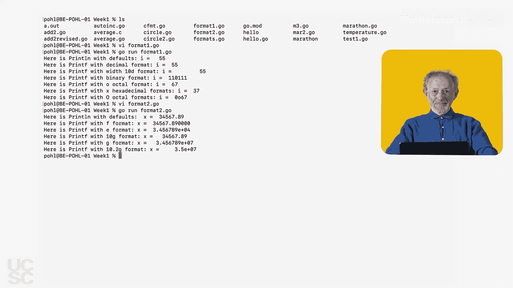

# 006：格式化


## 概述
在本节课中，我们将要学习Go语言中的格式化输出。格式化是输入输出操作中的重要部分，我们将重点介绍两个打印函数：`Println` 和 `Printf`。通过本课，你将学会如何控制数据的显示方式，包括整数、浮点数、字符和字符串。

---

## 打印函数简介
在Go语言中，我们主要使用 `fmt` 包中的 `Println` 和 `Printf` 函数进行屏幕输出。这两个函数都非常方便，但使用方式有所不同。

`Println` 函数较为简单，它会自动识别变量的类型并以默认格式打印，并在输出结束后自动换行。例如，如果我们有一个整数变量 `x` 值为55，使用 `Println` 打印 "X value is " 和 `x`，屏幕将显示 "X value is 55"，并且光标会移动到新的一行。

`Printf` 函数则更为强大，它允许我们通过格式控制字符串来精确指定输出的格式。例如，要实现与上面相同的输出，我们需要使用 `Printf` 并提供一个格式字符串："X value is %d\n"。这里的 `%d` 是一个格式化指令，表示以十进制整数格式打印后面的值，而 `\n` 则代表换行。

---

## 常用格式化指令
以下是初学者最常用的一些格式化指令。虽然Go语言提供了更多格式选项，但这些足以应对大多数初期编程需求。

### 整数格式化
整数格式化指令用于控制整数的显示方式，包括不同的进制。

*   **%d**: 以十进制（base 10）格式打印整数。例如，55 会显示为 `55`。
*   **%o**: 以八进制（base 8）格式打印整数。例如，55 会显示为 `67`。
*   **%x**: 以十六进制（base 16）格式打印整数。例如，55 会显示为 `37`。
*   **%X**: 以大写十六进制格式打印整数。
*   **%b**: 以二进制（base 2）格式打印整数。例如，55 会显示为 `110111`。

### 浮点数格式化
浮点数格式化指令用于控制小数和科学计数法的显示。

*   **%f**: 以标准小数格式打印浮点数。例如，12.345 会显示为 `12.345000`。
*   **%e**: 以科学计数法（指数）格式打印浮点数。例如，12.345 会显示为 `1.234500e+01`。
*   **%E**: 使用大写的 `E` 表示科学计数法。
*   **%g**: 根据数值大小，由Go语言自动选择 `%f` 或 `%e` 格式，以生成更简洁、易读的输出。

### 其他类型格式化
除了数字，我们还需要格式化其他基本类型。

*   **%c**: 打印字符（character）。例如，可以打印出大写字母 `A`。
*   **%s**: 打印字符串（string）。字符串中可以包含空格和特殊字符，如换行符 `\n`。

---

## 格式化宽度与精度
上一节我们介绍了基本的格式化指令，本节中我们来看看如何进一步控制输出的对齐和精度。通过在格式化指令中指定宽度和精度，我们可以让输出更加整齐或精确。

### 指定宽度
在百分号 `%` 和格式字母之间插入一个数字，可以指定该值打印时所占据的最小宽度。输出通常会右对齐填充空格。

**代码示例**: `%10d`
这表示将整数打印在至少10个字符宽度的空间中。如果数字不足10位，左侧会用空格填充。

### 指定浮点数精度
对于浮点数，我们还可以控制显示的小数位数或有效数字位数。格式为 `%宽度.精度f` 或 `%宽度.精度g`。

*   **精度对于 `%f`, `%e`, `%E`**: 表示小数点后的位数。
*   **精度对于 `%g`, `%G`**: 表示总的**有效数字**的最大位数。

**代码示例**: `%10.2f`
这表示将浮点数打印在至少10个字符宽度的空间中，并保留两位小数。

**代码示例**: `%10.2g`
这表示将浮点数打印在至少10个字符宽度的空间中，并且总共只显示2位有效数字。

---

## 实践演示：整数格式化
让我们通过一个具体的程序来观察整数格式化的效果。以下是演示不同整数格式的代码片段。

```go
package main
import "fmt"

func main() {
    i := 55 // 声明并初始化一个整数变量

    fmt.Println("Default Println:", i) // 使用 Println 默认打印

    fmt.Printf("Decimal (%%d): %d\n", i)        // 十进制
    fmt.Printf("Width 10 (%%10d): %10d\n", i)   // 宽度为10的十进制
    fmt.Printf("Binary (%%b): %b\n", i)         // 二进制
    fmt.Printf("Octal (%%o): %o\n", i)          // 八进制（小写o）
    fmt.Printf("Octal (%%O): %O\n", i)          // 八进制（大写O，带0o前缀）
    fmt.Printf("Hex (%%x): %x\n", i)            // 十六进制（小写）
}
```
运行上述程序，你将看到如下输出：
```
Default Println: 55
Decimal (%d): 55
Width 10 (%10d):         55
Binary (%b): 110111
Octal (%o): 67
Octal (%O): 0o67
Hex (%x): 37
```
观察输出，我们可以发现：
1.  `Println` 直接输出了值。
2.  `%10d` 在数字 `55` 左侧添加了空格，使其在10个字符宽度内右对齐。
3.  二进制、八进制和十六进制输出的是数值55在不同进制下的表示。
4.  使用 `%O`（大写O）时，八进制数会带有 `0o` 前缀，这使其在输出中更容易被识别。

---

## 实践演示：浮点数格式化
现在，我们来看浮点数格式化的例子。以下程序演示了如何控制浮点数的显示格式、宽度和精度。

```go
package main
import "fmt"

func main() {
    x := 3456.6789 // 声明一个浮点数

    fmt.Println("Default Println:", x)
    fmt.Printf("Standard float (%%f): %f\n", x)
    fmt.Printf("Scientific (%%e): %e\n", x)

    // 使用 %g，由Go决定格式
    fmt.Printf("Auto-format width 10 (%%10g): %10g\n", x)

    // 放大数值，观察 %g 的选择
    largeX := x * 1000
    fmt.Printf("Large number with %%g: %g\n", largeX)

    // 控制有效数字位数
    fmt.Printf("Width 10, 2 sig figs (%%10.2g): %10.2g\n", x)
}
```
运行这个程序，输出可能类似于：
```
Default Println: 3456.6789
Standard float (%f): 3456.678900
Scientific (%e): 3.456679e+03
Auto-format width 10 (%10g):   3456.6789
Large number with %g: 3.4566789e+06
Width 10, 2 sig figs (%10.2g):      3.5e+03
```
从输出中我们可以学到：
1.  `%f` 默认会补充小数位到6位。
2.  `%e` 总是使用科学计数法。
3.  `%g` 非常智能：对于 `x`，它选择了类似 `%f` 的格式但去掉了无意义的尾随零；对于放大后的 `largeX`，它自动切换到了科学计数法 `%e`，因为这样更简洁。
4.  `%10.2g` 指定了宽度为10，并且只显示2位有效数字。数值 `3456.6789` 被四舍五入为 `3.5`，并表示为 `3.5e+03` 以适应2位有效数字的限制。

---

## 总结
本节课中我们一起学习了Go语言格式化输出的核心知识。

我们首先认识了两个基本的打印函数：简单自动的 `Println` 和功能强大的 `Printf`。接着，我们详细介绍了用于整数（`%d`, `%b`, `%o`, `%x`）、浮点数（`%f`, `%e`, `%g`）以及其他类型（`%c`, `%s`）的常用格式化指令。

更重要的是，我们学会了如何通过指定**宽度**（如 `%10d`）来控制输出的对齐，以及如何为浮点数指定**精度**（如 `%.2f` 控制小数位数，`%.2g` 控制有效数字位数）。这些技巧能帮助你的程序输出更加清晰、专业。



格式化选项有很多，不必死记硬背，在需要时可以随时查阅官方文档或笔记。随着课程的深入，我们还会看到更多用于复杂类型的格式化技巧。