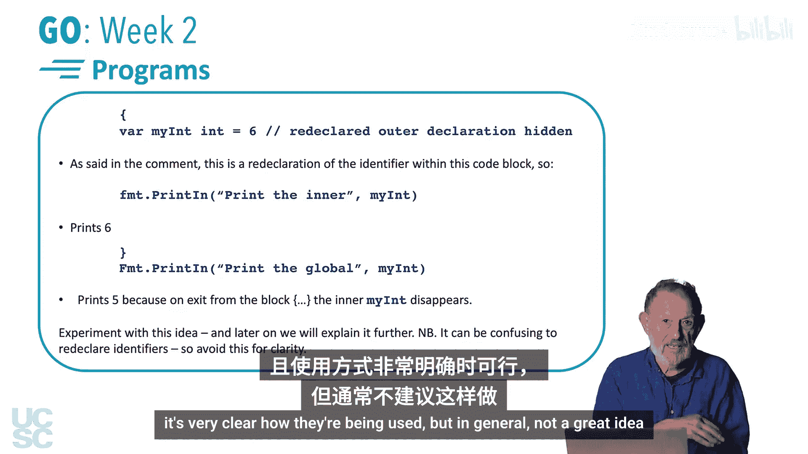

# 007：语法标记

## 概述

在本节课中，我们将学习Go编程的基础知识，包括如何选择标识符、语言如何被解析，以及根据语法规则构成合法Go代码的含义。我们将从一个简单的Go程序开始，说明什么是语法上合法的Go代码。本周我们将涵盖语言的词法元素，例如标识符、关键字、表达式和字面量。我们还将讨论声明语句，这是我们为程序获取变量的方式。在本周的第二部分，我们将通过一系列示例展示如何编写一个模拟掷一个公平骰子的简单程序。这些程序将逐步增加功能，最终的程序将允许你计算掷骰子游戏（如“双骰子”）中特定点数（如7点或12点）出现的概率。

## 语法规则与词法分析

Go语言和自然语言一样，拥有语法规则。这些规则告诉你如何用基本符号（如字母）构成单词，然后将单词组合成句子。这样你就得到了我们所说的语法上合法的Go代码。这是编译器首先要做的事情：将你输入的符号解析成语言的词法元素，这些元素会形成关键字、标识符或表达式等。然后编译器会解析它们，检查你是否以正确的语法将它们组合在一起。

让编译器认为你的程序语法正确，并不意味着它能正确运行，但至少它能通过编译器并开始运行。我们稍后会详细讨论如何确保程序正确运行。

## 标识符的选择

当你选择标识符时，关键是要使其具有可读性，让人类能够理解。它对程序可读性的贡献与注释一样重要。适当的空格和缩进也同样重要。因此，Go语言有一套关于如何布局程序的完整风格指南。甚至有一个专门的程序叫 `go fmt`，如果你懒得自己格式化，它可以帮你完成。但我们希望你按照这些关键的风格理念来输入程序，因为它们会使程序更易读。程序易读意味着你以后能够修改它，理解你写了什么，或者让其他需要使用或与你协作的人能够理解它，尽管编译器本身并不关心标识符是否有意义。

除了具有可读性，标识符不能是关键字。你会看到一个Go关键字表，共有25个，你不能将它们用作标识符，尽管从技术上讲它们符合标识符的语法（它们基本上只是一串字母，比如单词 `for`）。

我们还将讨论所谓的预声明标识符。你可以重新声明它们并赋予新的含义，但你应该避免这样做。这是一个非常糟糕的主意，但我们会展示一个这样做的例子，并再次解释为什么这是一个坏主意。

## 一个简单的程序示例

现在，我们将看一个简单的程序，其中包含标识符、关键字和标点符号。这些都是我们的标记。让我们看看这个简单的程序。

和往常一样，程序以关键字 `package` 开始。`package` 是25个关键字之一。你给 `package` 一个名字 `main`。`main` 确实是一个标识符，但它是一种特殊的标识符，因为它向Go编译器表明这是一段你想要执行的代码。你可以有其他名称的包（如 `fmt`），但它们不会是你开始运行程序的直接入口点。`main` 是你开始运行程序的地方。

接着我们有关键字 `import`。你会看到引用的标识符 `fmt`。这是一个让你进行输入和输出的代码包。我们在之前的一些程序中已经见过，比如使用了 `Println` 和 `Scanf`。

在下一行，我们有一个声明。这个声明是 `var MyInt int`。`var` 是一个关键字。`MyInt` 是我选择的一个标识符。`int` 是一个预声明的标识符，意味着我们将其用作整数类型。然后我们有标点符号 `=`，这是另一个标记，后面跟着一个表达式 `5`，在这个例子中是一个字面量。这就是最初赋值给 `MyInt` 的值。

你可以看到在注释中，标识符名称 `MyInt` 被称为驼峰式命名法。驼峰式命名法是一种风格，它不是强制性的，但它是Go社区在选择多单词标识符时喜欢使用的风格规则。所以，把 `MyInt` 和内部的大写字母看作是分隔单词的一种方式。

关于我们在程序中的位置，那个声明是在 `func main` 外部的，所以我们称之为全局变量。在 `func main` 中，我们将使用它，并尝试一些简单的想法。我们打印全局变量 `MyInt`，它会显示为 `5`，这是它初始化的值。

但请注意，我使用了一个开大括号 `{`。开大括号意味着开始一个所谓的“块”，这是一个我可以声明变量的新区域。在这个块内部，我重新使用了名称 `MyInt`。有时这是可以的，有时因为容易混淆，这是一个坏主意。但在这里，这被称为 `MyInt` 的内部声明。这意味着它是独立的，与全局声明不同。因为它是内部的，它隐藏了外部的声明。在这里，`var` 再次是一个关键字（25个关键字之一）。`int` 不是关键字，`int` 是预声明的，所以你应该避免重新声明它。

然后我们进行了赋值 `6` 或初始化到 `6`。现在，如果我们执行 `Println` 打印内部变量 `MyInt`，我们得到 `6`。然后当我们遇到闭大括号 `}` 时，意味着我们退出了那个块。接着我们再次打印，这次打印的是全局变量，它又变成了 `5`。

## 标识符的语法规则

那么，我们在这个例子中发现了什么？我们发现我们有变量，并且我们使用标识符来命名变量。标识符遵循以下简单的语法规则。

标识符的第一个字符必须是普通的字母字符或特殊的字母字符下划线 `_`。你需要习惯键盘上的下划线键，它通常在键盘的右上角。下划线可以用作标识符中的一个字母。我们还会看到，单个下划线 `_` 作为标识符有特殊用途，我们稍后会讨论。

在第一个字符之后，你可以有字母或数字，并且可以有很多个。所以你可以写很长的标识符。因此，很容易使它们具有可读性，在某种意义上成为你文档中有意义的一部分。同样，如果你想使用多单词的标识符，请选择驼峰式命名法。换句话说，单词内部的开始字母应该大写。

对于那些做过C编程或其他编程的人来说，有一种对应的风格叫做蛇形命名法。在蛇形命名法中，单词用下划线字符分隔。所以你们中的一些人可能从C语言世界熟悉蛇形命名法。顺便说一下，骆驼以什么闻名？它以驼峰闻名。这就是为什么你在这些标识符中间有大写字母，这就是为什么他们称之为驼峰式，而不是蛇形。蛇是地上的动物，很像下划线。

所以，这让我们可以选择创建标识符。正如我们已经说过的，你可以为第一个字符选择字母字符或下划线。之后，你可以选择数字。

## 其他标记与关键字

还有其他键盘符号，它们也会产生标记。它们通常用于某些标点符号，比如分号 `;`，在这个语言中非常重要，因为它可以分隔语句，或者分隔 `for` 语句的内部部分。我们会看到使用逗号 `,`，因为它们可以分隔函数的参数，或者组成列表，比如初始化值列表。我们还有其他可以使用的符号，比如加号 `+`、减号 `-` 和星号 `*` 用于算术运算。我们还有像感叹号 `!` 这样的符号，可以用于某些逻辑运算，如“非”。所有这些都会产生标记。如果所有这些都被组装起来并且语法合法，那么编译器会说，好的，我们现在可以运行程序了。

像 `main` 这样的标识符有特殊用途，所以你倾向于不将其用于其他目的。而像 `package` 这样的关键字根本不能被重新定义。所以它们必须被使用，并且对语言的核心概念至关重要。随着我们对语言越来越深入的了解，我们最终会使用所有的关键字，包括更复杂的关键字，比如我们稍后会看到的 `defer`。但在语言的早期，我们使用 `var`、`func`，我们将使用 `for` 进行循环语句。所以每个关键字都有一个目的，你会变得非常熟悉。

## 标识符命名风格与注意事项

好的，所以字母字符可以包括下划线，但一般来说应该避免使用，因为第一，它们往往有特殊用途，单个下划线字符确实如此，并且通常不需要声明。有时当你使用下划线时，比如声明一个函数，这是一种风格，表示这是某个系统代码包内部的某种内部函数。所以一般来说，我们期望普通的标识符以小写字母开头，这是一种风格。

请注意，像 `Q8QQ9` 这样的标识符是合法的，它符合语法：`Q` 是一个小写字母，`8` 是一个数字，`QQ` 又是字母，`9` 是一个数字。所以这都是合法的，但它没有为人类读者、人类程序员提供任何意义。所以它是不可读的，应该避免，除非出于某种原因，你正在编写不希望任何人理解的代码。我猜这是可能的。你不想让人们窃取你的代码。所以也许你想出于某些特殊原因这样做，但这将是非常不寻常的。

然后我们选择在标识符 `MyInt` 中使用驼峰式命名法，其中我们将 `I` 大写。当我们打算将标识符读作多单词标识符时，就会使用驼峰式命名法。

我们将展示所有25个关键字，它们有特殊用途。如果你想更详细地理解这门语言，我为你提供了详细规定Go语言的实际文档的URL，并给出了具体位置，参考了如何创建标识符。习惯使用Go语言规范是非常值得的。我无法在这门课中涵盖所有内容，所以这是一个非常有用的资源。它是你找到语言定义方式和一切含义的官方场所。

现在，标识符被用在所有地方，它们可以命名变量、包、类型。以下是语法如何被更正式地描述的方式。

标识符的创建总是首先有一个字母，这就是为什么它不在花括号里。当你看到花括号时，它意味着“尽可能多地重复”。然后你可以选择一个字母，那个上横线是一个“或”的符号，所以你可以选择一个字母或一个Unicode数字（Unicode数字可以认为是0到9）。因此，任何内部的东西都可以是数字或字母，你可以有任意多个。这就是正式的语法。如果你想成为一名计算机科学学生，值得去了解。我不会在这里做很多关于正式语法的内容，但在过去它被称为巴科斯-诺尔范式，对于理解语言语法的合法规范很重要。一般来说，每种语言都有这样的文档，并向你展示如何符合在该语言中创建合法结构。巴科斯-诺尔范式是为了纪念两位最著名的早期计算机科学家约翰·巴科斯和彼得·诺尔而命名的，他们创造了这种给出语法规则的风格。所以正如我所说，如果你希望继续学习计算机科学，可以去维基百科或其他地方阅读巴科斯-诺尔范式是如何使用的。

我们已经看到了如何创建标识符，注意没有提到驼峰式命名法。所以驼峰式命名法只是一种风格规则，可以被违反，没有规定你必须使用它。只是当你在编写可读的Go代码时，社区期望你使用它。

## 关键字表

现在让我们转向关键字表。表中有25个关键字。我们将看到它们指的是不同的东西。

许多关键字指的是声明事物，比如变量或函数。所以 `var` 和 `func` 很重要。其他关键字涉及控制流。所以有一个 `goto`，它让你跳转到程序中的不同位置。有 `if` 和 `else`，它们让你执行所谓的条件语句。有一个 `for`，它让你进行循环。然后有像 `continue` 这样的关键字，让你改变循环内的控制流。有 `return`，它让你从像 `func` 这样的东西返回。

这些是控制流。还有一些特殊的东西，比如 `import` 和 `package`，它们让你创建和导入函数，比如当你导入 `fmt` 包时找到的 `Printf`。所有这些在语言中都有关键用途。随着我们在这门课中变得越来越深入，你将学会它们。

到目前为止，我们已经见过 `func`，它开始一个函数声明；见过 `var`，它开始创建一个变量；见过 `import`，它从命名包（如 `fmt`）获取代码。我们还将在本周的示例中看到如何使用 `for` 来进行一些简单的控制流和循环结构。哦，我们还使用了 `const`。`const` 表示一个变量在代码内部不能更改其值。

所有这些都有关键的概念。Go语言有25个关键字，通常比像C++这样的语言简单得多，C++在现阶段和一些最新的编译器中多达95个关键字。所以这接近Go语言关键概念数量的四倍，也使得C++更难使用和学习。

## 程序示例的进一步解析

让我们从第一个程序中看一些其他想法。再次强调，这个初始的全局声明是在 `main` 外部声明的。这意味着如果我们有一个多函数程序，假设 `main` 调用了其他函数，所有这些函数都可以访问那个全局变量。所以这是一种函数之间相互通信的方式，而不必传入或传出东西，因为它们都可以修改这个全局变量并在需要时使用它。再次强调，这不是我们想要依赖的想法，它有非常特殊的用途，应该谨慎使用。

`Println` 来自 `fmt` 包，这就是点表示法的含义。然后，`Println` 符合Go语言中的另一个特殊概念。在Go语言中，如果你在包内部将标识符大写，这意味着如果该包被导入，它可以在其他地方使用。然而，如果你选择对某个函数或变量使用小写，那么这意味着该变量对该包是私有的，不可导出。所以你会看到很多“包名.大写标识符”的形式。它们之所以大写，是因为它们符合Go语言区分公共和私有标识符的特殊需求。所以这是一个重要的概念。

我们可以重新声明名称。但这不应该是首选，因为它可能导致混淆。相同的名称意味着不同的事物，实际上有两个叫做 `MyInt` 的实体：一个是在内部块中创建的，另一个是存在于全局环境中的。当我们开始做更复杂的程序时，我们会看到更多这种情况，这些程序有很多层花括号，因为花括号引入了一个新的层级，一个可能的新命名空间或所谓的“块”。好的，闭大括号退出一个块。或者如果它是程序的最后一个，它匹配初始的开大括号并退出程序。当你退出内部花括号时，声明的 `MyInt` 就消失了。你可以试验这个想法，稍后我们会有一个更大的解释。

N.B. 代表 Nota Bene，只是“注意”的意思，它是拉丁语，意思是“当心”。它说，不要因为重新声明标识符而把自己搞糊涂。在某些地方，当你使用一些非常简单的东西并且非常清楚它们是如何被使用时，这是一种习惯用法。但一般来说，这不是一个好主意。

## 总结

在本节课中，我们一起学习了Go语言的基础语法和词法元素。我们了解了如何根据规则创建合法且具有可读性的标识符，区分了关键字和预声明标识符，并通过一个简单的程序示例观察了变量作用域和声明规则。我们还介绍了Go语言中重要的代码风格，如驼峰式命名法，并强调了编写可读代码的重要性。理解这些基础概念是编写正确、高效Go程序的第一步。