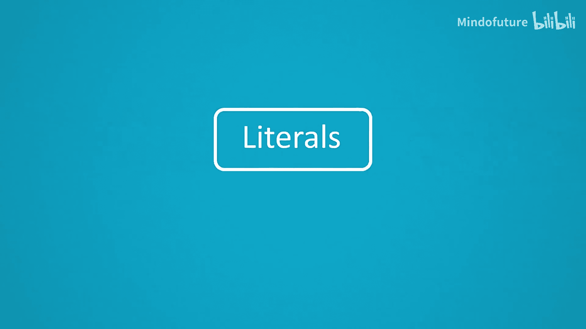
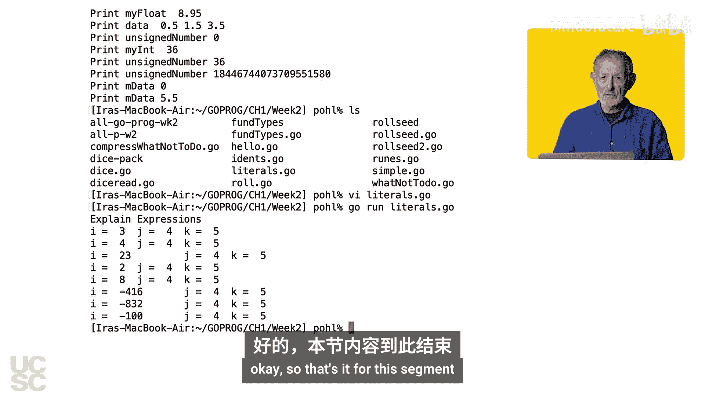

# 010：字面量与表达式




## 概述
在本节课中，我们将要学习Go语言中的字面量，以及它们如何在表达式中被使用。理解如何正确获取表达式的值至关重要。我们将从整数开始，逐步介绍字面量的类型、运算符的优先级和结合性，并通过代码示例来巩固这些概念。

---

## 字面量与类型
字面量是一个固定的值，并拥有一个关联的类型。例如，整数值 `4` 是一个字面量，其类型可以是 `int` 或 `int32`，具体取决于它的声明方式。在类型推断中，`4` 通常被推断为 `int` 类型。

然而，值 `4.0` 则是一个浮点数字面量。如果我们使用短变量声明 `:=` 来初始化一个变量为 `4.0`，编译器会将其类型识别为 `float64`。

同样，字面量 `true` 的类型是 `bool`。每种类型都有其对应的字面量。这些字面量既可用于类型推断声明中推导类型，也可在表达式中用于创建该类型的新值，例如将两个整数相加会得到另一个整数。

---

## 表达式与运算符优先级
我们已经在一个初始程序中见过如何计算圆的面积：`3.14159 * radius * radius`。这里的 `3.14159` 是一个浮点数字面量，`radius` 很可能被声明为 `float64` 类型。整个结构构成了一个表达式。

为了理解这个表达式的结果，我们需要知道 `*` 运算符表示乘法，并且需要理解所谓的**运算符优先级**。

因此，我们需要知道如何为每种类型书写字面量，以及如何解释表达式，因为表达式同样可以用来初始化变量。

---

## 整数类型与运算
我们从整数领域开始，因为整数是我们最早理解的概念之一。在Go中，`int` 类型的大小通常取决于机器和编译器，常见的是32位或64位。它是我们进行需要整数的计算时通常使用的类型。

此外，还有更专门的整数类型，如 `int32` 或 `int64`。除非有特定原因（例如需要压缩数据，或者数值范围超出了 `int32` 的 ±20亿），我们通常不会使用它们。无符号整数类型也有类似的区分。

---

## 运算符优先级与结合性
要理解运算符如何工作，我们必须知道它们的优先级和结合性。这与普通数学中的规则类似，但在编程语言中必须形式化地理解，否则可能导致错误结果。

一个简单的优先级规则是：加法运算符 `+` 和 `-` 的优先级低于乘法、除法和取模运算符 `*`、`/`、`%`。这意味着在混合使用这些运算符的表达式中，乘法运算会先于加法执行。

在Go等编程语言中，结合性通常是从左到右。如果我们不希望遵循默认的优先级或结合性，可以使用**括号**来覆盖它们。即使对于复杂的表达式，为了清晰起见，也建议使用括号，即使不依赖括号也能通过理解优先级来正确计算。

---

## 代码示例解析
让我们通过代码来具体理解。以下是一个示例程序：

```go
package main

import "fmt"

func main() {
    var j, k int = 4, 5 // 声明并初始化整数变量 j 和 k
    var i int

    // 表达式 1: i = j * k / 5
    i = j * k / 5
    fmt.Printf("j=%d, k=%d, i=%d\n", j, k, i)

    // 表达式 2: i = j*k + 99%6
    i = j*k + 99%6
    fmt.Printf("j=%d, k=%d, i=%d\n", j, k, i)

    // 表达式 3: i = j * (k + 99) % 6
    i = j * (k + 99) % 6
    fmt.Printf("j=%d, k=%d, i=%d\n", j, k, i)

    // 表达式 4: i = j * -k * 5
    i = j * -k * 5
    fmt.Printf("j=%d, k=%d, i=%d\n", j, k, i)
}
```

以下是代码中关键点的解析：

1.  **字面量**：代码中的 `4`、`5`、`99`、`6` 都是整数字面量。
2.  **表达式 `i = j * k / 5`**：
    *   运算符 `*` 和 `/` 优先级相同，结合性为从左到右。
    *   因此计算顺序为：`(j * k) / 5` => `(4 * 5) / 5` => `20 / 5` => `4`。
    *   所以 `i` 被赋值为 `4`。
3.  **取模运算符 `%`**：
    *   取模运算返回除法后的余数。`99 % 6` 的结果是 `3`，因为 `99 / 6 = 16` 余 `3`。
    *   这个运算符在后续的随机数生成等场景中会很有用。
4.  **表达式 `i = j*k + 99%6`**：
    *   根据优先级，`*` 和 `%` 先于 `+` 计算。
    *   计算顺序：`(j*k)` 和 `(99%6)` 先计算，然后相加。即 `(4*5) + (3)` => `20 + 3` => `23`。
5.  **表达式 `i = j * (k + 99) % 6`**：
    *   括号 `()` 覆盖了默认优先级，`k + 99` 先计算。
    *   计算顺序：`(k + 99)` => `(5 + 99)` => `104`。然后 `j * 104` => `4 * 104` => `416`。最后 `416 % 6` => `2`（因为 `416 / 6 = 69` 余 `2`）。
    *   这个结果与上一个表达式不同，展示了括号如何改变运算顺序。
6.  **复合赋值运算符**：
    *   像 `+=`、`-=` 这样的运算符是简写形式。例如 `i += expression` 等价于 `i = i + expression`。它们源于C语言社区，在Go中也很常见，可以节省一些代码输入。
7.  **与C语言的区别**：
    *   在Go语言中，自增 `i++` 和自减 `i--` 是语句，而不是表达式。这意味着你不能将它们混合在其他表达式中使用，例如 `k = i++` 在Go中是不允许的。这与C语言不同。

---




## 总结
本节课中我们一起学习了Go语言中的字面量和表达式。我们了解到字面量是具有固定值和类型的常量，并探讨了各种运算符的优先级和结合性规则。通过具体的代码示例，我们看到了括号如何改变运算顺序，以及整数除法与取模运算的特点。理解这些基础概念对于编写正确无误的Go程序至关重要。记住，当不确定运算顺序时，使用括号是保证清晰和正确的最佳实践。