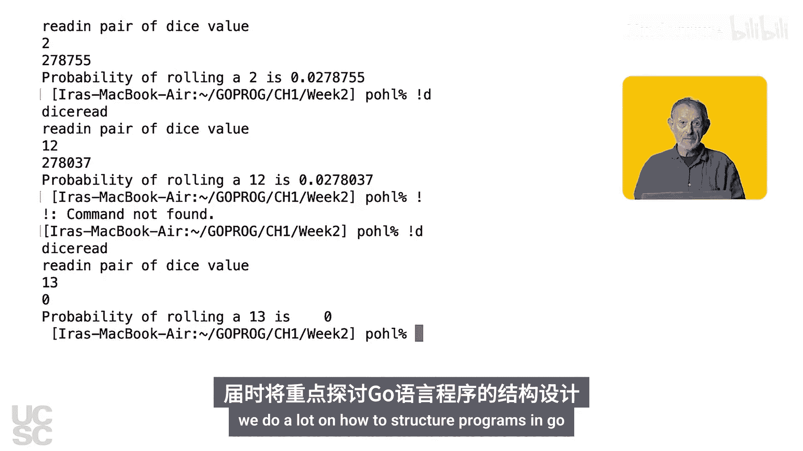

# 011：骰子概率计算

## 概述

在本节课中，我们将学习如何使用Go语言模拟掷骰子，并通过蒙特卡洛方法计算特定点数出现的概率。我们将从生成单个随机数开始，逐步构建一个能够计算任意骰子点数组合概率的程序。

## 1. 生成单个随机骰子点数

除了学习Go语言的基本词汇，我们还需要接触一些包含重要思想的有用小程序。在接下来的四个程序中，我们将介绍伪随机数生成器的使用。

我们将展示如何用它来计算概率，具体是计算掷两个骰子时各种点数组合出现的概率。想象一下在赌场玩双骰子游戏，了解掷出7点的概率对你非常有用，因为7点在双骰子游戏中是一个非常重要的数字。

我们将以渐进的方式编写这个程序。这是一个有用的方法：我们先编写一个包含基本思想的小程序，测试并确保它能正常工作，并且我们理解它。然后我们将扩展程序，第二个程序将获得更多功能。类似地，第三个程序也会进行扩展，最后我们将编写一个最终程序，用于计算任意骰子点数的概率。

现在，我们的第一段代码非常简单。它只是从一个名为 `math/rand` 的库中导入我们需要的函数，以获取伪随机数生成器。

我们当然也需要 `fmt` 包。因此，我们将使用一个导入语句同时导入 `math/rand` 和 `fmt`，这样就不需要使用多个导入语句。

整个程序在 `func main` 中只是一个 `fmt.Println` 语句，调用 `rand.Intn(6) + 1`。

`rand.Intn` 函数的作用是生成一个伪随机数。它生成0到5之间的数字，即0、1、2、3、4、5。但回想一下，当你掷一个骰子时，你得到的数字是1到6。这就是为什么我们要加1。

这个专用函数接受一个参数。例如，如果我们传入1000，它将允许我们生成0到999之间的数字。你可以自己尝试一下。

从代码中我们可以看到，`math/rand` 包含了伪随机数生成器。我们已经使用过 `math` 库来获取常量 `Pi`。`math` 是一个非常大的库，我们只需要它的子库 `rand`，这让我们可以只导入需要的部分。

## 2. 模拟掷两个骰子并计算特定点数概率

我们已经理解了如何模拟单个骰子的随机投掷。但回想一下，我们的最终目标是获得掷一对骰子的概率值。

第三个程序将着眼于掷两个骰子。我们想要计算掷出7点的概率，这是双骰子游戏中最重要的数字。

我已经写好了代码。让我们来看看它。我们导入了三个不同的包：`fmt`、`math/rand` 和 `time`。

我们将有一对骰子，我们将掷这对骰子，得到掷出的值。回想一下，当我们掷真正的骰子时，每个骰子上的数字是1到6。那么我们的结果可能是什么？结果在2到12之间。但请注意，我们实际上是掷两个骰子，每个随机产生1到6。非常重要的一点是，我们不能只是简单地产生一个2到12之间的随机数。我们必须产生两个1到6之间的随机数，才能正确模拟一对骰子的投掷。

和之前一样，为了开始并获得不同的结果，我们将使用 `rand.Seed(time.Now().UnixNano())` 作为种子。现在我们将使用一个非常大的投掷次数。我们将使用 `for` 循环语句。现在我们可以看到计算机的力量。我们将设置 `for i := 0; i < 10000000; i++`。这意味着我们将进行1000万次投掷，这应该足以找到一个概率。如果我只用很少的投掷次数，就像做一个实验只掷五次骰子来看7点出现的情况，那将是不准确的。投掷次数越多，所谓的蒙特卡洛计算就越准确。因此，你真的需要强大的计算机来应用蒙特卡洛技术，因为你希望一遍又一遍地重复做这件事。运行这个程序1000万次没有问题，但用真正的骰子掷1000万次并计算出7点出现的频率将是一个非常困难的任务，你会在完成实验之前就非常疲惫。所以这让你能够做到。

在循环内部，我们得到一对骰子的值，注意是 `rand.Intn(6) + rand.Intn(6) + 2`，而不是加1。为什么？因为我需要为每个骰子加1。否则，我会得到1到11之间的值，而不是2到12。所以这将给我2到12之间的值。然后，我测试我的这对值是否等于7。`pair == 7` 是一个布尔表达式。`==` 是布尔运算符，表示两个值是否相同。`pair` 等于7吗？所以我们不使用单个等号，因为那将是赋值，我们使用双等号。然后，因为它是一个 `if` 语句，与C语言不同，我们不需要把它放在括号里。相反，我们总是使用花括号来包含条件为真时要执行的代码，在那里我们有一个 `howMany` 计数器递增。

在1000万次运行之后，`howMany` 将告诉我们看到7点的次数。我可以打印 `howMany`，然后我想计算 `howMany` 的概率。因为 `howMany` 是一个整数，我希望将其计算为浮点数。所以我用 `howMany` 除以1000万，我应该得到一个答案。

让我们实际运行一下。我运行了1000万次，得到了7点出现1660139次。概率大约是0.1666139。如果你回想一下，这大约是六分之一的时间。所以在双骰子游戏中掷出7点，大约每六次出现一次。如果我们的模拟是正确的，并且你可以用数学证明这一点，你会发现这非常接近正确。

我们再运行一次，看看有什么不同。这次答案是1668000，上次是1666000，但仍然非常接近。是0.1668，而不是0.1666。所以仍然非常接近，这给了我们一定程度的信任。

我再运行一次，这次我得到1666702。这表明，如果我有更大的数字，我们会得到所谓的收敛。它基本上是0.1666。所以我们怀疑，从技术上讲，你得到7点的概率可能是六分之一。

## 3. 为随机数生成器设置种子

正如你所看到的，当我们运行那个程序时，我们总是得到数字6。嗯，这不是我们称之为随机的东西所期望的。我们不希望总是看到6。这听起来非常不随机，非常不可能，除非我们动了手脚确保每次都是6点朝上，否则这被称为不公平的骰子。

为什么会这样？我们遇到了一个有趣的小矛盾。计算机是确定性的，它总是做同样的事情。所以如果我们运行随机数生成器并从同一个地方开始，我们总是会得到相同的第一个数字。这不是我们想要的。我们如何避免这种情况？

有一个避免这种情况的标准技术。标准技术是用现实世界中可以被视为随机的东西来启动它。在这种情况下，我们将用它来启动。我们认为这是自操作系统开始运行以来的秒数。虚构地说，这被认为是1970年1月1日。所以我们现在是很多秒之后了。每当我们运行这个程序时，这个数字都会改变。这意味着，如果我们基于那个位置启动我们的随机数序列，我们每次可能会得到不同的随机数。这被称为为随机数生成器设置种子，这也是一个重要技术。如果你真的想了解更多关于这方面的知识，在《计算机程序设计艺术》中有非常详细的描述，尽管相当数学化，关于如何产生有效的随机数生成。

为了用这个特殊的时间开始，我们还需要导入第三个包。这次，我们将导入 `time` 包。所以现在我们将导入 `fmt`、`math/rand` 和 `time`。

`time` 将让我们使用这个花哨的东西，叫做 `time.Now().UnixNano()`。这意味着 `Now` 是 `UnixNano` 上的一个方法，它提取出我们处于Unix纪元以来的秒数。然后我们通过调用 `rand.Seed` 来设置种子。记住所有这些。它们都是大写的，因为它们是从那些包中导出的。一旦我们有了种子，我们将运行这个程序10次。这就是那个 `for` 语句，运行10次并打印我们认为的10次随机掷骰结果。

正如我已经说过的，`time.Now().UnixNano()` 计算从Unix时间（1970年1月1日）开始以来的秒数。这成为 `rand.Seed` 的参数。每次运行程序时它都不同，所以你应该得到不同的结果。

一个我们还没有太多关注的焦点是循环语句。看看循环语句。我们下周会详细讨论循环，因为我们将讨论改变控制流以使程序变得有趣。我们不能只有简单的线性程序。通常，当我们多次做某事时，程序非常有用。在这里，`for` 语句有一个 `i := 0`。记住 `:=` 的作用，它初始化一个变量。所以这个变量 `i` 被声明为循环的局部变量。第二部分是一个测试：`i < 10`。这是一个布尔表达式。布尔是预声明变量类型之一。它可以是 `true` 或 `false`。当它为 `false` 时，循环停止。所以只要测试为 `true`，我们就执行循环。`for` 语句的最后一部分是 `i++`，`i++` 是一个递增语句，变量 `i` 增加。如果 `i` 没有递增，循环将是无限的，`i` 将保持在0。这让我们达到10，10是停止循环的地方。所以这个循环让我们执行那个小的随机函数，产生掷骰子的值10次。

与C语言的不同之处在于，`for` 循环的写法。在C语言中，`for` 循环的这三个项目会被括在括号里，而在这里，它们写的时候没有括号，但我们总是用一个左花括号开始，即使是一个简单的单语句循环。在Go中总是使用花括号，而在C语言中并不总是使用。

现在我们将停止运行代码，看看我们是否每次确实得到不同的结果。

## 4. 计算任意点数的概率并进行输入

现在，让我做最终的计算。为了真正了解双骰子游戏，我必须知道，哦，我能得到“box cars”（两个6点，即12点）的频率是多少？或者“snake eyes”（两个1点，即2点）呢？赌徒们为这些东西起了名字，因为他们经常玩双骰子游戏。而且，如果他们非常擅长双骰子游戏，他们知道任何双骰子点数的概率。

为了找到这个，我们刚刚看到的代码中必须改变什么？在那个代码中，`howMany` 是针对7进行测试的。每次我们看到7时，我们就递增 `howMany`。所以，我想要一些可以输入的东西，而不是固定的7。我希望能够输入2、3、4、7、12等。为了使这个程序更通用、更有用，我必须允许用户向程序提供要检查的值。这就是我要做的修改。

这需要什么？回想一下，我们已经偶尔这样做过，这需要使用 `scanf`。让我们去看看那会是什么。这是我的程序，我称之为 `diceRead.go`。

所以，一切看起来都一样，除了这里。我有一个叫做 `vPair` 的东西。所以 `vPair` 将是之前硬编码为7的那个值。`vPair` 将是我要查找概率的骰子对的值。

这是我获取它的地方。在这一行，我有 `fmt.Scanf("%d", &vPair)`。为什么是 `%d`？因为那是整数的格式。`&` 是取地址运算符，这就是我们如何将值读入变量。所以它说，读入变量 `vPair` 的地址。然后，我的计算和之前完全一样，只是在 `if` 语句中，我说 `if pair == vPair`，而不是 `if pair == 7`。然后我计数 `howMany`，然后打印出我的答案。

我已经改变了我的程序，读入我需要的骰子对的值 `vPair`，然后计算概率。让我们去做这个。我将构建这个程序，而不是直接运行它，这样我可以在需要时重新运行它。程序是 `diceRead.go`。现在可执行文件是 `diceRead`。它说，读入骰子对的值。让我们读入7，因为我们已经用过7了。让我们看看它做了什么，如果我说7。和之前有些不同的数字，但它是0.1667，非常接近我们之前得到的所有其他数字。

让我再次运行这个程序。读取一个值。让我们看看“snake eyes”的值可能是多少。“snake eyes”的值是2。看看它的值低了多少：0.027877。这比7点要不可能得多，差不多差一个数量级。这有道理吗？是的。对于7点，你有很多组合：6和1、2和5、3和4。对于2点，你只有一种组合：1和1。所以你必须要得到那一种确切的组合，而不是7点所有可用的组合。这与我们直观的理解相符。特别是如果你以前玩过双骰子游戏，你会知道这个事实。

关于骰子或双骰子游戏还有一点有趣的是，6和6是另一个极端，但它也应该有一个接近“snake eyes”的概率。让我们试试那个。现在，6和6的值是12。让我们掷一下。哦，非常接近：0.0278。这正是我们期望的。我们期望它以同样的方式出现。看看这个蒙特卡洛模拟多么有价值。它给了我们数值，否则如果我们必须手工计算，将需要一些复杂的大学数学。如果我们必须通过实验来做，那会让我们筋疲力尽。

我要用这个程序尝试的最后一件事是，如果我给它一个不存在的骰子掷出值会怎样？所以我之前告诉过你，我不可能有13点的骰子掷出值，对吧？所以如果我问它得到13点骰子掷出值的概率是多少？我得到了答案，我期望是0。好的，所以我们测试了它。看起来不错。

## 总结

在本节课中，我们学习了一个小概念，学会了如何使用蒙特卡洛方法和随机数做一些事情，然后我们以一种让我们能够测试并确保我们理解概念的方式构建了它。看到我们如何使用 `for` 循环也很关键。`for` 循环非常强大，它是控制流中最重要的结构之一。所以我们下周将详细讨论它，届时我们将大量讨论如何在Go中构建程序。