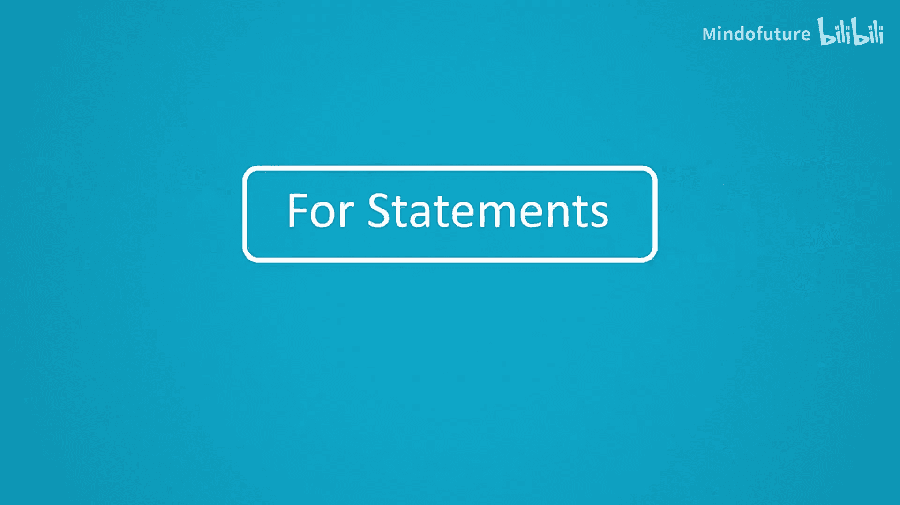
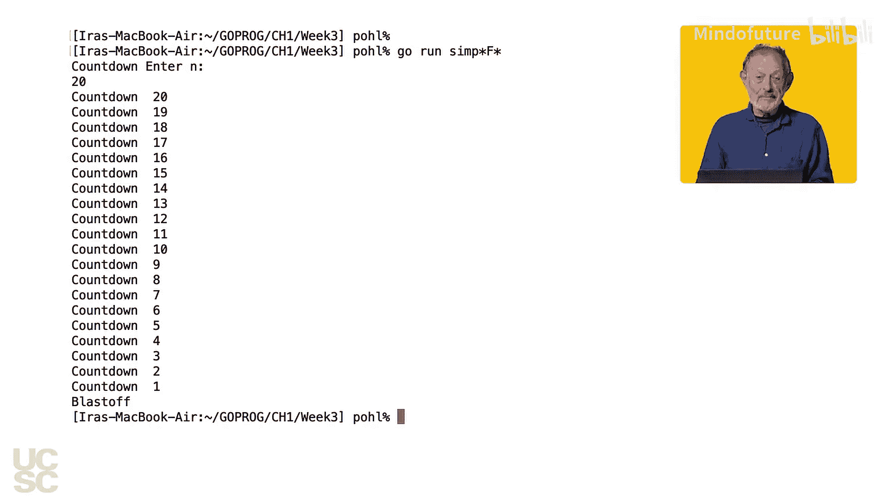

# 014：for语句详解




在本节课中，我们将要学习Go语言中用于实现循环控制的核心结构——`for`语句。循环是计算机擅长重复执行任务的基础，我们将深入探讨其语法、不同形式以及实际应用。

## 概述

计算机擅长重复执行任务，而人类则不然。反复做同一件事非常枯燥，但计算机却乐此不疲。它们被设计成拥有循环结构，可以轻松执行重复操作，例如每分钟处理大约十亿次操作。这正是大型数据库、流程图和电子表格等能够近乎即时计算的原因。因此，我们需要一种语言结构来反映这种控制流，这种结构就是`for`语句。它类似于包括C语言在内的许多其他语言中的同类语句，甚至可以追溯到20世纪60年代最初的学术编程语言Algol 60。

`for`语句的核心思想是让计算机按照你指定的次数重复执行任务。关键在于如何指定重复的频率。

## for语句的三种形式

上一节我们介绍了循环的概念，本节中我们来看看Go语言中`for`语句的具体形式。在Go中，`for`语句的控制部分可以是一个条件、一个for子句或一个range子句。Range子句需要等到我们学习名为“切片”的新数据类型时才展示，因为它直到那时才有用。现在，我们先展示条件形式和for子句形式的`for`语句。

### 1. 带for子句的for循环

这是我们之前“石头剪刀布”程序中见过的、我认为最地道和最重要的基础`for`语句形式。它在关键字`for`后面包含三个部分。

以下是for子句的组成部分：
*   **初始语句**：通常是一个短变量声明（例如 `i := 0`）。这意味着在受控的代码块内，`i`是一个专门声明用于迭代的局部变量。
*   **条件表达式**：一个布尔表达式，用于决定是否继续循环（例如 `i < rounds`）。该表达式会被求值为`true`或`false`。
*   **后置语句**：在每次循环迭代结束后执行的语句（例如 `i++`）。如果我们有一个索引`i`，通常希望迭代索引递增。如果需要倒数，也经常使用递减。

这三个部分由两个分号分隔。初始语句和后置语句都是简单语句，中间的部分始终是那个布尔表达式。

这是一个非常简单的例子：
```go
for i := 0; i < 5; i++ {
    fmt.Printf("%d 的立方是 %d\n", i, i*i*i)
}
```
`i`被声明并初始化为0。`i < 5`是待求值的布尔表达式。`i`从0开始，所以初始条件为`true`。后置语句是`i++`。在循环体（花括号内的代码块）执行完毕后，会执行后置语句。在这个例子中，我们将打印0到4的立方值，结果将是0, 1, 8, 27, 64。

### 2. 仅带条件的for循环（类似while循环）

这种形式在其他语言中通常被称为`while`循环。我们省略了初始语句和后置语句，只保留条件。当只保留条件时，不需要任何分号。

以下是这种形式的一个简单示例：
```go
i := 0
for i < 5 {
    fmt.Printf("%d 的立方是 %d\n", i, i*i*i)
    i++
}
```
这里假设`i`已经被声明为变量并初始化为0。从某种意义上说，for子句中的初始语句和后置语句被移到了循环外部。后置语句`i++`变成了循环体内的最后一条语句。这种形式对于来自拥有`while`循环编程语言背景的学习者来说非常熟悉，它也是一种非常简单、基本的循环形式，非常有用。

### 3. 无限循环

我们将讨论的最后一种形式是无限循环。

以下是这种形式的一个非常简单示例：
```go
for {
    // 循环体代码
}
```
当没有条件时，`for`直接开始控制代码块。其隐含的假设是条件始终为`true`，这意味着它将永远运行。

当某个程序在你的计算机上永远运行时，必须有一种方法来停止它。虽然你可以直接拔掉电脑电源，但这有点麻烦，通常你并不想这样做。大多数控制系统，如Unix这样的操作系统，都有某种方式向机器、向操作系统发送信号来中断正在运行的程序并停止它。对于使用Unix的用户，这通常通过按`Control-C`来实现。

但假设在循环中，你希望在某些条件下跳出。我们可以这样做：
```go
i := 0
for {
    i++
    if i > 4 {
        break
    }
    fmt.Printf("%d 的立方是 %d\n", i, i*i*i)
}
```
在无限循环中，我们检查`i`是否大于4，如果是，我们希望停止。我们可以使用`break`跳出循环。记得在我们之前的讨论中，我们使用了`continue`。`continue`会跳转到循环顶部并继续下一次迭代。而`break`则会完全停止循环，直接跳转到循环后的下一条可执行语句。因此，如果你有一个无限循环，并且想测试某个特定条件，可以放置一个带有`break`的`if`语句，这将使你跳出循环。如果没有这个`break`，如前所述，虽然麻烦，但你可以使用操作系统中断（如Unix下的`Control-C`）来停止程序。

## 示例演示

现在让我演示一个相当简单的`for`语句程序。

在我的终端屏幕上，有一个非常简单的程序，我们称之为`simple4.go`。你可以查看`main`函数。

我们看到，我们有一个将要输入的变量`n`。我们将进行所谓的“倒计时”。想象我们在卡纳维拉尔角，正在进行一次大型太空飞行，我们希望我们的机器人进行倒计时。所以我们将要求用户输入倒计时的起始数字。

以下是我们传统的、非常地道的`for`语句，包含三个部分：
```go
for i := n; i >= 0; i-- {
    if i > 0 {
        fmt.Printf("%d...\n", i)
    } else {
        fmt.Println("发射！")
    }
}
```
这可能是你最常使用的形式，高度地道，学习它很重要，这也是我们重复它的原因。当然，如果你在其他编程语言中见过这个，你真正需要做的只是确保理解其语法。

我们得到这个初始语句，它是`i`的局部声明，被赋值为输入的初始值`n`。现在我们测试`i`是否大于或等于零。倒计时是向下计数的，直到我们达到0。然后我们执行递减语句而不是递增语句。

再次思考，你如何用模仿`while`的`for`语句形式，或者用模仿无限循环（需要使用`break`）的`for`语句形式来重写这个循环。你可以在每种情况下都做到，这应该变得非常熟悉。

这里我们将检查并打印倒计时，或者在倒计时结束时打印“发射！”。

让我运行那个程序。我将输入20。我们按预期从20、19、18...一直倒数到1，然后“发射！”。没有问题，非常简单，只需确保你理解所有这些。

## 总结




本节课中我们一起学习了Go语言中`for`语句的三种主要形式：带for子句的标准循环、仅带条件的while风格循环以及无限循环。我们了解了如何使用初始语句、条件表达式和后置语句来控制循环的迭代次数和行为，并掌握了使用`break`语句从循环中退出的方法。通过倒计时的示例，我们看到了`for`循环在实际编程中的典型应用。理解这些循环结构是掌握程序控制流的基础。