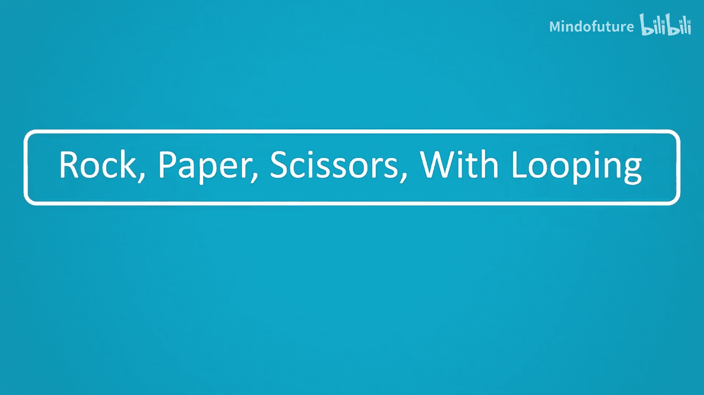
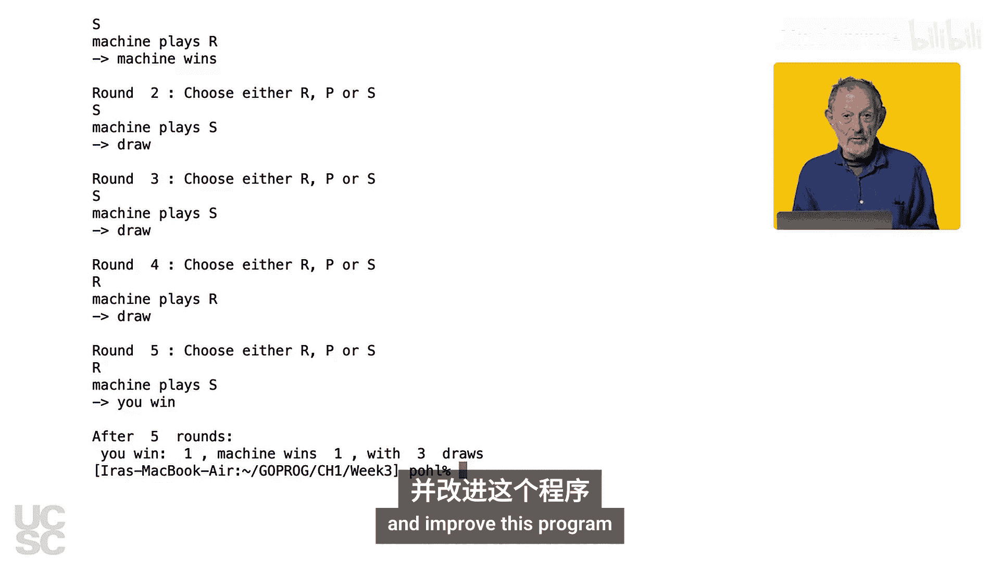

# 016：带循环的剪刀石头布




## 概述
在本节课中，我们将构建剪刀石头布游戏的最终版本。这个版本将允许用户指定与计算机对战的游戏轮数，并学习如何处理用户输入错误。我们将重点介绍Go语言中非常实用的`for`循环语句，并利用它来控制游戏流程。

---

## 游戏基础设置

首先，我们回顾并设置游戏的基础表示。在程序中，我们用数字代表不同的手势：石头是`0`，布是`1`，剪刀是`2`。同时，我们定义字符`R`、`P`、`S`（大写）作为用户输入的手势。

```go
const (
    rock = iota // 0
    paper       // 1
    scissors    // 2
)
const (
    cRock = 'R'
    cPaper = 'P'
    cScissors = 'S'
)
```

上一节我们介绍了游戏的基本表示，本节中我们来看看如何让游戏进行多轮。

---

## 获取游戏轮数与用户输入

游戏开始前，程序会询问用户想要进行多少轮比赛。我们使用`fmt.Scanf`函数来获取用户输入的整数。

```go
var rounds int
fmt.Print("How many rounds do you want to play? ")
fmt.Scanf("%d", &rounds)
```

这里，`%d`是整数的格式化符号，`&rounds`用于获取变量`rounds`的内存地址以存储输入值。

接下来，我们将进入游戏的核心循环部分。

---

## 使用`for`循环控制游戏轮次

计算机非常擅长重复执行任务，这正是循环语句的用武之地。我们将使用`for`循环来执行指定轮次的游戏。

以下是`for`循环的基本结构：

```go
for i := 0; i < rounds; i++ {
    // 循环体：每轮游戏的逻辑
}
```

这个结构包含三个部分，由分号分隔：
1.  **初始化语句**：`i := 0`。这里声明并初始化了局部变量`i`，其作用域仅限于这个`for`循环块内。
2.  **条件表达式**：`i < rounds`。这是一个布尔表达式。只要其值为`true`，循环就会继续执行。
3.  **后置语句**：`i++`。每次循环结束后执行，递增`i`的值。这是确保循环最终能结束的关键。

例如，如果用户输入`10`，这个循环将恰好执行10次。

---

## 处理用户输入与错误恢复

在每一轮游戏中，程序会提示用户输入手势。以下是处理流程：

1.  程序提示用户选择`R`、`P`或`S`。
2.  使用`fmt.Scanf(“%c”, &cMove)`读取单个字符。
3.  将用户输入的字符转换为对应的内部数字表示（0, 1, 2）。

然而，用户可能会输入错误的字符（例如小写字母或无效字母）。以下是处理非法输入的方法：

```go
cMove := ‘ ‘ // 假设这是读取到的用户输入
var move int

if cMove == cRock {
    move = rock
} else if cMove == cPaper {
    move = paper
} else if cMove == cScissors {
    move = scissors
} else {
    // 处理非法输入
    fmt.Println(“Illegal move. Please try again.”)
    i--        // 本轮不计入有效轮次
    continue   // 跳转回循环开始
}
```

**关键点解释**：
*   `i--`：因为用户输入非法，我们通过递减计数器`i`来“撤销”本轮，使其不消耗一个有效游戏轮次。
*   `continue`：这是Go语言中的流程控制语句。它会立即结束当前循环体的执行，并跳转回`for`循环的开头，重新进行条件判断并开始下一轮迭代。这样，用户就有机会重新输入正确的手势。

通过这种方式，我们实现了友好的错误恢复机制。

---

## 计算机的“人工智能”与胜负判定

为了让游戏有趣，我们为计算机对手设计一个简单的“AI”：随机选择手势。使用随机数可以防止对手轻易猜出我们的模式。

```go
import (
    “math/rand”
    “time”
)

rand.Seed(time.Now().UnixNano()) // 用当前时间初始化随机数种子，确保每次运行结果不同
machineMove := rand.Intn(3) // 生成0, 1, 2之间的随机整数
```

胜负判定逻辑如下：
1.  **平局**：如果用户和计算机的手势相同。
2.  **计算机获胜**：满足剪刀赢布、布赢石头、石头赢剪刀这三种情况之一。
3.  **用户获胜**：如果不满足以上两种情况，则用户获胜。

以下是判定逻辑的核心代码框架：

```go
if move == machineMove {
    // 平局
    draws++
} else if (move == paper && machineMove == scissors) ||
          (move == rock && machineMove == paper) ||
          (move == scissors && machineMove == rock) {
    // 计算机获胜的三种情况
    machineWins++
} else {
    // 其余情况为用户获胜
    userWins++
}
```

你可以尝试将计算机获胜的三个条件合并成一个更复杂的布尔表达式，作为练习。

---

## 运行示例与程序总结

当所有轮次结束后，程序会汇总并输出最终结果：用户获胜次数、计算机获胜次数和平局次数。

**运行示例**：
```
How many rounds do you want to play? 5
Choose your move for round 1 (R, P, S): S
Machine chose Rock. Machine wins!
Choose your move for round 2 (R, P, S): S
Machine chose Scissors. It‘s a draw!
...
Game Over!
Your wins: 1
Machine wins: 1
Draws: 3
```

**程序优化思考**：
当前计算机完全随机出招。一个有趣的改进方向是让计算机具备学习能力。例如，程序可以记录用户的历史出招偏好，如果发现用户特别偏爱某种手势（比如经常出石头），计算机就可以调整策略，更多地出布来克制。你可以思考如何实现这个功能，作为对本程序的扩展练习。

---

## 总结
本节课中我们一起学习了如何构建一个完整的、带循环的剪刀石头布游戏。我们掌握了以下核心知识：
1.  使用 `for i := 0; i < N; i++` 结构来控制固定次数的循环。
2.  利用 `continue` 语句和计数器调整（`i--`）来实现用户输入错误的恢复。
3.  使用 `math/rand` 包生成随机数为计算机对手创建简单的“AI”。
4.  通过清晰的 `if-else` 逻辑链来判断游戏胜负。




通过这个项目，你将循环、条件判断、输入输出和基本错误处理结合运用，完成了一个可以交互的完整命令行游戏程序。