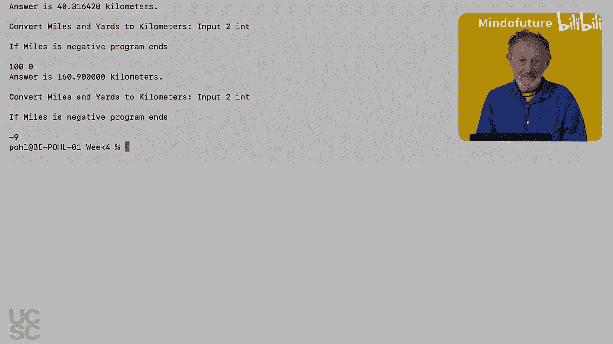

# 018：函数与切片 04_01_01


## 概述 📚

在本节课中，我们将要学习Go语言中两个非常重要的主题：**函数**和**切片**。函数是构建程序的基础模块，而切片是处理数据集合的强大工具。我们将从函数开始，了解如何将代码组织成可重用的逻辑单元。

## 函数：编程中的段落 📝

函数在编程中的作用，类似于文章中的段落。如果你能写好一个段落，你就能写好一篇文章。同样，如果你能写好一个函数，你就能掌握编写任何代码的能力。

大型的编码项目会被分解成多个部分。每个部分负责处理一个特定的、通常是简单的任务，这个任务就可以被编写成一个函数。

我遵循的一个经验法则是：**任何函数的长度都不应超过一屏（大约20行）**。如果你的函数开始超过20行，就应该考虑将其拆分成更小的函数。这有助于管理代码的复杂度。

此外，函数允许你**重用代码**。这是一个非常重要的软件工具特性。就像Go系统提供的`Println`或`Printf`函数一样，它们被整个社区持续地、重复地使用。如果每个人都自己编写打印函数，那将是非常糟糕的结果。因此，尽可能使用通用的、经过充分测试的代码，可以节省大量精力并避免错误。

## 将代码转换为函数 🔄

还记得在第一周，我们编写了将马拉松距离从码和英里转换为公里的代码。现在，我们将把那段代码转换成一个函数。

以下是我们定义的函数，它非常简单：

```go
func convertToKm(miles int, yards int) float64 {
    return 1.609 * (float64(miles) + float64(yards)/1760.0)
}
```

我们来分析一下这个函数的语法：
*   使用关键字 `func` 开始。
*   函数名是 `convertToKm`。函数名非常重要，我们使用驼峰命名法，并将新单词的首字母大写。
*   参数列表在括号内：`(miles int, yards int)`。
*   参数列表后面是**返回类型** `float64`。这个例子中返回类型是未命名的，但也可以命名。
*   大括号 `{}` 内是函数体，包含要执行的代码。这里只是一个简单的数学转换公式。

## 如何使用函数 📞

我们总是在 `func main()` 中开始执行程序。下面是如何使用 `convertToKm` 函数的例子：

```go
func main() {
    var miles, yards int
    for i := 0; i < 10; i++ {
        fmt.Print("Enter miles and yards: ")
        fmt.Scan(&miles, &yards)
        if miles < 0 {
            return // 结束程序
        }
        fmt.Printf("%d miles %d yards = %.3f km\n", miles, yards, convertToKm(miles, yards))
    }
}
```

在上面的 `main` 函数中：
*   我们声明了两个变量 `miles` 和 `yards`。
*   使用一个循环，以便可以多次进行转换。
*   提示用户输入两个整数值。
*   如果输入的英里数为负数，则结束程序。
*   否则，在 `Printf` 语句中，我们使用 `%f` 或 `%g` 来格式化浮点数输出。
*   **调用函数**的方式是直接使用其名称 `convertToKm`，并传入当前的参数 `miles` 和 `yards`。

需要注意的是，`main` 函数中的变量名 `miles` 和 `yards` 与 `convertToKm` 函数中的参数名相同，但这只是为了方便。它们是**不同的上下文**，属于**按值传递**的变量。这意味着传递给函数的是这些值的副本，就像在C语言中一样。

## 函数的更多特性 ✨

一个简单的函数语法是：`func` 关键字，后跟参数列表，再跟可选的返回结果，最后是代码块。

函数可以返回多个值，这是Go语言一个有趣且强大的特性。例如，在C语言中，函数只能返回一个值，如果要返回多个值，需要使用特殊的数据结构。而在Go中，可以直接返回。

下面是一个返回单个值的简单函数示例：

```go
func square(n int) int {
    return n * n
}
```

这个函数名为 `square`，接收一个 `int` 型参数 `n`，返回 `n * n` 的结果，类型也是 `int`。如果传入 `3`，将返回 `9`。

## 总结 🎯

本节课中我们一起学习了Go语言中函数的基础知识。我们了解到函数是组织代码、管理复杂度和实现代码复用的核心工具。我们通过将距离转换的代码重构为 `convertToKm` 函数，实践了如何定义和调用函数，包括函数的命名、参数、返回类型以及按值传递的特性。



记住，将大型任务分解为小而专注的函数，是编写清晰、可维护代码的关键。在下一节中，我们将探讨另一个核心概念——切片，它是Go语言中处理序列化数据的强大方式。