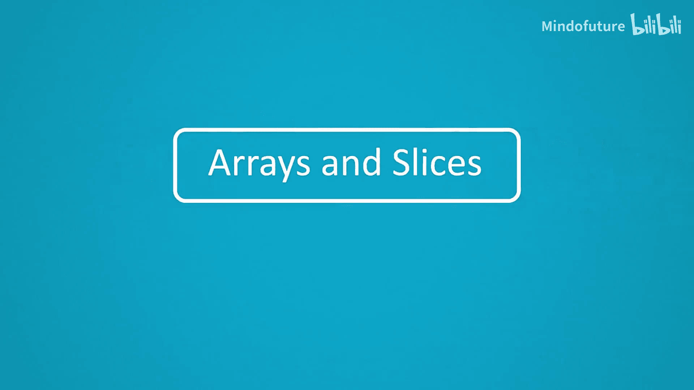
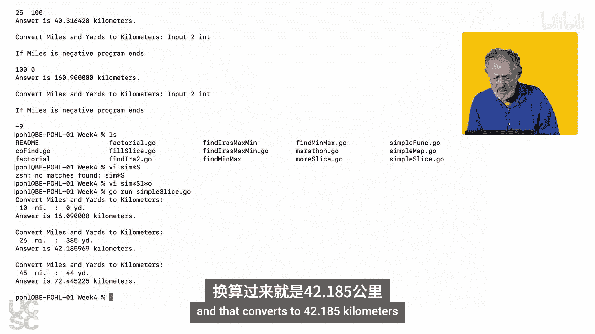

# 019：数组与切片




## 概述

在本节课中，我们将要学习Go语言中的两种重要数据结构：数组和切片。我们将了解它们的定义、创建方式、特性以及在实际编程中的应用，特别是切片如何提供比数组更灵活的动态处理能力。

---

## 数组：静态的同构数据结构

数组是一种同构数据结构，允许你存储相同类型的元素。例如，在加州大学的海象研究项目中，你可能需要存储500只海象的体重数据，这些数据就可以存储在一个数组中。

在Go语言中，创建数组的方式类似于声明普通变量。你需要指定数组的名称、长度和元素类型。

```go
var data [5]float64
```

上述代码创建了一个名为`data`的数组，它可以容纳5个`float64`类型的元素。如果不对数组进行初始化，Go语言会将其所有元素设置为对应类型的零值（对于数值类型是0，对于布尔类型是`false`，对于字符串是`""`）。数组的索引从0开始，因此这个数组的元素是`data[0]`、`data[1]`、`data[2]`、`data[3]`和`data[4]`。

另一种声明数组的方法是使用初始化列表。

```go
data := [5]float64{0, 2.81, 32.56, 9}
```

这种方式可以直接为数组元素赋予非零的初始值。

然而，Go语言中的数组是**静态**的，其长度是类型的一部分。这意味着一个长度为10的整数数组`[10]int`和一个长度为5的整数数组`[5]int`是两种不同的类型，不能直接混合使用，有时甚至需要进行类型转换，这带来了不便。

---

## 切片：动态灵活的替代方案

由于数组的静态特性限制了其灵活性，Go语言更常用的是**切片**。切片是动态的，其长度不是类型的一部分，因此使用起来更加灵活。

切片的声明方式与数组类似，但在方括号内不指定长度。

```go
var data []float64
```

你也可以在声明时直接初始化切片。

```go
data := []float64{0, 2.81, 32.56, 9}
```

这段代码会自动创建一个包含5个元素的切片。

---

## 使用切片：一个里程转换的例子

为了更好地理解切片，让我们修改之前的里程转换程序，使用切片来处理多个值。

以下是程序的核心部分：

```go
func convertMilesToYards(miles float64) float64 {
    return miles * 1760.0
}

func main() {
    // 定义两个切片
    miles := []float64{1.0, 26.385, 100.0} // 长度len=3，容量cap=3
    yards := make([]float64, len(miles))   // 创建一个与miles等长的切片

    // 使用for循环和range迭代切片
    for i := range miles {
        yards[i] = convertMilesToYards(miles[i])
    }

    // 打印结果
    for i := range miles {
        fmt.Printf("%.2f 英里 = %.2f 码\n", miles[i], yards[i])
    }
}
```

在这个例子中，我们定义了两个切片：`miles`和`yards`。`miles`切片在声明时初始化了三个值。我们使用内置的`make`函数创建了`yards`切片，并指定其初始长度与`miles`相同。

我们使用`for`循环和`range`关键字来迭代`miles`切片。`range`会返回两个值：当前元素的索引和值。如果我们不需要使用索引或值，可以使用下划线`_`将其丢弃。

```go
for i, _ := range miles {
    // 仅使用索引i
}
// 或
for _, value := range miles {
    // 仅使用值value
}
```

---

## 切片的关键操作

切片是动态的，这意味着我们可以在程序运行时改变它的大小。以下是几个关键的内置函数：

1.  **`make`**：用于创建具有指定长度和容量的切片。
    ```go
    data := make([]int, 100) // 创建一个长度为100的整数切片
    ```

2.  **`len`**：返回切片的当前长度。
    ```go
    length := len(data) // length 为 100
    ```

3.  **`cap`**：返回切片的容量（底层数组的大小）。容量可能大于长度，以便为未来的扩展预留空间。
    ```go
    capacity := cap(data)
    ```

4.  **`append`**：这是扩展切片最重要的函数。它向切片的末尾添加一个或多个新元素，并返回一个新的切片。**必须将`append`的结果重新赋值给原切片变量**。
    ```go
    data = append(data, 1, 2, 3, 4) // 在data末尾添加四个元素
    ```
    执行后，`data`的长度变为104。Go运行时可能会为了效率而将容量扩展得比新长度更大（例如，从100翻倍到200），以避免每次添加元素时都重新分配内存。

---

## 总结

本节课中我们一起学习了Go语言中的数组和切片。

*   **数组**是静态的、长度固定的同构集合，其长度是类型的一部分，因此在实际应用中较少直接使用。
*   **切片**是基于数组的、动态的、灵活的视图，是Go中最常用的集合类型。
*   我们学习了如何使用`make`创建切片，以及如何使用`len`、`cap`和`append`来操作切片。
*   我们重点介绍了`for`循环与`range`关键字结合使用来安全、便捷地迭代切片，这可以避免常见的“差一错误”。
*   我们还了解了如何使用下划线`_`来丢弃在迭代中不需要的返回值。




理解切片及其动态特性，是掌握Go语言高效处理数据集合的关键。