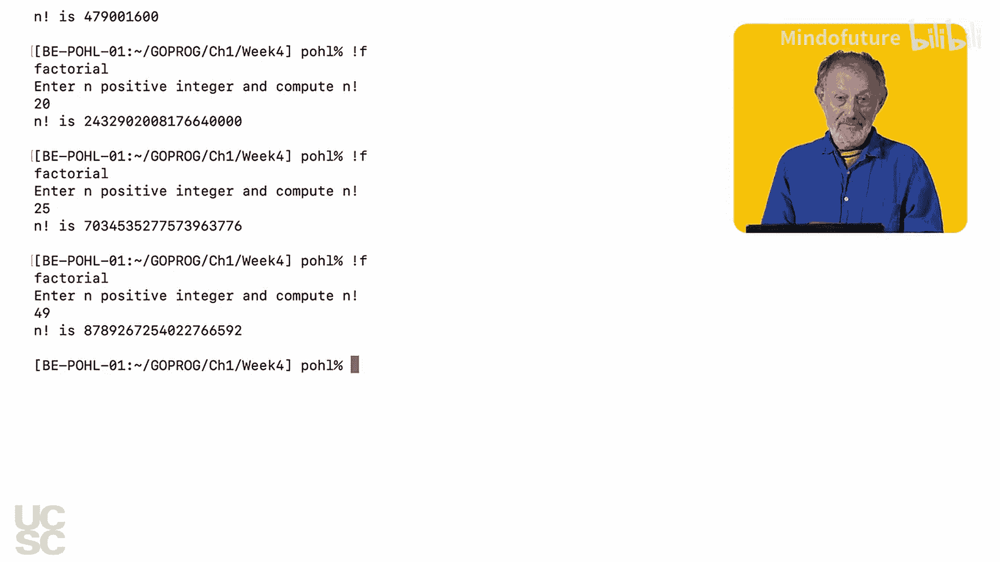

# 021：简单递归

## 概述
在本节课中，我们将要学习Go语言中一个重要的编程概念：递归。我们将通过计算阶乘的例子，来理解递归函数是如何工作的，以及在使用时需要注意的边界条件和潜在问题。

---

## 函数是封装例程的关键方式
函数是现代编程中封装例程的关键方式。现代编程语言一个非常好的特性是函数可以递归调用。这意味着函数可以调用自身。

如果你有数学背景，可能会熟悉某些被称为归纳定义的定义方式。例如，阶乘就是根据其自身来定义的。

## 阶乘的递归定义
阶乘的递归定义如下：`n`的阶乘等于`n-1`的阶乘乘以`n`。用公式表示就是：
**factorial(n) = factorial(n-1) * n**

例如，计算`3`的阶乘，结果是`1 * 2 * 3 = 6`。这也可以看作是`1 * 2`（即`2`的阶乘）再乘以`3`。

我们还需要定义递归的**基准情况**。当`n`等于`1`时，阶乘就是`1`。否则，就按照上述递归公式计算。

在数学上，这也可以被视为一种归纳论证。我们可以在Go语言中实现这个逻辑。

## Go语言中的递归函数
Go语言允许递归函数。这里有一个历史背景：在编程的早期，例如IBM在20世纪50年代发明的Fortran语言，是不允许函数递归调用的。后来，国际计算机科学家团队将递归引入了Algol 60语言，此后递归才成为计算机语言的常见特性。

以下是我们在Go中定义阶乘函数的方法。它将接收一个整数参数。由于阶乘增长非常快，我们将使用一个非常大的整数类型（64位整数）作为返回值。

函数定义遵循归纳逻辑：如果`n`等于`1`，则返回`1`。否则，它调用自身，计算`n * factorial(n-1)`。

这个递归不会无限运行下去，因为每次调用参数都会减`1`。当参数变为`1`时，递归停止并返回结果。如果我们犯了一个错误，写成`return n * factorial(n)`，那么函数将无限递归，最终导致程序崩溃。

通常，我们使用正整数调用此函数。由于测试条件的存在，负整数也会返回`1`。

## 递归与循环
这个程序也可以写成一个简单的`for`循环。实际上，许多递归几乎总是可以重写为某种循环。

在某些情况下，这一点非常重要，因为递归涉及函数调用，而函数调用在计算机运行时间上通常比迭代（循环）开销更大。不过，编译器通常会优化递归，使其等效于迭代。

因此，你应该选择能让你最简单表达函数逻辑的方式。正如我们所说，阶乘很适合用递归来定义。

## 整数溢出问题
由于阶乘增长极快，我们通常不希望计算超过`20`的阶乘。因为超过`20`，就会发生所谓的**整数溢出**。即使使用64位整数，也无法正确存储那么大的数字。

我们可以允许用户输入一个正整数进行计算。程序会询问用户想要计算哪个数的阶乘，然后使用格式化输出计算结果。

需要注意的是，阶乘增长太快，会导致溢出。对于普通的32位整数，在计算`13`的阶乘后就会溢出。

## 实际运行示例
让我们实际运行一下这个程序，看看会发生什么。假设我们已经编译好了一个名为`factorial`的可执行文件。

程序会提示：“输入一个正整数来计算其阶乘。”

首先，我们测试`3`，因为我们知道结果是`6`。这是调试过程的一部分，确保在已知案例上程序运行正确。

程序再次询问。我们尝试一个稍复杂的数字`12`。我们得到了一个相当大的数字，它增长得非常快，呈指数级增长。`12`的阶乘是`479,001,600`。

接下来尝试`20`。对于`20`，我们仍然能得到正确结果，这是一个非常大的数字，大约是64位整数能表示的最大值之一。

但是，如果我们尝试更大的数字，比如`25`，就会得到错误的结果。`25`的阶乘应该是`20 * 21 * 22 * 23 * 24 * 25`，这个数字会大得多。但屏幕上显示的数字位数和之前差不多，这显然是错误的结果。这就是**整数溢出**，计算机无法正确计算这个结果。

即使尝试更大的数字，我们也会看到这些非常大的数字，但它们完全不对应正确的值。正确的数字位数应该多得多。

## 关于计算的思考
对于这类固定计算，必须记住你的计算机并不等同于可以在纸上进行的数学运算。在纸上，只要有足够的空间，你就能算出数字。虽然对人来说这很繁琐，但理论上可以做到。

为了计算这类大数，你需要能够表示**任意大的整数**。有一些专门的包可以实现这一点。你可以将数字的每一位存储在一个切片中，并编写专门的算法来处理大数运算。当然，编写和解释这样的包会比较复杂。

---

## 总结
本节课中，我们一起学习了Go语言中的递归函数。我们通过阶乘的例子，理解了递归的基本原理、基准条件的重要性，以及如何用代码实现递归逻辑。同时，我们也探讨了递归与循环的关系，并重点指出了在处理快速增长的计算（如大数阶乘）时可能遇到的整数溢出问题。理解这些概念对于编写正确、高效的Go程序至关重要。