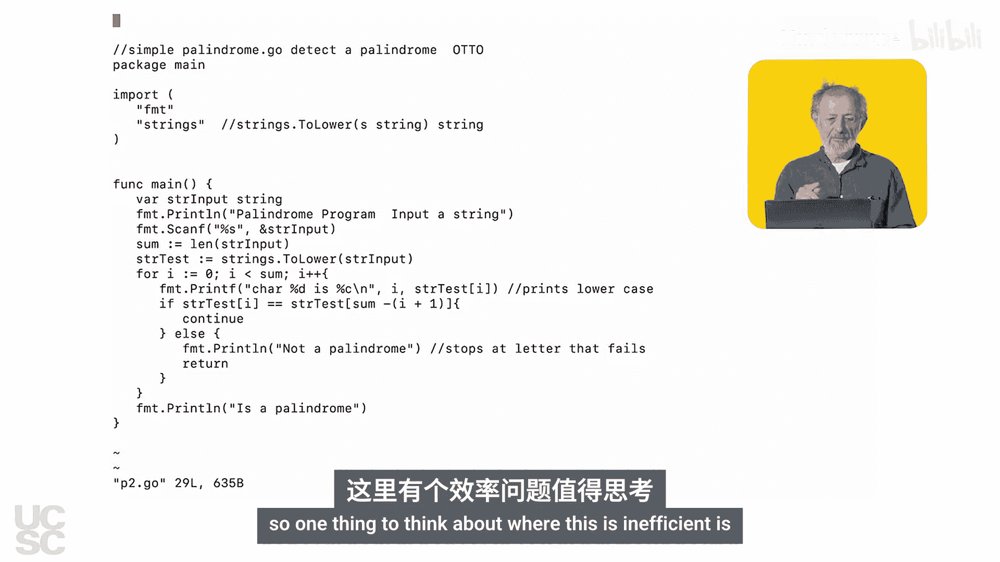
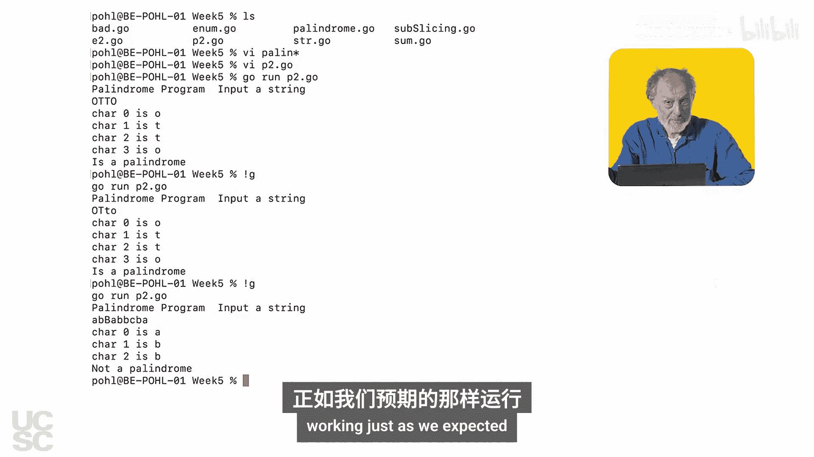

# 024：回文检测程序


在本节课中，我们将学习如何编写一个Go语言程序来判断一个输入的字符串是否为回文。回文是指正读和反读都相同的序列，例如“oto”和“ada”。我们将通过一个简单的示例程序，学习字符串处理、循环控制以及如何忽略字母大小写。

## 核心概念与程序结构

我们的程序将执行以下步骤：
1.  从用户处获取一个字符串输入。
2.  使用 `strings.ToLower` 函数将所有字符转换为小写，以确保检测不区分大小写。
3.  通过循环，逐个比较字符串首尾对应的字符。
4.  如果所有对应的字符都相同，则判定为回文；否则，判定为非回文。

以下是程序的核心逻辑代码片段：
```go
// 将输入字符串转换为全小写
testString := strings.ToLower(inputString)
length := len(testString)

// 遍历字符串前半部分，与对应的后半部分字符比较
for i := 0; i < length; i++ {
    if testString[i] != testString[length-1-i] {
        fmt.Println("不是回文")
        return
    }
}
fmt.Println("是回文")
```

## 程序实现详解

上一节我们介绍了回文检测的基本思路，本节中我们来看看具体的代码实现。

首先，我们需要导入必要的包并获取用户输入。
```go
package main

import (
    "fmt"
    "strings"
)

func main() {
    var input string
    fmt.Print("请输入一个字符串: ")
    fmt.Scanf("%s", &input)
    // ... 后续处理
}
```

接下来，我们对字符串进行预处理并开始比较。

以下是处理字符串和进行比较的关键步骤：
1.  **计算长度并转换大小写**：获取字符串长度，并将整个字符串转换为小写形式，以便进行不区分大小写的比较。
2.  **遍历与比较**：使用 `for` 循环遍历字符串。在循环体内，比较位置 `i` 的字符与从末尾数起对应位置 `length-1-i` 的字符。
3.  **判断与输出**：如果发现任何一对字符不匹配，则立即打印“不是回文”并退出程序。如果循环完整执行完毕，说明所有字符都匹配，则打印“是回文”。

## 程序优化与思考

我们当前的程序有一个可以优化的地方。在遍历整个字符串时，当字符串是回文时，我们实际上对每个字符位置进行了两次比较（例如，比较 `testString[0]` 和 `testString[length-1]` 后，在循环后期又会比较 `testString[length-1]` 和 `testString[0]`）。这对于长字符串来说是一种计算资源的浪费。

思考一下，如何修改循环条件，使得我们只需要遍历字符串的前一半即可完成所有必要的比较？这是一个很好的练习，能帮助你更深入地理解循环和索引。

## 运行示例




让我们运行程序看看效果。
*   输入 `OtTo`，程序会输出“是回文”，因为忽略大小写后是“otto”。
*   输入 `abc`，程序会很快发现 `a` 与 `c` 不匹配，并输出“不是回文”。

## 总结

本节课中我们一起学习了如何用Go语言编写一个回文检测程序。我们掌握了以下知识点：
*   使用 `strings.ToLower` 函数统一字符串大小写。
*   利用 `for` 循环和索引访问字符串中的单个字符。
*   通过比较首尾对称的字符来判断回文属性。
*   在循环中使用 `return` 语句提前结束程序。




这个程序是字符串处理的一个经典练习，希望你通过实践能更好地理解Go语言中字符串和循环的用法。