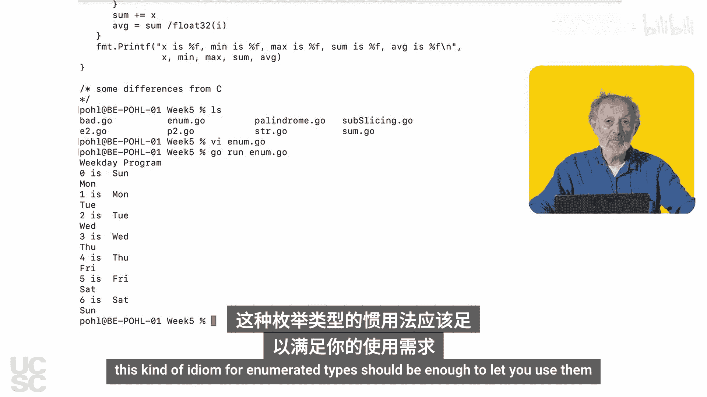

# 025：iota与枚举类型


## 概述

在本节课中，我们将要学习Go语言中的枚举类型概念，以及如何使用预定义标识符 `iota` 来自动生成一系列命名常量。我们将通过创建表示星期几的枚举类型，并编写相关功能函数来深入理解其用法。

---

## 枚举类型与iota简介

上一节我们介绍了Go语言中的基础类型。本节中我们来看看一种特殊的用户定义类型——枚举类型。

枚举类型在现代编程语言中是一种声明用户定义类型的方式。它适用于你的应用程序需要某些语言普通类型中不存在的特殊事物，并且你希望通过命名来获得程序可读性的清晰度和类型安全性。

在Go语言中，我们使用预定义标识符 `iota` 来自动生成一系列递增的命名常量。`iota` 从0开始，为列表中的每个常量依次分配递增值。

## 定义枚举类型

以下是定义一个枚举类型的基本语法结构。我们通过 `type` 关键字声明一个新类型，并指定其底层类型（通常是 `int`）。接着，在括号内列出常量名，并使用 `iota` 进行赋值。

```go
type Color int

const (
    Green Color = iota // 值为 0
    Yellow             // 值为 1
    Blue               // 值为 2
    Red                // 值为 3
)
```

在这个例子中，我们定义了一个 `Color` 类型，其底层是 `int` 类型。`iota` 从0开始，为 `Green`、`Yellow`、`Blue`、`Red` 分别分配了0、1、2、3的值。这种方式比单独声明每个常量更简洁，并且赋予了 `Color` 独立的类型身份，提供了类型安全。

## 实践：星期枚举

现在，让我们将这个概念应用于一个更具体的例子：创建一个表示星期几的枚举类型。

首先，我们定义 `Days` 类型和对应的常量。

```go
type Days int

const (
    Sunday Days = iota // 值为 0
    Monday             // 值为 1
    Tuesday            // 值为 2
    Wednesday          // 值为 3
    Thursday           // 值为 4
    Friday             // 值为 5
    Saturday           // 值为 6
)
```

通过这个声明，`Sunday` 到 `Saturday` 被依次赋予了0到6的整数值。`Days` 现在是一个独立的类型，虽然底层是 `int`，但不能直接与 `int` 混用，需要进行类型转换，这增强了代码的安全性。

## 功能函数实现

定义了枚举类型后，我们通常需要一些功能函数来操作它。下面我们来实现两个函数。

### 1. 获取下一天

这个函数接收一个 `Days` 类型的参数，返回它的下一天。我们利用底层整数值进行计算，并使用取模运算 `% 7` 来确保结果在0到6的范围内（即从星期六循环回星期日）。

```go
func nextDay(today Days) Days {
    // 将 today 转换为 int，加1，对7取模，再转换回 Days 类型
    return Days((int(today) + 1) % 7)
}
```

### 2. 获取星期名称

为了便于阅读输出，我们还需要一个函数将 `Days` 类型的值转换为其对应的字符串名称。这里使用 `switch` 语句非常合适。

```go
func dayName(day Days) string {
    switch day {
    case Sunday:
        return "Sunday"
    case Monday:
        return "Monday"
    case Tuesday:
        return "Tuesday"
    case Wednesday:
        return "Wednesday"
    case Thursday:
        return "Thursday"
    case Friday:
        return "Friday"
    case Saturday:
        return "Saturday"
    default:
        return "Invalid day"
    }
}
```

`switch` 语句是处理这种有限常量集合的理想选择，它为每个枚举值提供了清晰的处理路径。

## 测试程序

最后，我们编写一个主函数来测试上述所有功能。程序将遍历一周中的每一天，打印出当前天的名称和它的下一天。

```go
func main() {
    fmt.Println("Weekday Program")
    for d := Sunday; d <= Saturday; d++ {
        todayName := dayName(d)
        tomorrow := nextDay(d)
        tomorrowName := dayName(tomorrow)
        fmt.Printf("Today is %s, tomorrow is %s.\n", todayName, tomorrowName)
    }
}
```

运行这个程序，你会看到从星期日到星期六，每一天都正确地输出了其名称和下一天的名称。特别地，当输入是星期六（`Saturday`，值为6）时，`nextDay` 函数计算 `(6+1)%7 = 0`，成功返回了星期日（`Sunday`）。

## 总结

本节课中我们一起学习了Go语言中枚举类型的使用。我们了解到：
1.  使用 `type` 和 `const` 块配合 `iota` 可以方便地定义枚举类型。
2.  `iota` 从0开始自动为常量生成递增值，简化了声明过程。
3.  枚举类型提供了类型安全，防止了与底层类型的无意混用。
4.  我们可以为枚举类型编写功能函数（如 `nextDay`）和辅助函数（如 `dayName`）。
5.  `switch` 语句是处理枚举类型各个值的强大工具。




这种模式足以让你在需要表示一组相关常量（如状态码、配置选项、类别等）时有效地使用枚举类型。你可以尝试扩展这个例子，例如实现 `previousDay`（获取前一天）函数，或者构建更复杂的日历管理程序。