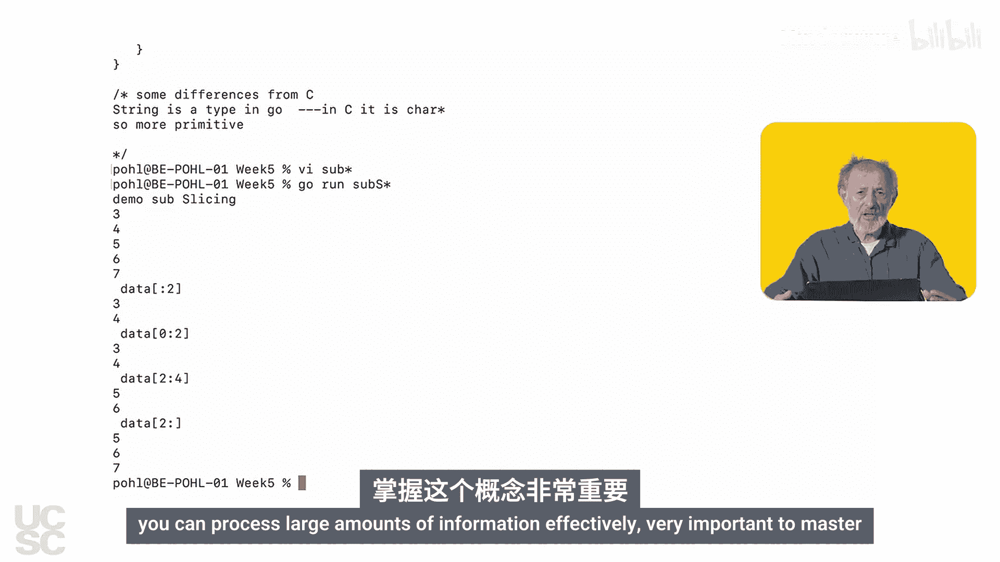

# 026：子切片


## 概述

在本节课中，我们将要学习Go语言中一个非常强大且实用的概念——子切片。我们已经了解了切片的基本用法，知道它比C语言中的数组更灵活、更安全。本节我们将深入探讨如何从一个已有的切片中提取一部分来使用，即创建子切片。

## 切片回顾与子切片引入

上一节我们介绍了切片，它是对C语言中静态数组概念的强大扩展和泛化。切片是动态数组，内置于Go语言中，因此你无需像在C语言中那样手动进行内存管理和指针操作，这避免了许多潜在的错误。

切片不仅可以在声明时指定任意大小，还可以动态扩展。它们还内置了许多实用功能，例如获取长度（`len`）和容量（`cap`），以及使用`range`关键字进行迭代。

现在，我们将探索另一个尚未尝试的功能：从现有切片中提取并使用其中一部分数据的能力，这就是子切片。这是一个非常强大的概念。试想一下，像美国社会保障系统这样的数据库可能拥有数亿条记录，但并非所有操作都需要处理全部数据。通过子切片，你可以高效地访问和处理数据的特定部分。

## 子切片语法与实践

那么，如何获取数组或切片的一部分呢？以下程序展示了具体方法。

首先，我们声明并初始化一个普通的切片：
```go
data := []int{3, 4, 5, 6, 7}
```
这里，`data`是一个整型切片，初始包含五个元素：3, 4, 5, 6, 7。它的长度和容量很可能都是5。

接下来，让我们创建第一个子切片：
```go
data2 := data[:2]
```
这种语法使用冒号分隔下界和上界。当左边界（下界）被省略时，默认为0。因此，`data[:2]`等同于`data[0:2]`，它包含原切片中索引0到索引2（不包括2）的元素。

以下是更多子切片的示例：
```go
data3 := data[0:2] // 显式指定下界和上界，与 data[:2] 结果相同
data4 := data[2:4] // 包含索引2和3的元素（即值5和6）
data5 := data[2:]  // 省略上界，默认为切片长度，包含索引2到末尾的所有元素（即值5, 6, 7）
```
子切片的语法是`[lower:upper]`。下界或上界可以隐式指定，但不能同时省略两者。

## 使用迭代器遍历子切片

为了演示子切片的效果，我们可以使用`for`循环和`range`关键字进行迭代。`range`会返回两个值：索引和该索引处的值。如果我们不需要索引，可以使用空白标识符`_`将其忽略。

以下是遍历不同切片的示例：
```go
// 遍历原始切片
for _, v := range data {
    fmt.Println(v)
}
// 遍历子切片 data[:2]
for _, v := range data2 {
    fmt.Println(v)
}
// 同样方法遍历 data3, data4, data5
```
通过这种方式，我们可以清楚地看到每个子切片所包含的元素范围。

## 运行结果分析

运行上述程序，输出结果如下：
*   原始切片 `data` 包含所有五个元素：`3, 4, 5, 6, 7`。
*   子切片 `data[:2]` 包含前两个元素：`3, 4`。
*   子切片 `data[0:2]` 结果相同：`3, 4`。
*   子切片 `data[2:4]` 包含索引2和3的元素：`5, 6`。
*   子切片 `data[2:]` 包含从索引2开始到末尾的元素：`5, 6, 7`。

结果完全符合预期，清晰地展示了子切片的创建和使用方法，同时也再次演示了迭代器的应用。这是Go语言中的核心惯用法。

## 总结

本节课中我们一起学习了Go语言中的子切片概念。我们了解到，子切片允许你高效地引用和处理现有切片中的一部分数据，其语法灵活，下界和上界可以隐式指定。通过结合`range`迭代器，可以方便地遍历子切片中的元素。




由于切片（或称动态数组）是处理大量信息的关键数据类型，熟练掌握切片和子切片的概念对于编写高效、地道的Go程序至关重要。