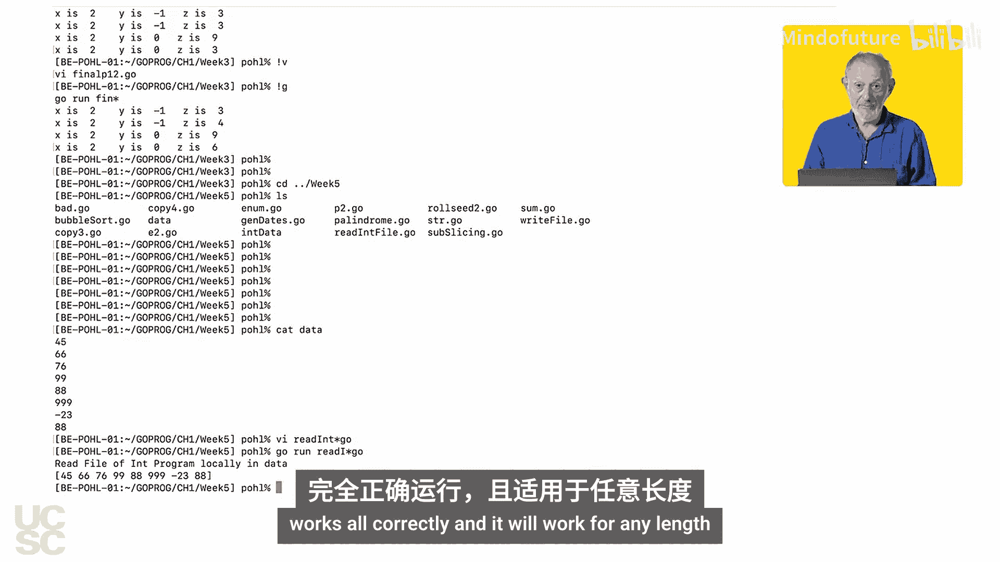

# 027：读取文件


在本节课中，我们将要学习如何使用文件进行输入和输出操作。文件是计算机内存中存储数据的一种极其重要的方式。使用计算机的主要原因通常是需要处理大量数据，并且经常需要永久保存这些数据，以便在程序运行结束后依然可用。例如，社会保障管理局需要记录全国每个人的信息，这些数据就需要存储在永久性的介质上。有时，文件也可能是半永久性的，比如在实验期间保存数据，直到不再需要为止。因此，我们需要掌握如何从文件中读取数据、如何访问文件中的数据，这是另一种形式的输入输出。

## 打开文件

上一节我们介绍了文件操作的重要性，本节中我们来看看如何打开一个文件进行读取。

首先，我们需要能够打开一个文件以供读取。这可以通过标准函数 `os.Open` 来实现。该函数来自 `os` 包。我们需要提供文件名作为参数。这个文件可以位于程序执行的当前目录，也可以包含一个路径，以便在辅助存储器中找到它。

尝试打开文件时可能会失败。失败的原因有多种，例如文件不存在于指定位置，或者文件受到保护。如果无法打开文件，我们会得到一个错误信息；如果成功打开，则会获得一个文件描述符。

使用 `Open` 函数后，我们需要检查是否有错误发生。可以通过检查错误值是否为 `nil` 来判断。如果错误不为 `nil`，则表示存在错误，我们必须尝试从错误中恢复，或者（更常见的情况）终止程序。如果错误为 `nil`，则可以使用返回的文件描述符进行读取操作。

以下是打开文件进行读取的惯用代码示例：

```go
file, err := os.Open("data")
if err != nil {
    fmt.Println(err)
    os.Exit(1)
}
```

在这段代码中，`os.Open` 返回两个值：文件描述符和错误。许多I/O函数都会返回错误，因为I/O操作很容易出错。我们检查错误，如果不为 `nil`，则打印错误信息并使用 `os.Exit` 终止程序。

## 从文件读取数据

成功打开文件后，接下来我们学习如何从文件中读取数据。

我们将使用 `fmt.Fscanf` 函数来读取文件。`Fscanf` 与之前使用的 `Scanf` 函数类似，区别在于 `Fscanf` 的第一个参数是文件描述符。因此，在获得文件描述符并存储在变量（例如 `file`）中之后，我们可以逐项读取数据。

假设我们有一个名为 `data` 的文件，其中存储了一系列整数。我们想要读取这些整数并处理它们。

以下是读取整数文件数据的 `main` 函数示例：

```go
var dataSlice []int
for {
    var item int
    _, err := fmt.Fscanf(file, "%d\n", &item)
    if err != nil {
        if err == io.EOF {
            break
        }
        fmt.Println(err)
        os.Exit(1)
    }
    dataSlice = append(dataSlice, item)
}
```

在这段代码中，我们声明了一个名为 `dataSlice` 的切片来存储数据。然后，我们使用一个无限循环，通过 `fmt.Fscanf` 逐行读取整数。`Fscanf` 函数需要文件描述符、格式字符串（`%d\n` 表示读取一个整数和换行符）以及存储读取值的变量地址（`&item`）。

`Fscanf` 返回读取的项目数和错误。我们忽略项目数，只检查错误。如果错误为 `nil`，表示成功读取了一个项目。如果错误是 `io.EOF`（文件结束符），则表示已到达文件末尾，没有更多数据可读，我们使用 `break` 跳出循环。如果是其他错误，则打印错误并退出程序。

成功读取一个项目后，我们使用 `append` 函数将其添加到 `dataSlice` 切片中。`append` 函数会自动扩展切片的容量以容纳新元素，这使得Go语言在处理任意长度的文件时非常灵活。

## 运行示例程序

现在，让我们在终端中运行这个程序，看看它是如何工作的。

首先，查看当前目录（假设是 `week5`），其中有一个名为 `data` 的文件。使用 `cat` 命令查看文件内容，可以看到一系列整数，例如 45, 66, 76, ..., 88。

接下来，查看并运行名为 `readfile.go` 的程序。该程序导入了必要的包（`fmt`、`io`、`os`），并按照上述逻辑读取 `data` 文件中的整数到切片中，最后打印出切片内容。

运行程序后，输出结果应该与 `data` 文件中的整数序列一致，例如 `[44 66 76 ... 88]`。这表明程序正确读取了文件中的所有数据。



🎼 好的。


## 总结


本节课中我们一起学习了如何在Go语言中读取文件。我们首先介绍了使用 `os.Open` 函数打开文件并检查错误。然后，我们学习了使用 `fmt.Fscanf` 函数从文件中逐项读取数据，并通过检查 `io.EOF` 错误来判断文件是否结束。最后，我们使用切片和 `append` 函数来动态存储读取到的数据，并运行了一个完整的示例程序来验证这些操作。通过这种方式，我们可以灵活地处理任意长度的文件数据。