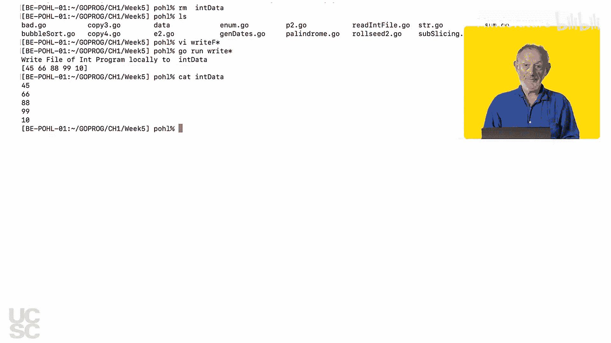

# 028：写入文件

## 概述
在本节课中，我们将要学习如何在Go语言中向文件写入数据。文件写入是严肃计算中的重要环节，因为我们需要永久或半永久地存储计算结果以供后续使用。

## 文件写入的基本模式
与读取文件类似，Go语言也为写入文件提供了简单的惯用模式。为了实现这一点，我们需要使用一些包来简化文件的打开和写入操作。这些包包括我们之前见过的`fmt`和`os`包。

## 创建与写入文件
当我们向文件写入时，通常需要创建它。我们也可以写入已存在的文件，但这部分内容将留待日后讨论。因此，在这个简单的示例中，我们实际上将创建并打开文件。

此外，在这个例子中，我们将看到，当我们不再需要文件时，需要将其正确地归还给系统。因为在某些系统中，可以同时保持打开的文件数量是有限的。因此，你不仅需要打开文件，还需要关闭它们。

## 使用`defer`关闭文件
一个良好的原则是，每次打开文件时，都习惯性地使用`defer`关键字来调用文件的`Close`方法。`defer`意味着将在计算结束时关闭文件。我们稍后在研究并行计算等内容时，会再次看到`defer`，那时它会变得更加重要。

通过在打开文件后立即安排关闭，我们可以避免忘记执行此操作。这种做法是Go语言的惯用模式，使得将打开和关闭操作配对变得更容易。

## 示例：写入整数到文件
以下是具体操作步骤。我们将创建一个名为`int.dat`的文件，用于写入整数。

首先，我们使用`os.Create`函数创建文件，并将文件句柄存储在变量`file`中。我们需要检查可能出现的错误。为了处理错误，我将编写一个名为`checkFile`的函数。如果打开文件时出现错误，该函数将终止程序并给出适当的消息。

紧接着，我们使用`defer file.Close()`来确保文件最终被关闭。

以下是文件写入的三个关键步骤：
1.  创建文件。
2.  检查错误，确保一切正常。
3.  使用`defer`安排关闭，以妥善管理资源。

在文件I/O操作中进行错误检查和处理非常重要。经常会出现无法写入、读取或正确打开文件等错误。在大多数情况下，适当的做法是简单地终止程序。

## 错误处理函数
让我们展示如何编写错误处理函数。我们将编写一个函数`checkFile`，它接收一个`error`类型的参数`err`。我们检查参数`err`是否不等于`nil`。如果是，则调用一个特殊的函数`panic`。`panic`类似于`os.Exit`，是另一种退出程序并输出消息的方式。这是一个有用的惯用模式，建议保留这样一个函数。

## 使用`Fprintf`写入数据
打开文件后，我们使用`Fprintf`向其中写入数据。这很合理，回想一下，读取时我们使用`scanf`，写入时我们使用`printf`。对于文件操作，`Fprintf`会有一个额外的文件参数。我们一直在使用`Printf`和`Println`，这里我们将使用`Fprintf`。

我们将写入一个切片。这里定义了一个包含10个值的切片。现在，我使用一个`for range`循环，变量`v`将依次代表切片中的每个元素。

`Fprintf`的第一个参数是文件描述符。第二个参数是格式字符串，这里是`"%d\n"`，表示每个整数后跟一个换行符。这样，文件中的每个整数都会像之前的数据文件一样单独占一行。写入的值来自变量`v`。

最后，我们检查写入过程中是否有错误，如果有错误就触发`panic`。如果没有错误，程序将在最后打印出数据切片的内容，以展示其工作状态。

## 运行示例
现在，让我们检查这个写入操作是否有效。首先，我之前已经运行过这个程序，并且会删除`int.dat`文件，所以现在它不存在。查看目录，我们看不到它。

我们有一个名为`writefile.go`的程序。快速查看一下，确认它符合我们的描述。我们只需要`fmt`和`os`包。这里有我们用于检查错误的特殊函数。在这个例子中，我们没有使用`exit`，而是使用了`panic`函数，这是一种替代方式。

我们将要写入的数据是初始化数据切片时放入的数据。它可以是任意长度，或者我们也可以生成它。例如，我们可以使用随机数生成器创建一百万个随机项放入数据切片中，然后处理它们，并将这些数据输出到文件中。事实上，我们将在最后的作业问题中使用这种方法。

这里是`for range`循环。我们遍历数据切片，依次获取每个元素，并将每个元素赋值给变量`v`。如果一切正常，我们将使用`Fprintf`将数据打印到文件中。第一个参数是指向名为`int.dat`的文件的文件描述符。我们检查错误以确保一切正常。

然后，我们只需在最后将其打印出来，以显示它正常工作。现在，我运行它：`go run writefile.go`。程序运行后，打印出了切片。现在，让我们查看`int.dat`文件：`cat int.dat`。确实，你看到的结果完全相同。每个值后面都跟着一个新行，这正是我在`Fprintf`中为每个打印项添加换行符的效果。

## 总结
本节课中，我们一起学习了Go语言中基本的文件写入操作。我们了解了创建文件、使用`defer`确保文件关闭、进行错误处理以及使用`Fprintf`写入格式化数据的完整流程。这是一个非常有用的惯用模式，现在你应该能够在Go中使用基本的文件I/O了。