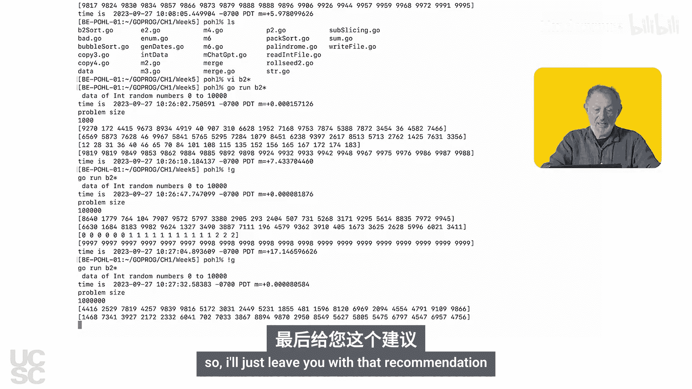

# 029：冒泡排序


## 概述
在本节课中，我们将要学习排序算法，特别是冒泡排序。排序是计算中最常用的算法之一，它使我们能够对数据进行排序，以便高效地处理。我们将了解冒泡排序的工作原理，使用Go语言实现它，并分析其效率。

排序是计算中使用最广泛的算法之一，也是研究最深入的算法之一。它使你能够对数据进行排序，以便快速高效地处理。

存在许多排序算法。最著名的参考是Knuth的《计算机程序设计艺术》第三卷。对于任何认真对待计算机科学的人来说，这是一本必读的书。它不仅详细描述了算法，还进行了详细分析，以便你理解为什么一种算法比另一种更好。

许多这些算法在标准库中都有提供。因此，虽然你很可能会使用库进行排序，例如Go中名为`sort`的包，就像有`fmt`包一样，但学习如何编写代码仍然很重要。如果你想成为一名计算机科学家，掌握这些代码并理解它们为何以及如何工作是绝对基础。

## 冒泡排序算法简介

上一节我们介绍了排序的重要性，本节中我们来看看一种具体的排序算法：冒泡排序。

从某种意义上说，最简单的代码就是我们即将展示的冒泡排序算法。它被称为冒泡排序，因为形象地说，数字像气泡一样上升到表面。

冒泡排序的问题在于，虽然编码非常简单，但它有一个很大的缺点：效率非常低。我们称之为**O(n²)** 阶。这意味着对于n个元素，运行时间以平方级增长。例如，如果1000个元素的运行时间是1微秒，那么对于一百万个元素，运行时间将是其平方，会达到许多秒。因此，当使用这种算法时，很快就不可能对非常大量的数据进行排序。想象一下社会保障系统，那里有数亿个元素需要排序，以便工作人员能够高效地搜索数据。

然而，我们知道许多更高效的算法，例如归并排序，其复杂度是**O(n log n)**。我们使用大写的O表示阶，这就是所谓的大O表示法。我们并不关心其中的小常数项，而是关心像n²、n³、阶乘和log n这样的项。所有这些都用于描述算法的效率。

## Go语言中的多重赋值

在编写这个冒泡排序算法时，我们将使用Go的一个特殊功能，这个功能有些不同寻常：Go允许多重赋值。我们已经看到过，例如在`for range`循环中，我们可以得到两个值，有时我们会使用下划线`_`丢弃其中一个值。但任何函数都可以产生多个值，并可以赋值给一个由逗号分隔的标识符列表。这在像C这样的语言中是不可能的，所以它有所不同。

当你编写排序算法时，必须交换元素，因为元素被认为是无序的。如果两个元素顺序不对，你将交换它们。在Go中，交换可以通过这种非常简单的方式完成：`a, b = b, a`。这允许a和b交换值，而不需要一个临时变量，而这在大多数语言中是必需的。这里展示了在C语言中你会如何做：你需要一个临时变量，将a的值赋给临时变量保存，然后将b赋给a，最后将临时变量赋给b。如果你试图直接将a赋给b，会得到错误的值，最终会得到两个b值。因此，你需要一个临时变量。但Go的多重赋值技巧意味着，编译器在背后提供了这种交换功能。我们将在冒泡排序中使用这个功能。

## 冒泡排序的工作原理

让我们看看冒泡排序是如何工作的。我们假设要对一组整数进行冒泡排序。当然，你可以对任何有顺序的东西进行冒泡排序，例如浮点数，或者使用字典序对字符串进行排序，就像字典或电话簿中的排序一样。

冒泡排序的复杂度是**O(n²)**，我们将看到这是如何产生的。本质上，我们将有一个主循环，其循环次数等于我们存储值的切片的长度。然后，我们会有第二个循环，这就是我们得到n²的地方。外层循环的长度被认为是n，在内层J循环中，我们循环到`len(d) - i - 1`。这就是所谓的内层循环。

以下是冒泡排序的核心代码结构，展示了双循环：
```go
for i := 0; i < len(d)-1; i++ {
    for j := 0; j < len(d)-i-1; j++ {
        if d[j] > d[j+1] {
            d[j], d[j+1] = d[j+1], d[j] // 交换
        }
    }
}
```
在冒泡排序中，我们再次看到了双循环：一个外层循环和一个内层循环。在内层循环内部，我们进行检查和交换。我们检查两个元素是否顺序错误，如果较低索引`j`的元素大于`j+1`的元素，则交换这两个元素。你可以看到我们使用了Go语言中通过多重赋值进行交换的小技巧。

思考一下这个过程：如果`d[0]`是最大值，那么在内层循环中，`d[0]`会像气泡一样上升到顶部。在内层循环的第一次迭代中，我们知道最大值会被“冒泡”到顶部。它总是赢得比较，总是被交换，并移动到顶部。然后我们可以不再管它。这就是为什么我们在内层循环中不断使用`len(d)-i-1`，`-i`来自于这样一个事实：我们已经排序到了那个点，我们已经排序了顶部的元素。每次迭代都会在排序中增加一个元素。因此，每次迭代都将剩余的最大元素移动到切片的当前末尾。所以，剩余的最大元素冒泡到顶部。显然，两个循环都是O(n)阶，它们相乘就得到了O(n²)阶。

考虑一个无序序列，如`[9, 7, 15, 3, 6]`。第一次迭代会发生什么？首先，7与9比较，无事发生。9与3比较，9移动。9与6比较，9移动。9与15比较，15保持最大。现在，进行下一次迭代，我们知道最大的15已经在末尾。所以我们开始比较7和3，移动7。比较7和6，移动7。比较7和9，9更大，无事发生，依此类推。你应该自己尝试这个过程，说服自己这会正常工作。手动模拟你的算法以确保你理解它们并看到它们是正确的，这是一项非常重要的技能。

## 测试冒泡排序

我们将如何测试这个算法？我们将有一个`main`函数。`main`函数将生成一系列0到10000之间的随机数。由于我们不希望每次运行都重复相同的结果，我们将使用一个种子，我们已经做过很多次了。在这个例子中，我们将对3000个元素进行冒泡排序。我们将创建一个该大小的切片，并在该切片内分配一个0到10000之间的随机数。这就是我们在`for`循环中为`data`切片所做的事情。

然后，我们产生了一个随机组合的元素，在这个例子中是3000个。现在我们在这个数据切片上调用`bubbleSort`。我们不想打印出10000个数字，所以我们只打印前20个和后20个。你可以看到我们在那里使用了切片操作。这些操作将让我们检查前20个元素和后20个元素是否被正确排序，这将相当有说服力地证明我们做对了。

以下是生成测试数据并验证排序结果的示例代码：
```go
func main() {
    rand.Seed(time.Now().UnixNano())
    size := 3000
    data := make([]int, size)
    for i := range data {
        data[i] = rand.Intn(10000)
    }
    bubbleSort(data)
    fmt.Println("Sorted first 20:", data[:20])
    fmt.Println("Sorted last 20:", data[len(data)-20:])
}
```
总结一下，我们将生成未排序的数据来测试我们的冒泡排序，然后对其进行冒泡排序，接着打印一些切片以查看结果是否合适。

## 运行演示与效率分析

现在让我们在屏幕上运行它。这里有一个与我们刚才描述的类似的冒泡排序。我将使用`a, b = b, a`进行交换。如果你是一个老派的C程序员，你可能学会了通过调用一个函数来交换两个值，在该函数中，两个值通过指针传递，然后使用一个内部临时变量来执行交换。你也可以用那种方式编写。Go允许你这样做，但这个非常好的功能意味着你可以避免那样做。

我们将生成数据。这是一个简单的冒泡排序，就像我们看到的，它是O(n²)阶。外层循环`for i := 0; i < len(d)-1; i++`，内部是内层循环`for j := 0; j < len(d)-i-1; j++`。所以每次循环，我们少做一次比较。然后，我们在必要时进行交换。

我想提一件事，如果你想尝试，可以尝试改进冒泡排序，因为有时列表在你完成之前就已经排好序了，或者可能偶然得到一个已排序的列表。你怎么能知道列表已经排序了呢？我给你一点时间思考一下。你会知道的方法是，如果在内层循环中没有发生任何交换。所以，你可以在内层循环中设置一个标志。如果没有任何交换，该标志为真；只有当你得到一个交换时，它才变为假。一旦发生交换，你必须继续算法。但如果你在整个内层循环中没有发生任何交换，你就可以退出。你可以从冒泡排序中`return`，所以你可以思考一下，如果你想的话可以尝试。

在这里，我将打印出一大堆数字。在这个模型中，我将要求用户指定切片大小，然后我将向你展示排序前的值和排序后的值。希望你能被说服。我还将打印时间，因为我也想证明它以O(n²)运行，所以效率不高。

让我们运行它。我们先做一个小问题，比如1000个元素。你可以看到是1000个。你可以看到初始的随机数像`9217, 2`这样开始，这些切片没有明显的顺序。然后我们调用冒泡排序，你可以看到我们得到了`12, 28, 31, 36, 40`。我们得到了小数字，然后在切片的末尾得到了大数字。我们在很短的时间内完成了。现在，我将重新运行。我们尝试一个问题大小为100000。它应该可以工作。

现在你可以看到程序在运行，而不是立即产生结果。它只是向你展示排序前的切片。你可以看到一个明显的停顿。在第一个例子中，当我们处理1000个元素时，它非常快，可能几微秒或几毫秒。而现在，突然间，它用了17秒。它增长了。如果我们再进一步，我们真的会在这里遇到延迟，这就是这种排序例程与使用库中的排序例程（如快速排序，或者我将要求你作为最后一个问题编写的归并排序例程）之间的区别。

这里我们处理一百万个元素的问题。生成一百万个值没有问题，看生成一百万个随机值有多快，它们几乎是立即发生的。所以这不是问题所在。问题在于我们得到的是类似一百万平方的东西，那将会非常大。所以，在这里，它花了很长时间。你可以看到，一旦这些数字变大，而一百万对于一个大型数据库来说并不算大，使用冒泡排序就变得不切实际了。好的，我不会等待它完成，你可以自己尝试一下。我就给你这个建议。




## 总结
本节课中我们一起学习了冒泡排序算法。我们了解了排序的重要性，学习了冒泡排序O(n²)复杂度的原理，并使用Go语言的多重赋值特性实现了它。我们还通过生成随机数据测试了算法，并直观地看到了其对大量数据排序时的效率瓶颈。虽然冒泡排序简单易懂，但其效率低下，因此在实际应用中，我们会选择更高效的算法，如归并排序或快速排序。