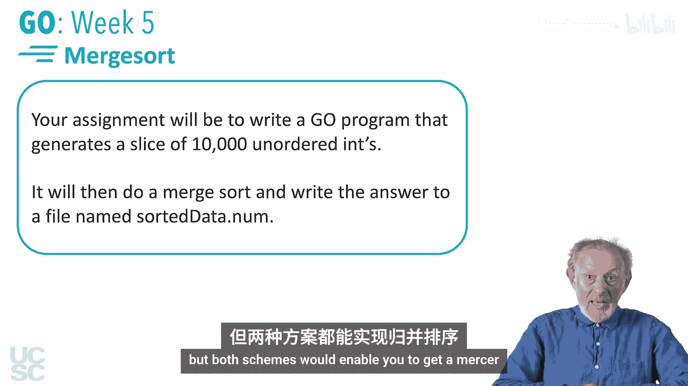
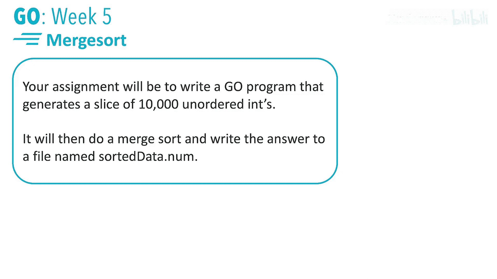

# 030：归并排序


在本节课中，我们将学习如何完成本课程的最后一个编程作业：实现归并排序。我们将解释归并排序的原理、重要性以及实现方法。

归并排序之所以重要，是因为它比冒泡排序高效得多。我们通常用计算复杂度来衡量算法的效率。对于包含 **n** 个元素的列表，冒泡排序的复杂度是 **O(n²)**，这意味着其运行时间会随着元素数量呈指数级增长。相比之下，归并排序的复杂度是 **O(n log n)**。当处理大量数据时，例如对1000万个元素进行排序，你将能明显感受到两者在运行时间上的巨大差异。**O(n log n)** 的增长速度远小于 **O(n²)**。

## 归并排序的核心思想

归并排序的核心是“分而治之”的思想。我们首先考虑一个场景：有两个已经排好序的序列。

例如，第一个序列是：**3, 9, 18, 23**（从小到大）。第二个序列是：**2, 16, 17, 29**。

归并排序的关键步骤，就是将这两个已排序的序列合并成一个更大的有序序列。通常，我们会使用2的幂次方大小的序列进行合并，这样在算法执行过程中，合并的序列大小会不断翻倍，这正是算法复杂度达到 **O(n log n)** 的原因。

## 合并过程详解

接下来，我们具体看看如何合并这两个序列。

我们分别从两个序列的头部开始，比较当前最小的元素。较小的那个元素会被放入新的合并序列中，然后该序列的指针向后移动一位。我们重复这个过程，直到其中一个序列的所有元素都被处理完。

以下是合并过程的逐步演示：
1.  比较 **2** 和 **3**，**2** 更小，将 **2** 放入新序列。
2.  比较 **3** 和 **16**，**3** 更小，将 **3** 放入新序列。
3.  比较 **9** 和 **16**，**9** 更小，将 **9** 放入新序列。
4.  比较 **18** 和 **16**，**16** 更小，将 **16** 放入新序列。
5.  比较 **18** 和 **17**，**17** 更小，将 **17** 放入新序列。
6.  比较 **18** 和 **29**，**18** 更小，将 **18** 放入新序列。
7.  比较 **23** 和 **29**，**23** 更小，将 **23** 放入新序列。
8.  第一个序列已空，将第二个序列剩余的 **29** 放入新序列。

最终，我们得到合并后的有序序列：**2, 3, 9, 16, 17, 18, 23, 29**。如果原始数据规模更大，我们会不断重复这种合并操作，直到所有元素都合并到一个有序序列中。

## 关键代码逻辑

为了帮助你理解如何实现合并步骤，这里提供一段接近Go语言的伪代码。这段代码展示了合并两个已排序切片的核心逻辑。

在合并过程中，我们需要三个索引：
*   `index1`：用于跟踪在第一个已排序切片 `sortedSlice1` 中的当前位置。
*   `index2`：用于跟踪在第二个已排序切片 `sortedSlice2` 中的当前位置。
*   `index3`：用于跟踪在合并结果切片 `mergedSlice` 中的当前位置。

以下是核心循环逻辑的伪代码：
```go
for index1 < len(sortedSlice1) && index2 < len(sortedSlice2) {
    if sortedSlice1[index1] < sortedSlice2[index2] {
        mergedSlice[index3] = sortedSlice1[index1]
        index1++
    } else {
        mergedSlice[index3] = sortedSlice2[index2]
        index2++
    }
    index3++
}
```
这个循环会持续比较两个切片当前指针所指的元素，将较小的元素放入 `mergedSlice`，并移动相应的指针。当循环结束时，意味着其中一个切片的所有元素都已处理完毕。

循环结束后，我们需要将另一个切片中剩余的所有元素直接追加到 `mergedSlice` 的末尾。这段代码是实现完整归并排序的基础。

## 作业任务与测试

你的任务是编写一个归并排序程序，对一个包含10000个无序整数的切片进行排序。

以下是生成测试数据和建议：
*   使用随机数生成器来创建这10000个无序整数。
*   为了测试程序的正确性，我们提供了一个名为 `sorted.dat` 的文件。你的程序应该能正确排序文件中的数据。
*   在正式处理10000个数据之前，强烈建议先用小规模数据（例如6个随机数）进行测试和手动画图模拟，以确保你完全理解算法逻辑，并且代码能够正确运行。

## 实现方式的建议

在实现完整的归并排序时，主要有两种思路：
1.  **递归方法**：这是更经典和优雅的实现方式，它完美体现了“分而治之”的思想。我们鼓励你思考如何使用递归来解决问题。
2.  **迭代方法**：也可以使用循环迭代的方式来实现。

两种方法都能成功实现归并排序算法。

---

本节课中，我们一起学习了归并排序算法。我们了解了它相比冒泡排序的高效性（**O(n log n)** vs **O(n²)**），掌握了其“分而治之”的核心思想与合并两个有序序列的关键步骤，并分析了实现合并逻辑所需的代码结构。最后，明确了本次编程作业的要求与测试方法。归并排序是计算机科学中一个非常重要的算法，希望你通过动手实现能对其有更深刻的理解。






