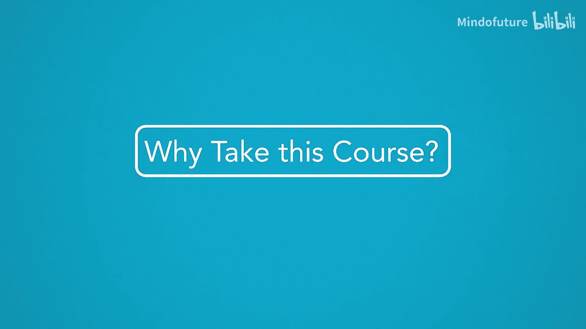
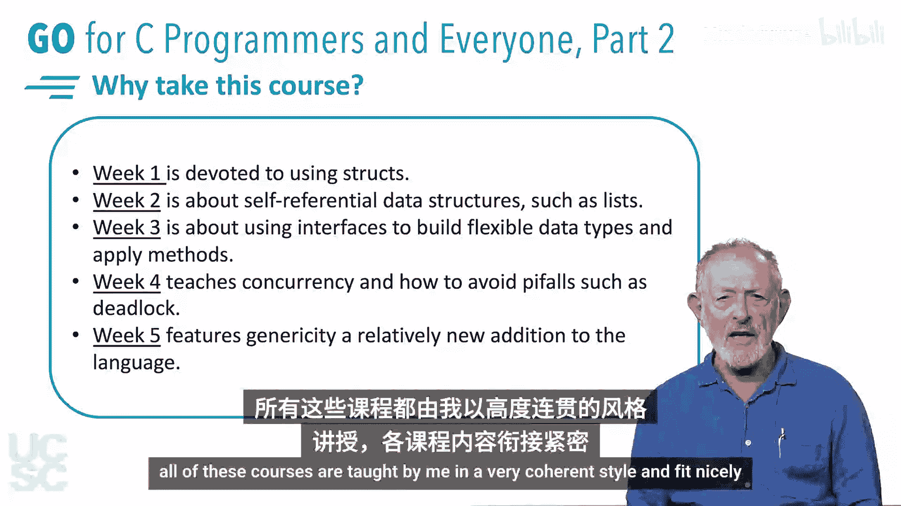
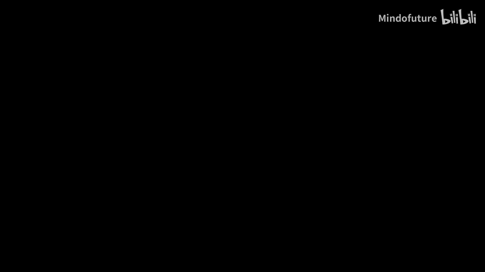

Go语言编程：第二部分：课程介绍与概览

在本节课中，我们将要学习加州大学圣克鲁兹分校的“Go语言编程（面向所有人）”课程第二部分的整体介绍。课程将深入讲解Go语言的高级特性，包括复杂数据结构、接口、并发编程以及泛型。

我是加州大学圣克鲁兹分校的I Raol教授。我邀请大家参加“Go语言编程（面向所有人）”课程的第二部分。

在这门课程中，你将学习如何构建和使用复杂的数据结构，例如结构体（structs）。你还将了解Go语言中一些独特的特性，例如接口（interfaces），以及它们如何用于泛化数据类型。Go语言还允许你在语言内部进行并发编程，这与C/C++必须使用库的方式不同。最后，你将练习使用所有这些高级特性以及Go语言中相对较新的补充——泛型（generics）来编写代码。

本课程为期五周。第一周专注于使用结构体。第二周是关于自引用数据，例如链表。第三周是关于使用接口来构建灵活的数据类型和应用方法。第四周教授并发编程以及如何避免死锁等陷阱。第五周介绍泛型，这是Go语言中相对较新的补充。

每周大约需要五小时的观看和学习时间。如果你是为了获得证书而学习本课程，每周还会有测验和编程作业。

到本课程结束时，你应该能熟练运用Go语言的几乎所有特性。此外，完成课程后将提供证书。

在学习Go语言的同时，也可以学习C/C++。所有这些课程都由我以非常连贯的风格讲授，并且能够很好地衔接在一起。

本节课中我们一起学习了“Go语言编程（面向所有人）”课程第二部分的课程目标、核心内容、时间安排以及学习成果。课程将系统性地引导你掌握Go语言的高级编程技能。