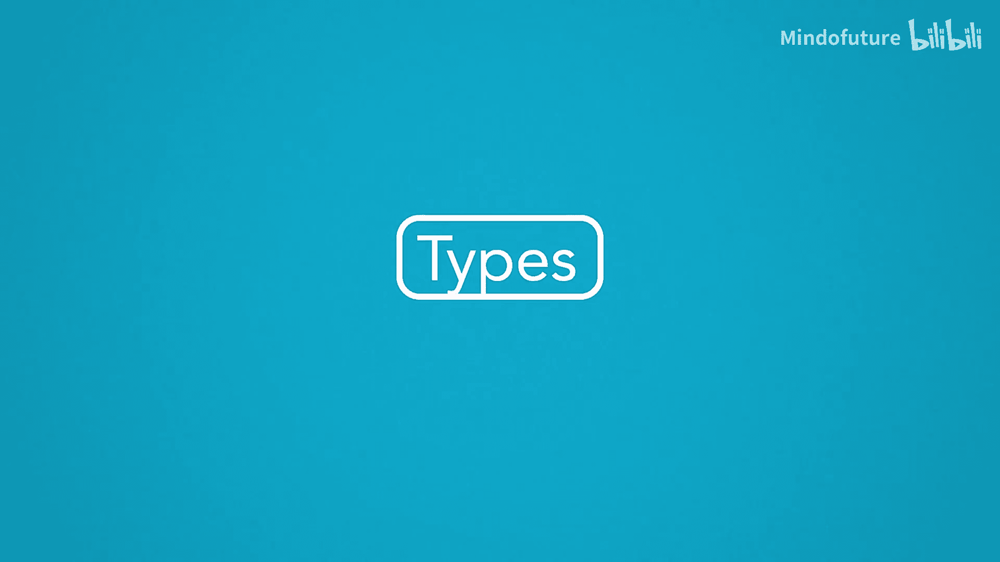
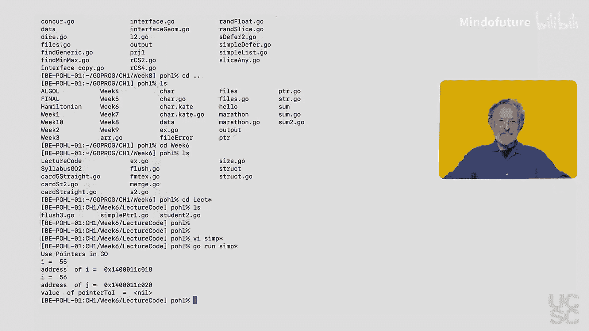

# 002：用户定义类型与指针



## 概述

在本节课中，我们将学习Go语言中用户定义类型的基础知识。我们将了解为什么需要创建自己的类型，以及如何使用类型声明、结构体和指针来实现这一目标。掌握这些概念将使你的代码更清晰、更安全、更易于维护。

## 用户定义类型简介

在上一节中，我们学习了Go语言内置的基本类型，如`int`和`string`。然而，这些标准类型并不能完美地适用于所有问题领域。因此，现代编程语言允许我们创建**用户定义类型**。

通过定义适合特定问题的类型，我们可以获得诸多好处：代码更清晰，类型安全性更高。例如，我们可以定义一个`Card`类型来表示扑克牌，或者定义一个`Student`类型来管理大学里的学生信息。

## 类型声明基础

在Go语言中，我们使用`type`关键字进行类型声明。以下是一个简单的例子：

```go
type TestGrade uint8
```

在这个例子中，我们创建了一个名为`TestGrade`的新类型，它基于`uint8`（无符号8位整数）。你可以将其理解为存储0到100之间的分数。虽然它本质上是一个整数，但通过赋予其特定的类型名称，我们的代码更具可读性，并且能获得一定程度的类型安全，因为它不能轻易地与其他类型进行转换，从而避免了转换错误。

## 深入理解指针

在讲解如何使用结构体创建用户定义类型之前，我们需要进一步理解**指针**，因为指针将与结构体紧密协作，对于使用用户定义类型至关重要。

指针是一个对象的地址。让我们通过一个例子来回顾指针的基本操作：

```go
a := 5          // 创建一个整型变量a，并初始化为5
pointer := &a   // 使用 & 操作符获取变量a的地址，并将其赋值给指针变量
```

变量`a`可以看作一个“邮箱”，里面存放着值`5`。`&a`操作就是获取这个“邮箱”的地址。这个地址通常是一个非常大的数字。

指针变量`pointer`的类型是`*int`（指向整型的指针），而不是`int`。

接下来是**解引用**操作，使用`*`操作符：

```go
value := *pointer // 解引用指针，获取指针指向地址中存储的值，此处为5
```

解引用允许我们通过指针来操作原始变量：

```go
*pointer = *pointer + 1 // 通过指针将a的值增加1
fmt.Println(a)          // 现在a的值是6
```

你需要理解的两个基本操作是：
*   `&`：取地址操作符。
*   `*`：解引用操作符。

## 指针使用示例

以下是展示指针各种用法的简单程序：

```go
package main

import "fmt"

func main() {
    // 声明并初始化一个整型变量
    i := 55
    // 获取变量i的地址并赋值给指针
    pointerToI := &i

    fmt.Println("i 的值:", i)               // 输出: 55
    fmt.Println("pointerToI 的值 (地址):", pointerToI) // 输出一个十六进制地址

    // 通过解引用指针来修改i的值
    *pointerToI = *pointerToI + 1
    fmt.Println("i 的新值:", i) // 输出: 56

    // 指针可以重新指向另一个同类型变量
    j := 100
    pointerToI = &j
    fmt.Println("pointerToI 现在指向 j:", *pointerToI)

    // 指针可以被赋值为 nil，表示不指向任何内存地址
    pointerToI = nil
    fmt.Println("pointerToI 被设置为 nil:", pointerToI)
}
```

运行此程序，你会看到：
1.  变量`i`的初始值。
2.  指针`pointerToI`存储的地址（以十六进制显示）。十六进制常用于表示计算机内存中的大数字。
3.  通过指针解引用修改后，`i`的新值。
4.  指针重新指向变量`j`。
5.  指针被设置为`nil`（空值）。`nil`是Go语言中一个非常重要的特殊常量，常用于表示指针不指向任何有效对象。在后续数据结构（如链表）中，`nil`常被用作结束标志。

**注意**：Go语言的指针与C语言的指针类似，但更安全。例如，Go语言不允许进行指针算术运算，这避免了许多潜在的安全漏洞。

## 总结



本节课我们一起学习了Go语言中用户定义类型的基础。我们首先了解了创建自定义类型的必要性及其优势。接着，我们学习了如何使用`type`关键字进行简单的类型声明。然后，我们深入探讨了指针的核心概念，包括取地址(`&`)和解引用(`*`)操作，并通过一个完整的示例程序演示了指针的声明、赋值、修改和置空(`nil`)。理解这些概念是接下来学习结构体并构建复杂自定义类型的关键基础。