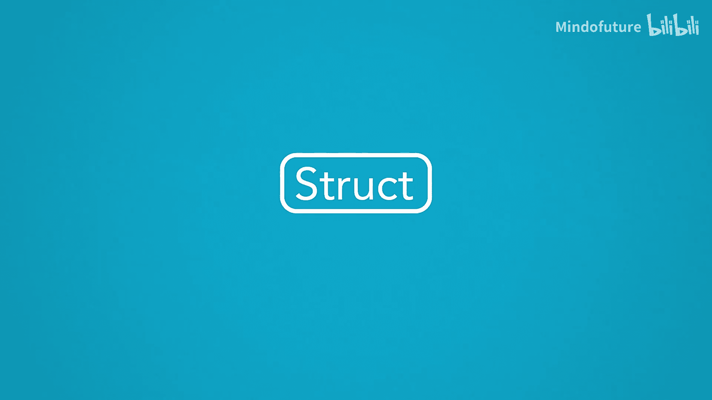
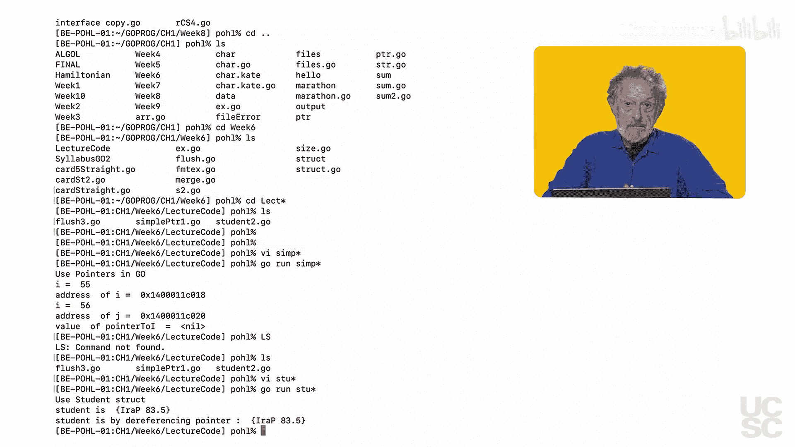

# 003：结构体




在本节课中，我们将要学习Go语言中一个非常重要的概念：结构体。我们将回顾指针的用法，并了解如何使用`type`关键字定义新类型。核心部分将介绍如何通过组合基本类型来创建更复杂的自定义类型——结构体。我们将学习如何声明、初始化和访问结构体，并理解指针在操作结构体时的特殊便利性。

## 结构体的定义与用途 🏗️

上一节我们讨论了指针和简单的类型声明。本节中我们来看看如何创建更有趣的用户自定义类型，这需要用到一种称为“结构体”的机制。

如果你学习过C语言，那么你已经见过结构体。类似结构体的概念也存在于许多其他编程语言中。结构体对于构建更复杂的用户自定义类型至关重要。

以下是定义一个结构体的基本方法。我们将以定义一个`Person`类型为例：

```go
type Person struct {
    Name string
    Address string
    SSN uint64
    Sex bool
}
```

在这个例子中，我们定义了一个`Person`类型。想象一下，在大型公司的软件中，`Person`（作为员工）会是许多应用的核心。我们使用基本类型来定义结构体的各个字段：
*   `Name`字段是字符串类型。
*   `Address`字段是字符串类型。
*   `SSN`（社会保险号）字段是64位无符号整数。
*   `Sex`字段是布尔类型，可以用`true`或`false`表示男性或女性。

需要注意的一点是，我们将`Person`的首字母大写了。这是Go语言风格的一个重要约定。大写意味着这个类型在包中是**可导出**的。如果你的代码将被大量其他软件使用，并且位于一个包中，你通常会希望它是可导出的，这就是我们遵循大写首字母约定的原因。

## 结构体的使用与指针操作 🎯

一旦我们定义了`Person`类型，就可以使用它。这有助于让我们的代码更具可读性。

我们可以声明一个`Person`类型的变量，并通过**点表达式**来访问和赋值其字段：

```go
var p Person
p.Name = "Ira"
p.Address = "123 Main St"
p.SSN = 123456789
p.Sex = true
```

通过为每个独立字段赋值，我们就构建了一个完整的`Person`实例。顺便提一下，你也可以在声明结构体变量时直接进行初始化，我们稍后会看到。

指针在结构体操作中也非常有用。我们可以获取一个结构体变量的地址：

```go
pp := &p // pp 是一个指向 Person 的指针
```

这里有一个非常关键的点：在Go语言中，无论是结构体变量本身，还是指向结构体的指针，都使用**点操作符**来访问字段。

```go
pp.Name = "NewName" // 通过指针访问字段，与 p.Name 效果相同
```

这对于有C语言背景的程序员来说可能有点困惑。在C语言中，我们倾向于使用`指针->字段名`的语法。而在Go中，点操作符对两者都适用，这一点需要牢记。

指针在函数调用中尤为重要。因为Go语言中函数参数是**值传递**的。如果我们想在一个函数内部修改一个结构体，我们不能直接传递结构体本身，因为那样会在函数内部创建一个副本，外部的原始结构体不会被改变。正确的做法是传递指向该结构体的指针，通过指针间接修改，这样函数调用结束后，外部的结构体就能正确反映更改。

## 结构体的历史背景 📜

让我们简单谈谈结构体的历史背景。在20世纪50年代，编程语言主要用于数值计算，最著名的是Fortran。到了60年代，像IBM这样的公司发现很多计算不再纯粹是数值或科学计算，于是开始开发能使用非数值类型的语言。

例如，IBM开发的PL/I语言就包含了结构体类型。从Algol传统发展而来的语言，如Pascal和Algol W（由我的教授Niklaus Wirth设计，他因对编程语言设计的巨大贡献而获得图灵奖），引入了称为“记录”的概念。Pascal在80年代非常成功，是许多学校的基础教学语言。

后来，Dennis Ritchie为开发Unix系统而创造了C语言，他决定使用关键字`struct`而不是`record`，并保留了用`struct`创建用户自定义类型的能力。这个概念一直延续至今，包括Go语言在内的现代语言都继承了它。

## 实践示例：学生结构体 👨‍🎓

让我们看一个具体的例子。我们将定义一个`Student`结构体并学习如何使用它。

```go
package main

import "fmt"

// 定义Student结构体
type Student struct {
    Name string
    GPA  float64
}

func main() {
    // 创建一个Student类型的变量
    var s Student
    // 创建一个指向s的指针
    sp := &s

    // 通过指针初始化字段
    sp.Name = "Ira"
    sp.GPA = 3.5

    // 打印结构体内容
    fmt.Println("Student is:", s)
    // 通过解引用指针打印，结果相同
    fmt.Println("Student is (via pointer):", *sp)
}
```

在这个`main`函数中，我们使用了`Student`结构体。我们创建了一个`Student`类型的变量`s`，以及一个指向它的指针`sp`。我们通过指针初始化了它的字段，然后分别通过变量本身和解引用指针来打印内容，两者结果相同。

理解如何通过指针类型或直接通过结构体变量来操作数据非常重要。当我们想开发更复杂的程序时，结构体组合会很有用。例如，也许`Student`不应该直接包含`Name`字段，而是应该包含一个`Person`类型的字段，因为我们已经定义了`Person`类型。这样，一个学生就是一个`Person`，然后我们额外添加一个`GPA`字段。这体现了结构体组合构建复杂类型的思想。

运行上面的代码，输出结果如下：
```
Student is: {Ira 3.5}
Student is (via pointer): {Ira 3.5}
```

我们可以看到，无论是直接访问变量`s`，还是通过解引用指针`*sp`，打印的结果完全相同。我们必须习惯这两种访问方式。

## 总结 ✨



本节课中我们一起学习了Go语言中的结构体。我们了解了如何通过`struct`关键字将基本类型组合起来，定义出像`Person`或`Student`这样的新类型。我们掌握了结构体的声明、字段初始化以及通过点操作符访问字段的方法。特别重要的是，我们理解了指针在结构体操作中的角色——无论是结构体变量还是指向它的指针，都使用点操作符访问字段，并且传递指针到函数中是修改外部结构体的有效方式。最后，我们通过一个简单的`Student`示例实践了这些概念。结构体是构建Go语言中更复杂数据模型的基石，熟练掌握它对后续学习至关重要。