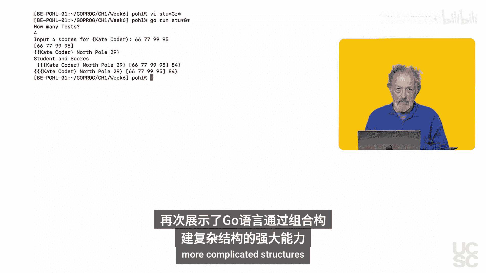
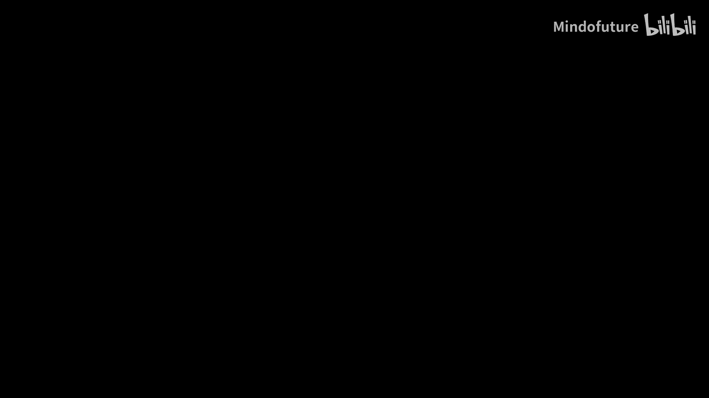

# 004：结构体进阶与组合


在本节课中，我们将要学习如何使用Go语言中的结构体组合来构建更复杂的数据结构。组合是一种非常强大的技术，它允许我们复用已有的结构体来构建新的、功能更丰富的结构体。

## 概述

上一节我们介绍了结构体的基本概念。本节中，我们来看看如何通过组合已有的结构体来创建新的结构体。我们将以“人”和“学生”为例，演示如何利用组合来复用代码和数据。

## 构建复杂数据结构：组合

组合是一种构建复杂数据结构的方式。例如，如果我们已经有一个表示“人”的结构体，并且这个结构体内部可能还包含其他子结构体，那么我们就可以利用这个“人”的结构体来构建一个“学生”结构体。

这样，所有为“人”结构体编写的代码和功能，都可以立即用于操作“学生”结构体。像C++这样更强大的、采用面向对象编程的语言也使用组合。经过长期实践发现，与使用继承来构建复杂结构的面向对象方法相比，组合这种更早期的风格实际上更容易维护。

我们将学习如何从一个“人”结构体构建一个“学生”结构体。

## 定义结构体

首先，我们定义一个简单的`Name`结构体，它包含名和姓。

```go
type Name struct {
    first string
    last  string
}
```

接着，我们使用组合来定义`Person`结构体。`Person`结构体的一个字段就是`Name`类型。

```go
type Person struct {
    name    Name
    address string
    age     int
}
```

`Person`结构体有很多用途，例如在构建员工系统或任何你能想到的软件时，都可以从`Person`开始，并用它来构建你需要的更复杂的软件。

现在，我们来定义`Student`结构体。一个学生当然是一个人，所以`Student`结构体嵌入了`Person`。此外，学生需要参加考试，因此我们添加一个整数切片来存储考试成绩。

```go
type Student struct {
    person      Person
    testScores  []int
    gradeAvg    int
}
```

请注意组合是如何工作的：我们利用已有的`Person`结构体，通过将其作为`Student`的一个字段，构建了更复杂的`Student`数据结构。

## 使用组合结构体

在上一节，我们构建了复杂的数据结构。一些面向对象语言可能会使用继承，但Go语言选择避免完全的面向对象。因此，在Go中构建复杂数据结构时，组合是你最强大的工具。

以下是使用组合结构体的一个例子。我们将为一名学生输入考试成绩。

```go
func inputScores(s *Student, testCount int) {
    fmt.Printf("输入 %d 门考试的成绩:\n", testCount)
    for i := 0; i < testCount; i++ {
        var score int
        fmt.Scanf("%d", &score)
        s.testScores = append(s.testScores, score)
    }
}
```

在这个函数中，我们循环`testCount`次，每次提示用户输入一个成绩，并使用`Scanf`读取它，然后将其添加到学生的`testScores`切片中。

## 为结构体定义方法

除了普通函数，我们还可以为结构体定义方法。当处理结构体时，方法是一种非常典型的编码方式，我们可以将它们视为操作这些结构体的“动词”。

例如，我们想为`Student`结构体计算平均分。以下是`testAverage`方法的实现：

```go
func (s *Student) testAverage() {
    sum := 0
    for _, v := range s.testScores {
        sum += v
    }
    s.gradeAvg = sum / len(s.testScores)
}
```

这个方法接收一个指向`Student`的指针。它使用`for range`循环遍历`testScores`切片中的每个分数，将它们累加到`sum`变量中。然后，通过整数除法`sum / len(s.testScores)`计算出平均分，并存储到`Student`的`gradeAvg`字段中。这种`for range`循环是一种迭代器，无需担心索引问题。

## 主程序流程

现在，我们来看主程序如何将这些部分组合起来。

```go
func main() {
    // 1. 创建一个Person
    p := Person{
        name:    Name{first: "Kate", last: "Coder"},
        address: "North Pole",
        age:     29,
    }

    // 2. 创建一个Student，组合了上面创建的Person
    s := Student{person: p}

    // 3. 询问考试数量
    var testCount int
    fmt.Print("请输入考试数量: ")
    fmt.Scanf("%d", &testCount)

    // 4. 动态分配切片空间并输入成绩
    s.testScores = make([]int, testCount)
    inputScores(&s, testCount)

    // 5. 计算并打印平均分
    s.testAverage()
    fmt.Printf("学生 %s %s 的平均分是: %d\n", s.person.name.first, s.person.name.last, s.gradeAvg)
}
```

程序执行步骤如下：
1.  创建一个名为“Kate Coder”的`Person`实例。
2.  使用这个`Person`实例来初始化一个`Student`。
3.  从用户输入获取考试数量。
4.  使用`make`函数动态分配一个大小为`testCount`的整数切片来存储成绩，然后调用`inputScores`函数输入具体分数。
5.  调用`testAverage`方法计算平均分，并打印结果。

## 程序运行示例

当运行这个程序时，它会首先询问考试数量。假设输入`4`。
接着，程序会提示为学生Kate Coder输入4个成绩。例如，输入`66, 77, 99, 95`。
程序会输出学生的姓名、地址、年龄、所有考试成绩以及计算出的平均分（84分）。

这演示了在Go语言中，使用组合来构建和管理复杂数据结构是多么强大。

## 扩展思考

你可以尝试修改这个程序，为`Student`添加更多字段，例如：
*   专业 (`major`)
*   年级 (`year`，如大二)
你也可以扩展程序来处理多个学生，而不仅仅是一个。

## 总结

本节课中我们一起学习了Go语言结构体的组合。
*   我们了解了组合是一种通过嵌入已有结构体来构建新结构体的强大技术。
*   我们定义了`Name`、`Person`和`Student`结构体，并演示了如何通过组合来复用`Person`的字段。
*   我们学习了如何为结构体定义方法，例如为`Student`计算平均分。
*   最后，我们编写了一个完整的程序，创建学生、输入成绩、计算并输出平均分，展示了组合在实际中的应用。





通过组合，你可以清晰地组织代码，高效地复用已有组件，从而构建出易于维护的复杂数据结构。