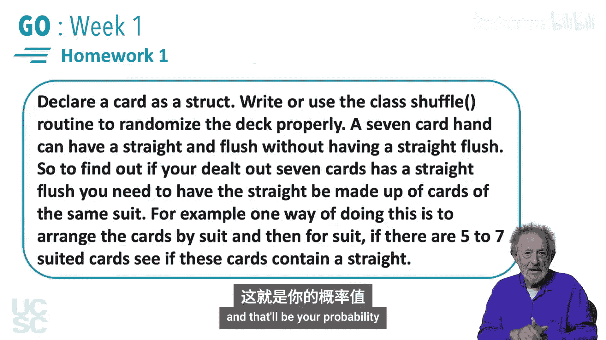

# 006：同行评审作业 - 计算七张牌扑克中同花顺的概率 🃏


## 概述
在本节课中，我们将学习如何使用Go语言和蒙特卡洛模拟方法，来计算七张牌扑克中出现同花顺的概率。我们将从构建扑克牌数据结构开始，实现随机洗牌算法，并最终通过大量模拟试验来估算这一稀有事件的概率。

## 构建扑克牌数据结构
上一节我们提到了概率计算的目标，本节中我们来看看如何用代码表示一副扑克牌。为了高效地模拟发牌和判断牌型，我们需要先定义牌的花色和点数。

以下是定义扑克牌类型的代码示例：
```go
// 定义花色类型，使用iota生成枚举值
type Suit int
const (
    Club Suit = iota // 梅花，值为0
    Diamond          // 方块，值为1
    Heart            // 红心，值为2
    Spade            // 黑桃，值为3
)

// 定义单张牌的结构体
type Card struct {
    suit  Suit  // 花色
    value int   // 点数，通常为1到13（A到K）
}
```
在这段代码中，我们使用`iota`为四种花色生成了连续的整数值，并用结构体`Card`将花色和点数组合在一起，形成一张完整的牌。

## 实现随机洗牌算法
定义好牌之后，我们需要一个方法来随机打乱牌的顺序。在真实的扑克中，简单的“鸽尾式洗牌”往往无法达到真正的随机，因此我们需要在代码中实现一个能保证随机性的算法。

以下是实现高效随机洗牌的代码：
```go
func shuffleDeck(deck []Card) {
    rand.Seed(time.Now().UnixNano()) // 初始化随机数种子
    for i := range deck {
        j := rand.Intn(i + 1)        // 生成一个随机位置
        deck[i], deck[j] = deck[j], deck[i] // 交换两张牌的位置
    }
}
```
这个算法遍历牌堆，将每张牌与一个随机位置（包括它自身）的牌进行交换。Go语言特有的多重赋值语法`deck[i], deck[j] = deck[j], deck[i]`使得交换操作无需临时变量，既简洁又高效。

## 设计蒙特卡洛模拟流程
有了随机牌堆，我们就可以开始模拟发牌和判断牌型的过程了。由于同花顺是极其罕见的事件，我们需要进行数百万次试验才能得到一个稳定的概率估计。

以下是模拟流程的核心步骤：
1.  **初始化与洗牌**：创建一副52张牌并按上述算法洗牌。
2.  **发牌**：从洗好的牌堆中发出7张牌，构成一手牌。
3.  **判断同花**：检查这7张牌中是否有至少5张是同一花色。如果没有，则本次试验失败。
4.  **判断顺子**：在满足同花的牌中，检查是否存在至少5张点数连续（构成顺子）的牌。例如，红心4、5、6、7、8。
5.  **记录结果**：如果同时满足同花和顺子，则记录一次“同花顺”事件。

**关键点**：一手牌中可能包含超过5张的同花牌（如6张或7张同花），也可能包含多个潜在的顺子组合。在评估时，取其中最高的同花顺作为该手牌的牌力。例如，`10, J, Q, K, A` 组成的“皇家同花顺”是最高牌型。

## 运行模拟与计算概率
按照上述流程，我们可以编写一个循环来执行大量试验。

以下是计算概率的公式：
**概率 ≈ （发生同花顺的次数） / （总模拟次数）**

例如，如果运行1000万次模拟，其中发生了`x`次同花顺，那么估算的概率就是 **`x / 10,000,000`**。模拟次数越多，得到的结果就越接近真实的理论概率。



## 总结
本节课中我们一起学习了如何用Go语言解决一个复杂的概率计算问题。我们从定义扑克牌的基本数据结构开始，实现了一个高效的随机洗牌函数。接着，我们设计了蒙特卡洛模拟的核心流程，通过“判断同花”和“判断顺子”两个步骤来检测稀有的同花顺牌型。最后，通过运行海量模拟试验并统计频率，我们能够估算出七张牌扑克中出现同花顺的概率。这个方法不仅适用于扑克，也是解决许多复杂统计和概率问题的强大工具。