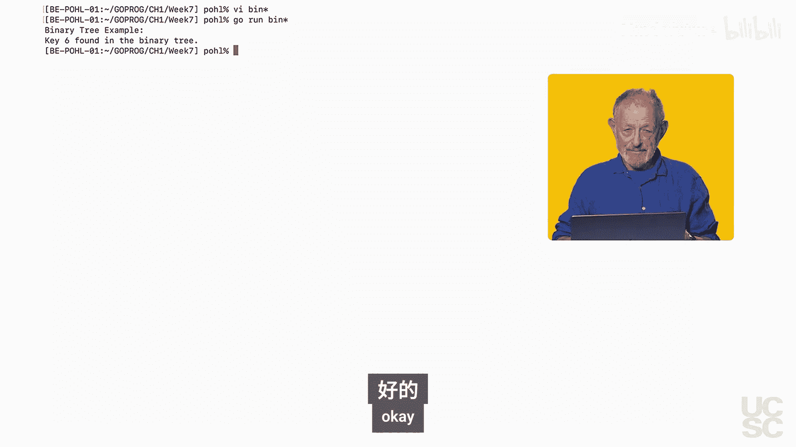

# 009：二叉树


## 概述

在本节课中，我们将要学习一种更复杂的自引用数据结构——二叉树。我们将了解它的结构、用途，并学习如何在Go语言中实现二叉树的创建、插入和搜索功能。

## 什么是二叉树？🌳

上一节我们介绍了线性链表，它是一种非常重要的数据结构。本节中我们来看看二叉树。

二叉树是一种稍微复杂的自引用数据结构，在计算领域有许多用途。在线性链表中，每个节点有一个指向下一个元素的指针。而二叉树更复杂的地方在于，每个节点有两个指针，分别指向其左子节点和右子节点。这使得二叉树能够呈指数级增长，这一特性对其某些用途至关重要。

二叉树有一个根节点，然后有左、右子节点，这由两个指针表示。一个典型的二叉树可以容纳n个元素。与需要遍历n个元素的线性链表不同，在二叉树中，你需要遍历的路径长度大约是log₂(n)。这要短得多。例如，如果你有1000个元素，log₂(1000)大约是10。因此，在一个相当平衡的二叉树中，你可以存储一千个元素，而搜索最多可能只需要经过10个链接。这使得树成为一种非常高效的数据结构，用于维护、访问和更新大量数据，因此它在计算机科学和算法中极其有用。

视觉上，二叉树看起来像这样：有一个根节点，有左、右子节点。每个树元素最多可以有两个子节点。当然，也有更一般化的结构，比如三叉树或具有任意数量子节点的树。但二叉树是最有用的，因为它已经具有深度大约为log n的特性。

有可能出现一种倾斜的二叉树，例如，只有左子节点，那么元素最终看起来就像一条向左延伸的线性链表，所有右指针都是空的。但这会非常倾斜，并且不那么有用。

## 在Go中定义二叉树节点

现在让我们看看如何实际构建它。在Go语言中，我们有一个节点。与线性链表节点不同，二叉树节点有一个存放数据的地方（当然，键值可以远不止一个整数，可以是一整批数据），然后有左子节点和右子节点。这是自引用的。树的头部当然也是一个指向节点的指针。所以，一个指向节点的指针是头部，然后每个内部节点都有左、右子节点。

以下是节点结构的定义：

```go
type Node struct {
    key   int
    left  *Node
    right *Node
}
```

## 向二叉树插入节点

接下来，我们想看看如何向二叉树插入一个节点，实际上也就是如何构建一个节点。这将是一个有序的二叉树。我们将把较小的键推到左边，较大的键推到右边。这将使我们以后能够有效地在二叉树中搜索一个键。

以下是插入的逻辑步骤：

首先，检查二叉树是否为空。一个空的二叉树其根节点为nil（记住，nil是空指针的通用值）。如果它是空的，那么我们必须创建二叉树，实际上是创建二叉树的根节点。这意味着我们返回一个节点的地址，其中键是键元素，左元素是nil，右元素是nil。所以它没有子节点，只是一个用键创建的单节点。这是因为二叉树最初是空的。

如果二叉树不为空，那么我们在键值上进行搜索。如果键小于根的键，那么我们进行插入操作，并将其赋值给左指针值。否则，我们进行插入操作，并将其赋值给右指针。这是一个非常简单的例程，有三种情况：树为空，则通过创建根节点来创建树；树不为空，则判断是向右还是向左；如果向右，则在右侧插入，否则在左侧插入。

以下是插入函数的代码：

```go
func insert(root *Node, key int) *Node {
    if root == nil {
        return &Node{key: key, left: nil, right: nil}
    }
    if key < root.key {
        root.left = insert(root.left, key)
    } else {
        root.right = insert(root.right, key)
    }
    return root
}
```

## 在二叉树中搜索节点

现在我们将尝试搜索二叉树中现有的键。这里我们将使用递归。就像递归在线性链表情况下很有用一样，递归在这些自引用数据结构中非常有用。递归是一种非常自然的控制流形式。并不是说你不能将其转换为使用循环的东西，但逻辑更适合递归。

同样，我们将尝试在树中查找一个键。一种可能性是键不存在。如果根是nil，那么我们不可能有这个键，也没有东西可搜索。所以一个基本情况是返回false，如果没有东西可搜索了。否则，我们必须将要搜索的键与根的键进行比较。如果找到了，我们可以停止，并可以说找到了，返回true。顺便说一下，你也可以返回该值的位置，即持有该键的节点，因为可能你想对它进行一些更新或进一步的操作。当然，另一种情况是我们没有找到键。所以我们不能停止，然后我们利用树已被排序的特性，如果键小于根键，我们向左走；如果键不小于根键，我们向右走。然后我们执行递归步骤，即`search(root.left, key)`或`search(root.right, key)`。这就是递归。最终，它要么以返回true（如果找到键）停止，要么以返回false（如果一切最终到达叶节点，叶节点是nil）停止。

以下是搜索函数的代码：

```go
func search(root *Node, key int) bool {
    if root == nil {
        return false
    }
    if key == root.key {
        return true
    }
    if key < root.key {
        return search(root.left, key)
    }
    return search(root.right, key)
}
```

## 使用示例：构建与搜索

现在让我们看看如何使用它并展示它。我们将从一个根开始，根只是一个指向节点的指针。这里是我们想要插入的键，我们将有一个整数切片，其中有八个键，它们将出现在那棵树中。然后，遍历该切片，我们将进行插入，插入就是我们构建树的方式。我们之前已经看过插入操作。一旦我们构建了一棵树，我们将进行搜索，寻找`searchKey = 6`。当然，我们看到6在构建部分被放入了树中，所以我们会说它被找到了。否则，我们就找不到它，但在这个例子中，我们会找到它。这是一个简单的二叉树使用示例，展示了如何创建它，如何搜索它。

以下是主函数的示例代码：

```go
func main() {
    var root *Node
    keys := []int{8, 3, 10, 1, 6, 14, 4, 7, 13}

    for _, key := range keys {
        root = insert(root, key)
    }

    searchKey := 6
    if search(root, searchKey) {
        fmt.Printf("键 %d 已在二叉树中找到。\n", searchKey)
    } else {
        fmt.Printf("键 %d 未在二叉树中找到。\n", searchKey)
    }
}
```

## 代码运行与总结

现在让我们转向运行代码。我们将运行代码，展示如何构建这棵有序树（记住它是有序的，因为我们可以比较键并向左或向右走，并且我们可以递归地搜索它）。稍后，我们可能会看看如何构建一种称为平衡树的东西，这对于搜索和更新更高效。

让我们看看我终端上二叉树程序的代码。同样，是自引用数据结构。所以一个节点里面只嵌入了节点。它有左部分和右部分，两者都是指针，然后是键信息，在我们的简单例子中只是一个int，但显然，如果你想构建一个庞大的数据库，那本身可能是一个非常复杂的结构。这是插入函数。插入的第一部分是，哦，我们还没有树。所以我们必须创建树。这就是为什么我们返回一个`&Node{}`，并用信息nil、nil作为左、右节点来构建一个键。否则，我们向左或向右查找。根据键的位置，我们向左或向右走，并在适当的位置执行插入，以便该树通过这个左右过程进行排序。最后，我们再次展示了一个递归，在其中我们可以返回是否能在树中找到键。这是一个非常简单的搜索。我们实际上并没有返回节点，我们只是说是真还是假。键位于树中的某个地方，我们必须找到它，我们通过首先查看树（如果我们所在的位置是空的，即nil）来找到它，那么我们没有找到它，所以我们返回false。否则，我们进行左、右搜索。首先看看是否找到了键。所以`==`是测试`root.key`是否等于`key`，然后我们返回true，表示找到了。否则，我们必须向左或向右走。在每种情况下，我们都递归地调用该例程。所以最终，我们将以false或true结束。这是我们的主函数。我们正在从一个切片构建一棵树。该切片有九个值，所以将有一个包含九个节点的二叉树。我们对键的范围进行`for`循环，将各个键插入到二叉树中。然后我们尝试看看是否能找到6。所以如果一切正常，6将产生true。它会说`printf`，`printf`会说它已在二叉树中找到。否则，就没有找到。在这个Go代码中，它真的是一个非常简单的二叉树实现，具有插入和搜索功能。让我们试着运行一下代码。你看到的是，确实，键已在二叉树中找到。非常简单，容易完成，你应该尝试玩一下这个例子。




本节课中我们一起学习了二叉树的基本概念、在Go语言中的结构定义、节点的插入与搜索算法。通过递归，我们能够优雅地处理这种自引用数据结构。理解二叉树是学习更复杂树形结构（如平衡树）的重要基础。