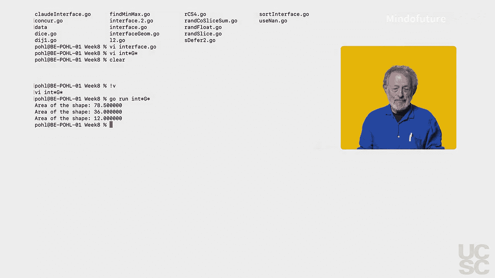

# 013：接口 03 01 01 🧩

在本节课中，我们将要学习Go语言中一个独特且强大的概念——**接口**。接口是一种抽象的类型规范，它允许我们定义一组方法，任何实现了这些方法的类型都自动满足该接口。这使得我们可以编写更通用、更灵活的代码。

## 接口的定义与概念

上一节我们介绍了方法，本节中我们来看看如何通过接口实现多态。接口在Go语言中是一个新颖的主题，在其他语言（如C语言）中并不常见。

接口是一种**抽象类型规范**。它允许你为某一类类型提供一个“配方”，这些类型必须**隐式地匹配**接口的规范。一旦某个类型匹配了接口，编译器就能识别它，而无需你显式声明。这种方式有时也被称为**鸭子类型**。

以下是定义一个名为 `shape` 的接口的示例：

```go
type Shape interface {
    Area() float64
}
```

这个接口规定，任何想要成为 `Shape` 的类型，都必须拥有一个名为 `Area`、返回 `float64` 类型的方法。

## 实现接口的具体类型

现在，让我们看看哪些具体类型可以实现这个 `Shape` 接口。

### 圆形 (Circle)

首先，我们定义一个表示圆形的结构体：

```go
type Circle struct {
    Radius float64
}
```

接着，我们为 `Circle` 类型实现 `Area` 方法：

```go
func (c Circle) Area() float64 {
    return 3.14 * c.Radius * c.Radius
}
```

### 正方形 (Square)

然后，我们定义一个表示正方形的结构体：

```go
type Square struct {
    Side float64
}
```

同样，为其实现 `Area` 方法：

```go
func (s Square) Area() float64 {
    return s.Side * s.Side
}
```

### 矩形 (Rectangle)

最后，我们定义一个表示矩形的结构体：

```go
type Rectangle struct {
    Width, Height float64
}
```

为其实现 `Area` 方法：

```go
func (r Rectangle) Area() float64 {
    return r.Width * r.Height
}
```

## 接口带来的多态性

接口为我们提供了一种**多态**的形式，即编写可以用于一系列类型的代码，只要这些类型满足接口规范。

以下是使用接口的示例：

```go
func main() {
    c := Circle{Radius: 5}
    s := Square{Side: 6}
    r := Rectangle{Width: 3, Height: 4}

    shapes := []Shape{c, s, r}

    for _, shape := range shapes {
        fmt.Println(shape.Area())
    }
}
```

在这段代码中：
1.  我们创建了三个具体类型的实例：`Circle`、`Square` 和 `Rectangle`。
2.  我们将它们全部存储在一个 `Shape` 类型的切片中。这正是多态的体现，因为所有这三种类型都满足 `Shape` 接口。
3.  通过一个简单的 `for` 循环，我们可以遍历切片中的每个形状并计算其面积，而无需关心它们的具体类型。

## 运行示例与总结

当我们运行上述程序时，会得到每个形状的面积计算结果。

本节课中我们一起学习了Go语言接口的核心概念。我们了解到：
*   接口是一种定义方法集合的抽象类型。
*   任何实现了接口所有方法的类型都隐式地满足了该接口。
*   利用接口可以实现多态，编写出更通用、更灵活的代码，例如将不同类型的对象存储在同一个切片中并进行统一处理。




接口是Go语言强大类型系统的关键组成部分，掌握它将帮助你构建更模块化和可扩展的程序。