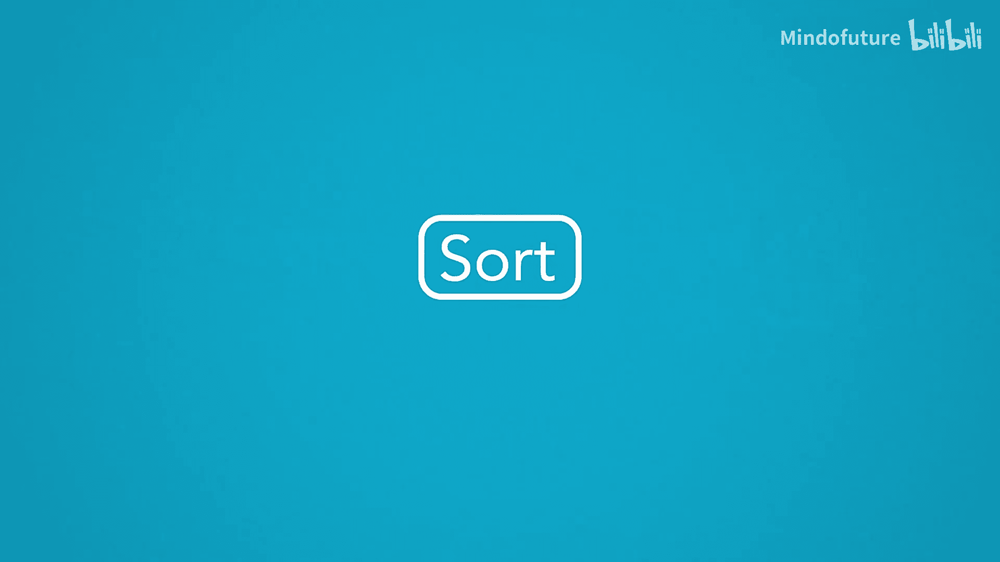
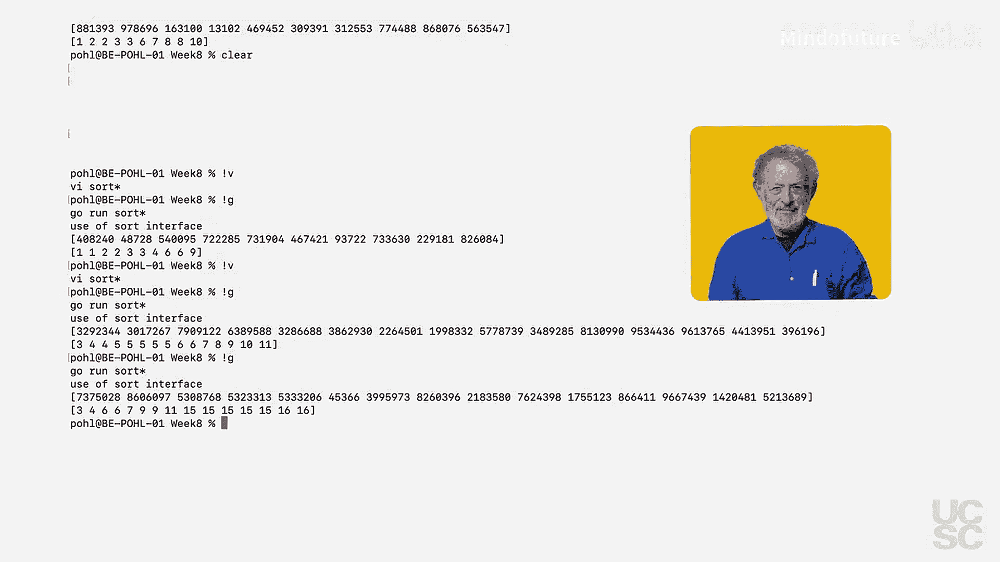

# 014：排序接口详解 🧑‍💻



在本节课中，我们将学习Go语言中一个非常重要的接口——`sort.Interface`。我们将了解排序在计算中的重要性，并学习如何通过实现三个核心方法来使自定义类型支持排序。

排序是计算科学中最重要的话题之一。当需要处理海量数据时，例如美国社会保障局需要管理数亿人的信息，高效查找数据的能力至关重要，而这通常要求数据是有序的。因此，高效的排序算法是核心。幸运的是，Go语言的`sort`包提供了易于使用的接口，允许我们利用专家编写的、高效的排序算法（通常是快速排序的变体）来排序自定义类型。

上一节我们介绍了接口类型排序的概念，本节中我们来看看`sort.Interface`接口的具体要求。

## 排序接口的要求

要对数据进行排序，需要满足三个基本条件：
1.  需要知道待排序元素的数量。
2.  需要知道如何比较两个元素的顺序。
3.  需要能够交换两个元素的位置。

Go语言的`sort.Interface`接口正是定义了这三个方法。

以下是`sort.Interface`接口的定义：
```go
type Interface interface {
    Len() int
    Less(i, j int) bool
    Swap(i, j int)
}
```
*   `Len()` 返回集合中元素的数量。
*   `Less(i, j int) bool` 判断索引`i`的元素是否应排在索引`j`的元素之前。
*   `Swap(i, j int)` 交换索引`i`和`j`的两个元素。

任何实现了这三个方法的类型，都可以使用`sort`包中的排序功能。

## 实现排序接口

让我们通过一个具体例子来实践。我们将定义一个名为`data`的类型，它只是一个整数切片，并为其实现`sort.Interface`接口。

以下是实现代码：
```go
type data []int

func (d data) Len() int {
    return len(d)
}

func (d data) Less(i, j int) bool {
    return d[i] < d[j]
}

func (d data) Swap(i, j int) {
    d[i], d[j] = d[j], d[i]
}
```
*   `Len()`方法直接返回切片的长度。
*   `Less()`方法使用小于运算符`<`比较两个整数。
*   `Swap()`方法利用了Go语言的多重赋值特性，无需临时变量即可交换两个元素的值。

## 排序实践与性能演示

现在，我们将使用这个实现了接口的类型进行排序，并观察其性能。

以下是完整的演示程序步骤：
1.  生成一个包含大量随机整数的`data`切片。
2.  打印排序前的前几个元素，确认其无序状态。
3.  调用`sort.Sort()`函数对数据进行排序。
4.  打印排序后的前几个元素，验证排序结果。

```go
package main

import (
    "fmt"
    "math/rand"
    "sort"
    "time"
)

func main() {
    // 定义元素数量
    const numElements = 1000000 // 可尝试修改为 10000000
    rand.Seed(time.Now().UnixNano())

    // 生成随机数据
    d := make(data, numElements)
    for i := range d {
        d[i] = rand.Intn(numElements)
    }

    // 打印排序前的前10个元素
    fmt.Println("Unsorted (first 10):", d[:10])

    // 执行排序
    sort.Sort(d)

    // 打印排序后的前10个元素
    fmt.Println("Sorted (first 10):", d[:10])
}
```
运行此程序，你会看到程序几乎能瞬间完成对一百万甚至一千万个整数的排序，这充分展示了Go标准库排序算法的高效性。




本节课中我们一起学习了Go语言的`sort.Interface`接口。我们理解了排序的重要性，掌握了实现该接口所需的三个核心方法：`Len()`、`Less()`和`Swap()`，并通过一个整数切片的例子实践了如何让自定义类型支持排序。最后，我们见证了Go标准库排序算法处理海量数据时的高效性能。通过实现这个接口，你可以轻松地对任何自定义数据类型进行排序。