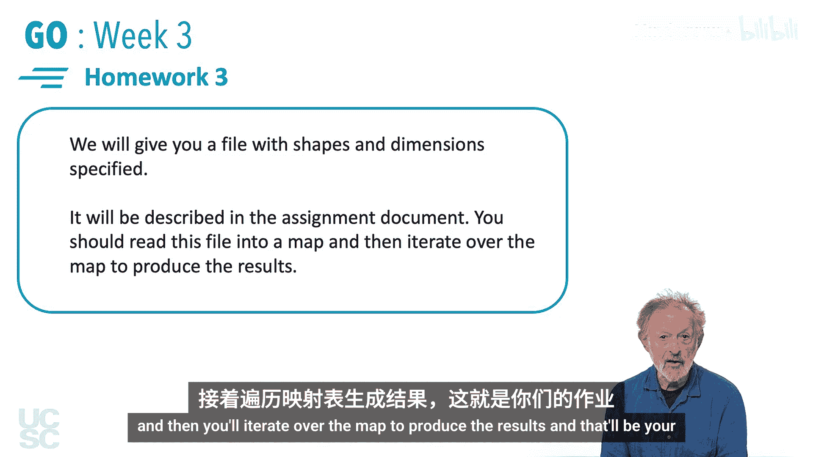

# 016：使用接口与映射计算立体体积 📐


在本节课中，我们将学习如何编写一个Go程序来计算不同立体图形的体积。我们将重点运用本周学习的核心概念——**接口**，以及一个非常有用的数据结构——**映射**。

## 概述

我们将创建一个程序，能够计算球体、立方体和金字塔的体积。为了实现这个目标，我们需要定义一个名为 `Solid` 的接口，并创建一个映射来存储不同形状的立体图形及其对应的体积计算方法。

## 定义接口与结构体

上一节我们介绍了本次作业的目标。本节中，我们来看看如何定义所需的接口和具体形状的结构体。

首先，我们需要定义一个 `Solid` 接口。该接口要求实现一个返回 `float64` 类型的 `Volume` 方法。

```go
type Solid interface {
    Volume() float64
}
```

接下来，我们为三种立体图形定义对应的结构体。

*   **球体 (Sphere)**：拥有一个半径字段。
    ```go
    type Sphere struct {
        Radius float64
    }
    ```
*   **立方体 (Cube)**：拥有一个边长字段。
    ```go
    type Cube struct {
        Length float64
    }
    ```
*   **金字塔 (Pyramid)**：我们假设金字塔的底面为正方形，因此它需要底面边长和高两个字段。
    ```go
    type Pyramid struct {
        Base   float64
        Height float64
    }
    ```

## 实现体积计算方法

定义了结构体之后，我们需要为它们分别实现 `Solid` 接口所要求的 `Volume` 方法。以下是每种形状的体积计算公式。

*   **立方体体积**：边长的三次方。
    ```go
    func (c Cube) Volume() float64 {
        return c.Length * c.Length * c.Length
    }
    ```
*   **球体体积**：公式为 `(4/3) * π * r³`。在Go中，我们可以使用 `math.Pi` 来获取π的值。
    ```go
    import "math"
    func (s Sphere) Volume() float64 {
        return (4.0 / 3.0) * math.Pi * s.Radius * s.Radius * s.Radius
    }
    ```
*   **金字塔体积**：对于底面为正方形的金字塔，其体积公式为 `(底边长² * 高) / 3`。
    ```go
    func (p Pyramid) Volume() float64 {
        return (p.Base * p.Base * p.Height) / 3.0
    }
    ```

## 使用映射存储与遍历

现在我们已经有了可以计算体积的各种形状。本节我们将学习如何使用映射来组织这些数据，并遍历它们以输出结果。

我们将创建一个映射，其键（Key）是表示形状名称的字符串，值（Value）是实现了 `Solid` 接口的类型。

```go
solidsMap := make(map[string]Solid)
// 示例：向映射中添加形状
solidsMap["小球"] = Sphere{Radius: 2.5}
solidsMap["方盒"] = Cube{Length: 3.0}
solidsMap["金字塔"] = Pyramid{Base: 4.0, Height: 6.0}
```

我们需要编写一个函数来遍历这个映射，并打印每个形状的名称及其体积。

```go
func printVolumes(solids map[string]Solid) {
    for name, solid := range solids {
        fmt.Printf("%s 的体积是：%.2f\n", name, solid.Volume())
    }
}
```

## 从文件读取数据

在实际的作业中，形状及其尺寸信息将被存储在一个文件中。以下是处理流程。

1.  按照作业文档描述的格式读取文件。
2.  根据读取到的数据，创建相应的结构体实例（如 `Sphere`、`Cube` 或 `Pyramid`）。
3.  将这些实例添加到之前定义的 `map[string]Solid` 映射中。
4.  最后，调用 `printVolumes` 函数输出所有形状的体积计算结果。

## 总结



本节课中我们一起学习了如何利用Go语言的接口和映射来解决一个实际问题——计算多种立体图形的体积。我们定义了 `Solid` 接口，为三种不同的形状实现了该接口，并使用映射来灵活地存储和管理这些形状。最后，我们还探讨了如何从外部文件读取数据来填充我们的程序。通过这个练习，你应该对接口的用法和映射数据结构的强大之处有了更深入的理解。