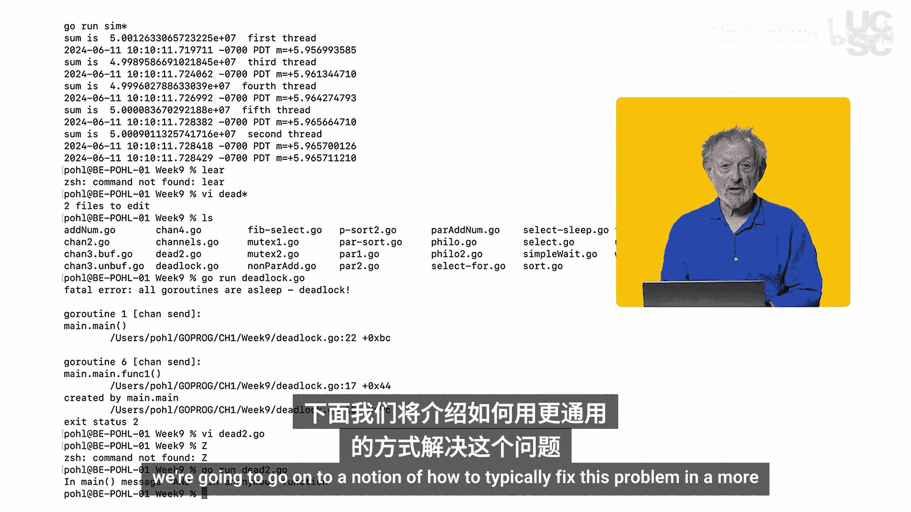

# 018：死锁


## 概述
在本节课中，我们将要学习并发编程中的一个常见且棘手的问题：死锁。我们将通过一个具体的Go程序示例来理解死锁是如何发生的，以及如何识别和避免它。

编写并发程序的一个难点在于调试。在单线程的非并发程序中，我们可以通过逐步跟踪代码来检查每一步的执行结果。然而，在并发程序中，多个线程（goroutine）独立运行，它们之间的交互方式难以预测。因此，即使单个线程工作正常，线程间的交互也可能引发问题。其中一个关键问题就是死锁。

## 什么是死锁？🧐
死锁涉及多个线程相互等待对方释放资源。一个经典的比喻是两个法国人在门口互相礼让，都说“您先请”，结果两人都无法通过，形成了僵局。在程序中，当多个goroutine竞争同一资源（如通道），并且没有明确的顺序来决定谁先执行时，就可能发生死锁。

在某些情况下，Go运行时会检测到死锁并触发`panic`，这是一种运行时错误，会停止程序并给出错误信息。但有时，死锁就像那两个法国人一样，程序会永远等待下去，看起来像是陷入了无限循环。这时，你只能从外部（例如在Unix系统中使用`Ctrl+C`）终止程序。

## 一个死锁示例 🔄
下面是一个会导致死锁的简单Go程序。我们将创建两个通道和两个goroutine（主goroutine和一个匿名goroutine），它们试图通过通道交换消息，但由于顺序错误而相互等待。

```go
package main

import "fmt"

func main() {
    c1 := make(chan string)
    c2 := make(chan string)

    go func() {
        mess := "in anonymous function"
        c1 <- mess
        stress := <-c2
        fmt.Println(mess, stress)
    }()

    mess := "in main message"
    c2 <- mess
    stress := <-c1
    fmt.Println(mess, stress)
}
```

### 代码解析
*   `c1`和`c2`是两个无缓冲的字符串通道。
*   匿名goroutine试图将消息`mess`发送到`c1`，然后从`c2`接收消息到`stress`，最后打印两者。
*   主goroutine将消息发送到`c2`，然后从`c1`接收消息，最后打印。

问题在于发送和接收操作的顺序不匹配，导致两个goroutine都在等待对方先发送数据，从而形成死锁。

运行此程序，你会看到类似以下的错误：
```
fatal error: all goroutines are asleep - deadlock!
```

## 如何修复死锁？🔧
要修复这个死锁，我们需要确保通信的顺序一致，避免循环等待。修改后的版本如下：

```go
package main

import "fmt"

func main() {
    c1 := make(chan string)
    c2 := make(chan string)

    go func() {
        mess := "in anonymous function"
        c1 <- mess
        stress := <-c2
        fmt.Println(mess, stress)
    }()

    mess := "in main message"
    stress := <-c1 // 先接收
    c2 <- mess     // 后发送
    fmt.Println(mess, stress)
}
```

### 修复解析
在修复版本中，我们调整了主goroutine中的操作顺序：
1.  主goroutine首先从`c1`接收数据（对应匿名goroutine的发送）。
2.  然后主goroutine向`c2`发送数据（对应匿名goroutine的接收）。

这个顺序与匿名goroutine中的操作顺序（先发后收）相匹配，从而避免了相互等待。

运行修复后的程序，你会发现程序正常执行完毕。但请注意，由于主goroutine没有等待匿名goroutine完成（例如使用`sync.WaitGroup`），你可能只会看到主goroutine的打印输出，匿名goroutine的输出可能在程序退出前来不及打印。




## 总结
本节课我们一起学习了并发编程中的死锁问题。我们了解到死锁是多个goroutine因相互等待资源而无法继续执行的状态。通过一个具体的代码示例，我们看到了死锁是如何因通信顺序错误而产生的，并学习了通过调整通道操作的顺序来避免死锁。请记住，在编写并发代码时，仔细规划goroutine间的通信顺序至关重要。在后续课程中，我们将探索更多协调并发任务的方法。