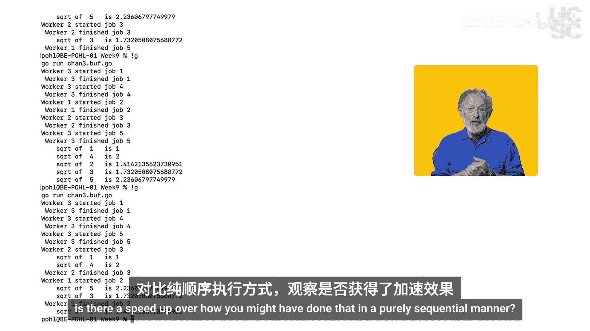

# 019：工作者模式


## 概述

在本节课中，我们将要学习Go语言中一个更复杂的并发与并行模式：工作者模式。我们将创建多个工作者（goroutine）来处理一系列任务，并使用带缓冲的通道来协调它们的工作，以避免程序死锁。

## 工作者模式架构

上一节我们介绍了基础的并发概念，本节中我们来看看如何构建一个实际工作的并发系统。我们的架构包含以下核心部分：

*   **工作者**：即goroutine，它们是执行具体任务的线程。
*   **任务**：需要被计算的具体工作项。
*   **通道**：用于在工作者和主程序之间传递任务和结果。

我们需要确保任务能够被工作者有效处理。在这种情况下，我们需要使用一种更复杂的通道：**带缓冲的通道**。

## 带缓冲的通道与死锁

如果使用无缓冲通道，并且任务数量超过工作者数量，程序可能会发生**死锁**。死锁是指所有goroutine都在等待对方，导致程序无法继续执行。Go运行时通常会检测到这种情况并报告panic。

为了避免死锁，并且因为我们知道希望同时运行的任务数量，我们可以在创建通道时指定其缓冲区大小。这决定了通道中可以暂存多少条消息。

**代码示例：创建带缓冲的通道**
```go
jobs := make(chan int, numJobs)       // 任务通道，缓冲区大小为任务总数
results := make(chan ResultType, numJobs) // 结果通道，缓冲区大小同样为任务总数
```

## 程序设计与实现

我们将编写一个程序，计算一系列整数的平方根。这比简单的`sleep`操作更具实际意义。

### 定义数据结构

首先，我们定义一个结构体来封装计算结果。通过自定义结构体，我们可以在通道中传递多个信息。

**代码示例：定义结果结构体**
```go
type sqrtResult struct {
    number int     // 要计算平方根的原始数字
    answer float64 // 计算得到的平方根结果
}
```

### 工作者函数

工作者函数负责接收任务、执行计算并返回结果。

以下是工作者函数的核心逻辑：
1.  接收一个工作者ID、一个任务输入通道和一个结果输出通道。
2.  循环从`jobs`通道中读取任务。
3.  对每个任务（整数`j`）计算其平方根。注意，`math.Sqrt`函数接收`float64`类型参数，因此需要进行类型转换。
4.  将计算结果封装成`sqrtResult`结构体，并发送到`results`通道。
5.  所有任务完成后，打印退出信息。

**代码示例：工作者函数**
```go
func worker(id int, jobs <-chan int, results chan<- sqrtResult) {
    for j := range jobs {
        fmt.Printf("worker %d started job %d\n", id, j)
        // 执行计算：计算整数j的平方根
        result := math.Sqrt(float64(j))
        // 将结果发送到通道
        results <- sqrtResult{number: j, answer: result}
        fmt.Printf("worker %d finished job %d\n", id, j)
    }
    fmt.Printf("worker %d exiting\n", id)
}
```

### 主函数逻辑

在主函数中，我们设置任务和工作者，并启动整个流程。

以下是主函数的步骤：
1.  定义任务总数和工作者数量。
2.  创建带缓冲的任务通道和结果通道。
3.  启动指定数量的工作者goroutine。
4.  将所有任务发送到`jobs`通道。
5.  从`results`通道接收所有结果并打印。
6.  关闭通道，释放资源。

**代码示例：主函数**
```go
func main() {
    const numJobs = 5
    const numWorkers = 3

    jobs := make(chan int, numJobs)
    results := make(chan sqrtResult, numJobs)

    // 启动工作者
    for w := 1; w <= numWorkers; w++ {
        go worker(w, jobs, results)
    }

    // 发送任务
    for j := 1; j <= numJobs; j++ {
        jobs <- j
    }
    close(jobs) // 任务发送完毕，关闭通道

    // 接收结果
    for r := 1; r <= numJobs; r++ {
        result := <-results
        fmt.Printf("square root of %d is %.3f\n", result.number, result.answer)
    }
    close(results) // 结果接收完毕，关闭通道
}
```

## 运行结果分析

程序运行时，输出顺序可能每次都不相同。例如：
*   工作者3可能先处理任务1，然后处理任务4。
*   工作者1可能处理任务2和任务5。
*   结果的打印顺序也可能与任务提交顺序不同。

这是因为Go调度器以非确定性的方式将任务分配给空闲的工作者，并且各个goroutine的执行进度由操作系统调度。对于计算量很小的任务（如平方根），这种调度顺序的随机性会更加明显。

**核心概念**：在并发程序中，**任务的启动顺序、执行顺序和完成顺序没有必然联系**。它们由Go运行时调度，可能产生看似“混乱”但高效的执行流。

## 总结

本节课中我们一起学习了Go语言的工作者模式。我们构建了一个使用带缓冲通道的并发系统，其中多个工作者goroutine从共享通道中获取任务，并将结果发送到另一个通道。我们了解了使用缓冲通道可以防止任务过载导致死锁。通过实际计算平方根的例子，我们观察到并发执行的非确定性和调度器的作用。你可以通过调整工作者数量、任务数量或增加任务复杂度来进一步探索这个模式，并测试在你自己计算机上的性能提升效果。




