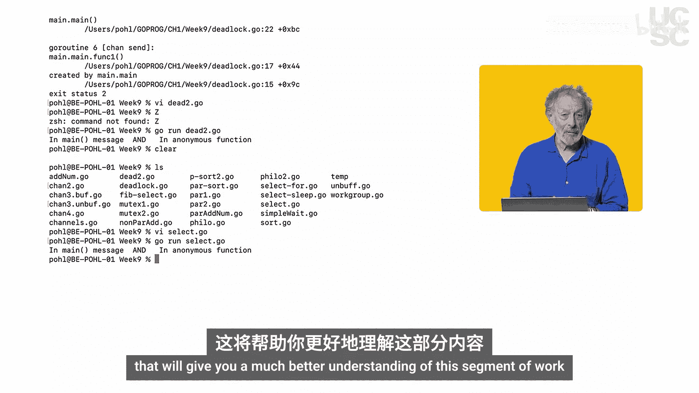

# 020：使用Select避免死锁


## 概述
在本节课中，我们将要学习Go语言中一个用于避免并发程序死锁的关键字：`select`。我们将了解`select`语句的语法、工作原理，并通过一个具体的例子来演示它如何解决上一节中遇到的死锁问题。

## 死锁问题回顾
上一节我们介绍了死锁，这是一个非常棘手的问题。我们不希望程序发生死锁，就像我们不希望程序陷入无限循环一样。

避免死锁的一个关键方法是使用`select`。

## 什么是Select？
`select`是Go语言中的一个关键字，在C语言中并不存在。从某种程度上说，Go是C语言的现代版本。C语言诞生于50年前，并在1989年进行了一次主要修订，形成了ANSI C标准。即使如此，那也是35年前的事情了。如今，许多人转向了C++等新语言，它们有不同的现代化方式。但C语言的优点在于它小巧，概念清晰，因此至今仍被广泛使用。

Go语言的发明者，谷歌的团队，其领导者与当年贝尔实验室参与开发Unix系统并在早期使用C语言的人是同一批，例如Thompson和Pike。他们不希望语言有大量的关键字，但由于Go内置了并发机制，而C语言没有，所以Go需要新的关键字。在C语言中，并发通常通过像`pthread`这样的特殊库来实现。Go语言则将其作为语言特性，这在很多方面使其更简单、更规范。

除了我们已经见过的用于启动协程的`go`关键字，`select`是另一个用于决定哪个通道操作应该优先执行的关键字。

## Select的语法
让我们来看看`select`语句的语法。`select`语句非常类似于`case`语句。`case`语句可以看作是`if`语句的一种泛化形式。

`select`语句包含多个`case`子句，每个`case`子句使用关键字`case`。在`case`关键字之后，是一个发送或接收表达式，这本质上就是对一个通道的操作。然后是一个冒号，以及可能的一条语句（该语句可以为空）。无论如何，`case`子句将决定哪个通道操作被执行。

你可以根据需要定义任意数量的`case`子句，通常`case`的数量与通道的数量或通道的使用方式相关。

此外，你还可以选择性地添加一个`default`语句，通常放在最后。`default`意味着：如果没有一个`case`条件为真，则执行`default`语句。`default`语句很可能用于终止程序，因为你原本期望某个通道被选中，但实际没有，这意味着程序出现了混乱，你可以通过`default`来确保程序以适当的方式结束。

## Select示例
以下是一个`select`的例子：
```go
select {
case foo := <-channel1:
    // 什么都不做
case channel2 <- boo:
    // 发送操作
default:
    fmt.Println("done")
}
```
这里有多个`case`可能被匹配。需要注意的是，与`switch`语句不同，`switch`会按顺序检查第一个匹配的`case`并执行。而在`select`中，所有`case`具有同等地位。如果有多个`case`同时满足条件，**其中一个会被随机选中执行**。因此，程序的逻辑是：如果任何一个`case`条件满足，就使用它。具体使用哪一个并不重要，因为程序会继续执行，这决定了接下来哪个操作会进行。`select`机制就是坐在通道之上，决定“谁下一个执行”。

## 使用Select解决死锁
我们有一个之前导致死锁的程序，它有两个通道。我们还有一个匿名函数用于打印信息，然后在主函数中执行。

这个程序与之前死锁程序的区别在于，我们使用了`select`。在`select`内部，我们查看两个`case`，哪个条件满足就执行哪个。最后，我们执行打印操作。现在，程序将不会出现死锁。

让我们运行这个程序看看效果。之前没有使用`select`时，程序发生了死锁并阻塞。而使用了`select`之后，程序成功运行，没有出现死锁情况。`select`告诉我们：“优先处理这个，因为我匹配到了这个通道表达式。”于是它使用了那个通道，并打印出了信息。

## 练习与探索
你可以尝试修改这个程序，让两个线程（协程）都能完成它们的打印。你可能需要引入`WaitGroup`来实现同步。尝试这样做会让你对这部分内容有更深入的理解。




## 总结
本节课我们一起学习了Go语言中的`select`语句。我们了解到`select`是避免通道操作导致死锁的关键工具，它通过提供一种机制来监听多个通道操作，并随机执行一个就绪的`case`，从而打破了潜在的竞争和等待循环。通过将`select`应用到之前的死锁示例中，我们成功解决了问题，使程序得以顺利执行。掌握`select`是编写健壮、高效并发Go程序的重要一步。