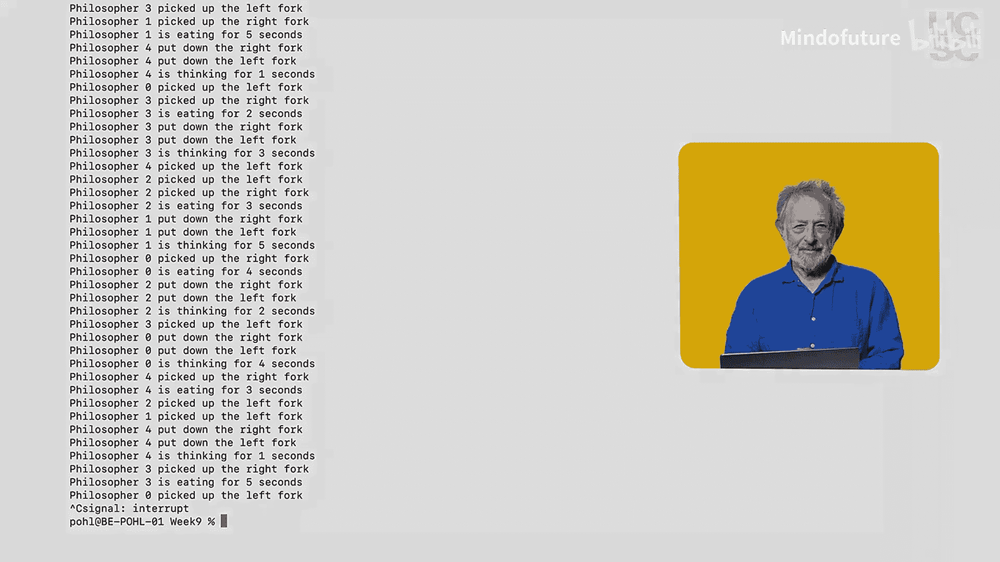

# 022：互斥锁


## 概述

在本节课中，我们将要学习并发编程中的一个核心概念——互斥锁。我们将通过一个经典的“哲学家就餐问题”来理解为什么需要互斥锁，以及如何在Go语言中使用`sync.Mutex`来实现它，从而确保多个并发线程能够安全地共享资源。

---

## 互斥锁的重要性

并发程序经常包含所谓的“临界区”。假设有多个线程在同时运行，每个线程都需要访问一个关键资源。那么就必须有一种机制来告诉其他线程“请等待”。因此，我们需要一种能力，让一个线程能够独占使用某个资源。

在Go语言的`sync`包中，我们已经见过`WaitGroup`。该包中还有一个名为`sync.Mutex`的类型。`Mutex`代表互斥锁，我们可以使用它的`Lock`和`Unlock`操作。这允许一个线程为关键资源或代码的临界区“上锁”，在该线程“解锁”之前，它是唯一能使用该资源的线程，之后其他线程才能使用。这非常重要。

## 哲学家就餐问题

我们将通过一个非常著名的问题来研究互斥锁，即“哲学家就餐问题”。在这个问题中，5位哲学家围坐在一张圆桌旁，面前放着食物。每两位哲学家之间有一根筷子（或西方版本中的叉子）。为了从碗中吃饭，哲学家必须使用两根筷子或两把叉子。

想象一下，哲学家必须拿起左边的筷子和右边的筷子。如果所有哲学家都同时抓起右边的筷子，那么每个人都只有一根筷子，他们将无法吃饭，导致“饥饿”或“死锁”。我们希望避免这种情况。这个问题由Dijkstra提出，他通过创建一种称为“信号量”的互斥锁形式解决了它。后来，另一位计算机科学家Tony Hoare（他也发明了Go语言并发模型所基于的CSP理论）也使用互斥锁解决了这个问题。

下图展示了这个问题：哲学家们围坐在桌旁，不吃饭时就在思考。但他们必须时不时吃饭，否则就会饿死。

## 代码解析

在我们的Go代码中，有五位哲学家和五把叉子。每位哲学家都有一个编号（1到5）。每位哲学家都有一把左叉和一把右叉。互斥锁意味着左叉和右叉都可以被锁定和解锁，这样一位特定的哲学家就可以独占这些资源并吃饭。

让我们看看代码是如何实现的。

我们有一个函数，接收一位哲学家，并尝试看他是否会吃饭。这些函数将作为线程运行。首先，哲学家会思考一段时间（随机时长）。然后，当他们尝试吃饭时，会去拿叉子。如果他们能拿到左叉，就锁定它；接着必须去拿右叉。一旦他们获得了这些资源，其他哲学家就被排除在外，无法抓取这些叉子，然后他们就可以开始吃饭。

吃饭过程也会持续一段随机时间。之后，哲学家必须解锁资源，否则其他哲学家会饿死。不同的线程（代表不同的哲学家）可以思考，或者在能够获取资源时尝试吃饭；如果无法获取，就等待。最终，拥有资源的哲学家会解锁它，下一个在随机时间点结束思考的哲学家就会来拿起叉子，进入他的临界区吃饭。

## 主函数逻辑

在`main`函数中，我们初始化随机数种子，以确保每个例程从伪随机数序列的不同位置开始。然后我们创建一些叉子（包含互斥锁）和相同数量的哲学家。接着，为每位哲学家分配左叉和右叉。我们使用一个`WaitGroup`来同步所有线程。在一个循环中，我们为每位哲学家启动一个线程来执行`eat`方法。每个线程都会尝试吃饭，随机地获取锁、解锁，让下一位哲学家吃饭。不吃饭时，他们就在思考。最后，`wg.Wait()`等待所有程序同步完成。

在这个机制下，没有人会饿死，因为我们不允许所有哲学家同时抓起一根筷子或叉子，总有人能有两把叉子可用。

## 代码细节

以下是程序的主要部分：

```go
import (
    "fmt"
    "math/rand"
    "sync"
    "time"
)

const numPhilosophers = 5

type Philosopher struct {
    id        int
    leftFork  *sync.Mutex
    rightFork *sync.Mutex
}

func (p *Philosopher) eat() {
    // 思考随机时间
    thinkTime := rand.Intn(5) + 1
    fmt.Printf("哲学家 %d 思考 %d 秒\n", p.id, thinkTime)
    time.Sleep(time.Duration(thinkTime) * time.Second)

    // 尝试拿起左叉
    p.leftFork.Lock()
    fmt.Printf("哲学家 %d 拿起左叉\n", p.id)

    // 尝试拿起右叉
    p.rightFork.Lock()
    fmt.Printf("哲学家 %d 拿起右叉\n", p.id)

    // 吃饭随机时间
    eatTime := rand.Intn(5) + 1
    fmt.Printf("哲学家 %d 吃饭 %d 秒\n", p.id, eatTime)
    time.Sleep(time.Duration(eatTime) * time.Second)

    // 放下叉子
    p.rightFork.Unlock()
    fmt.Printf("哲学家 %d 放下右叉\n", p.id)
    p.leftFork.Unlock()
    fmt.Printf("哲学家 %d 放下左叉\n", p.id)
}

func main() {
    rand.Seed(time.Now().UnixNano())

    // 创建叉子
    forks := make([]*sync.Mutex, numPhilosophers)
    for i := 0; i < numPhilosophers; i++ {
        forks[i] = &sync.Mutex{}
    }

    // 创建哲学家并分配叉子
    philosophers := make([]*Philosopher, numPhilosophers)
    for i := 0; i < numPhilosophers; i++ {
        philosophers[i] = &Philosopher{
            id:        i,
            leftFork:  forks[i],
            rightFork: forks[(i+1)%numPhilosophers], // 环形分配
        }
    }

    var wg sync.WaitGroup
    wg.Add(numPhilosophers)

    // 启动哲学家线程
    for _, p := range philosophers {
        go func(phil *Philosopher) {
            defer wg.Done()
            phil.eat()
        }(p)
    }

    wg.Wait()
    fmt.Println("所有哲学家都吃完了。")
}
```

## 程序运行与观察

运行程序时，你会看到哲学家们以随机顺序思考和吃饭。没有固定的顺序，因为所有线程都是并发启动的，并且包含随机因素。我们不知道谁会先吃，这取决于谁能先进入并获取临界区资源。

在输出中，你会看到类似这样的信息：
- 哲学家 X 思考 Y 秒
- 哲学家 X 拿起左叉
- 哲学家 X 拿起右叉
- 哲学家 X 吃饭 Z 秒
- 哲学家 X 放下右叉
- 哲学家 X 放下左叉

程序会持续运行，因为当前版本没有终止条件。每位哲学家都有机会吃饭，没有人会饿死，这解决了哲学家就餐问题。

## 思考与挑战

当前版本的程序没有停止条件。我建议你修改程序，使得当每位哲学家都至少就餐了三次（例如）后，程序可以终止。他们都有了三次吃饭的机会，这足以完成用餐，可以去做其他事情了。请思考如何添加额外的代码来终止程序，而不是让程序无限运行并需要手动中断。

---

## 总结



本节课中，我们一起学习了并发编程中的关键概念——互斥锁。我们通过“哲学家就餐问题”这个经典案例，理解了为什么需要互斥来防止资源冲突和死锁。在Go语言中，我们使用`sync.Mutex`的`Lock`和`Unlock`方法来实现临界区的独占访问。通过编写并观察程序运行，我们看到了互斥锁如何确保多个并发线程能够有序、安全地共享资源。最后，我们还提出了一个改进挑战，为程序添加合理的终止条件。