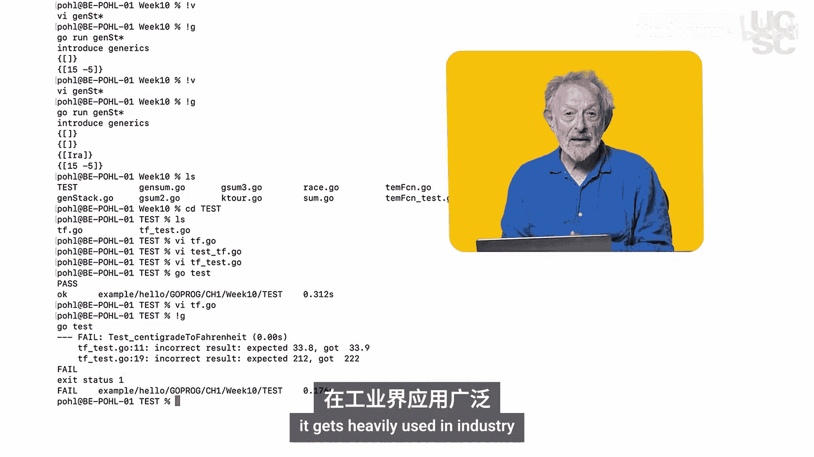

# 024：测试基础


## 概述

在本节课中，我们将要学习Go语言中一个非常重要的概念：**单元测试**。我们将了解为什么测试代码至关重要，并学习如何使用Go语言内置的`go test`工具来编写和运行测试，以确保我们的代码按预期工作。

## 为什么需要测试

编写完全没有错误的代码是不可能的。因此，拥有一个测试策略至关重要。

一种方法是手动模拟代码，用少量数据逐步执行。但通常人们会觉得这种方法太麻烦。

另一种方法是在代码的关键位置添加`Print`语句，以观察代码的行为并确保其按我们设想的方式执行。但这种方法也比较繁琐。

因此，Go语言提供了专门的方式来测试你的代码。

## Go语言中的单元测试

在软件工程中，**单元测试**被证明是非常有用的。当我们编写Go代码并想确保其正常工作，我们可以为它们编写测试，然后使用`go test`指令来运行这些测试。

为了实践这一点，我们将回到最初的Go课程示例。

在那个课程中，我们编写了一个著名的将摄氏温度转换为华氏温度的程序。我们使用这个代码是因为它在描述C语言的原始书籍中是一个早期的、非平凡的程序示例。这是一个非常有用的程序，每个人都应该能够编写这样的代码，同时我们也希望能够测试它。

## 编写可测试的代码

在编写测试代码时，你通常测试的是**函数**，而不是它们在`main`函数中的使用。因此，你通常需要将你要使用的函数写出来，并放入一个包中。

以下是我们将要测试的代码。我们将其放在一个名为`convert`的包中，因为它执行摄氏到华氏的转换。

**文件：temperature/tf.go**
```go
package convert

func ToFahrenheit(cTemp float64) float64 {
    return 32 + 1.8*cTemp
}
```

这个函数接收一个`float64`类型的摄氏温度，并使用公式 **`32 + 1.8 * cTemp`** 返回一个`float64`类型的华氏温度。我们将这个文件命名为`tf.go`。

## 编写单元测试

现在，让我们来编写单元测试。

我们使用相同的包名。这是因为当使用`go test`时，它会查找该包下的测试代码来运行。

测试文件的命名规则是：`test_`加上原始代码的文件名。所以我们的测试文件将命名为`tf_test.go`。

**文件：temperature/tf_test.go**
```go
package convert

import "testing"

func TestToFahrenheit(t *testing.T) {
    // 以下是测试用例
    tests := []struct {
        input    float64
        expected float64
    }{
        {input: 1.0, expected: 33.8},   // 1°C 应为 33.8°F
        {input: 0.0, expected: 32.0},   // 0°C 应为 32°F
        {input: 100.0, expected: 212.0}, // 100°C 应为 212°F
    }

    for _, test := range tests {
        result := ToFahrenheit(test.input)
        if result != test.expected {
            t.Errorf("输入 %.1f°C 时，预期 %.1f°F，但得到 %.1f°F", test.input, test.expected, result)
        }
    }
}
```

在上面的测试中，我们导入了`testing`包。我们创建了三个测试用例：
1.  输入1°C，预期输出33.8°F。
2.  输入0°C（冰点），预期输出32°F。
3.  输入100°C（沸点），预期输出212°F。

对于每个测试用例，我们运行`ToFahrenheit`函数，并将结果与预期值进行比较。如果不相等，我们使用`t.Errorf`输出一个错误信息，指出预期的结果和实际得到的结果。

## 运行测试

要运行测试，只需在包含`tf.go`和`tf_test.go`文件的目录中执行以下命令：
```bash
go test
```

如果所有测试都通过，你将看到类似以下的输出：
```
PASS
ok      your/package/path    0.002s
```

## 测试失败的情况

现在，让我们看看测试失败时会发生什么。假设我们错误地将公式写成了 **`32 + 1.9 * cTemp`**。

修改`tf.go`文件中的函数：
```go
func ToFahrenheit(cTemp float64) float64 {
    return 32 + 1.9*cTemp // 错误的公式！
}
```

再次运行`go test`，你将看到测试失败，并输出详细的错误信息：
```
--- FAIL: TestToFahrenheit (0.00s)
    tf_test.go:15: 输入 1.0°C 时，预期 33.8°F，但得到 33.9°F
    tf_test.go:15: 输入 100.0°C 时，预期 212.0°F，但得到 222.0°F
FAIL
exit status 1
FAIL    your/package/path    0.003s
```

注意，0°C的测试用例仍然通过了（因为32 + 1.9*0 = 32）。这说明了拥有足够多测试用例的重要性，以便能发现关键性的错误。

## 总结

本节课中，我们一起学习了Go语言的单元测试。
1.  我们了解了测试代码的重要性。
2.  我们学习了如何将业务逻辑封装在函数中，以便于测试。
3.  我们掌握了Go测试文件的命名规范（`*_test.go`）和基本结构。
4.  我们编写了一个包含多个测试用例的单元测试函数。
5.  我们使用`go test`命令来运行测试，并观察了测试通过和失败时的不同输出。




编写和运行单元测试是一种非常好的编程习惯，在工业界被广泛使用。通过为你的代码编写测试，你可以更早地发现错误，更有信心地进行代码重构，并确保代码的长期质量。