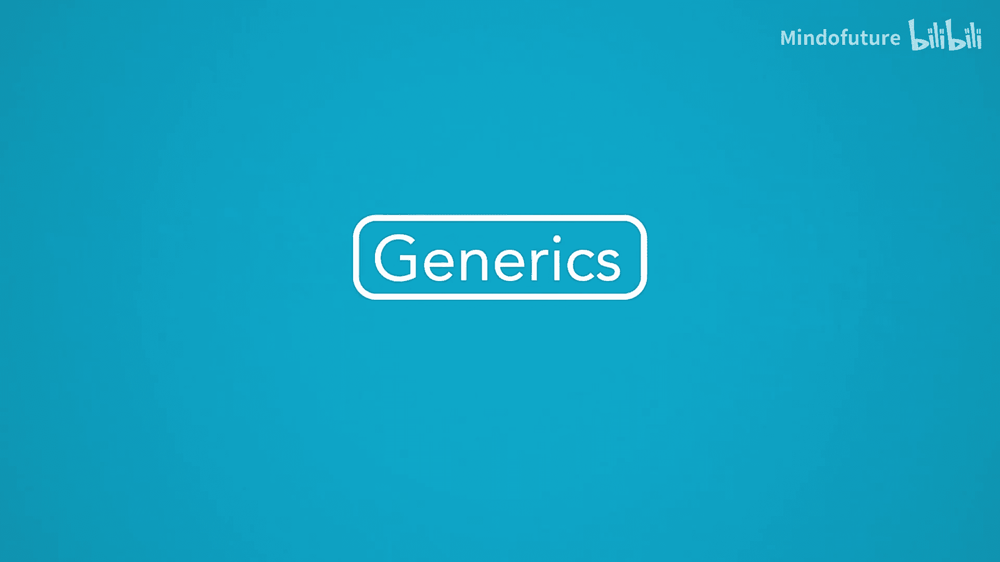
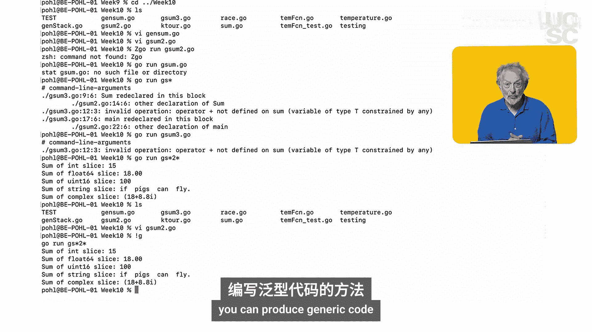

# 026：生成求和函数



## 概述
在本节课中，我们将要学习Go语言中的泛型。泛型是一种强大的代码复用功能，它允许我们编写一个函数，使其能够处理多种不同的数据类型，而无需为每种类型编写重复的代码。

## 泛型简介
上一节我们介绍了Go语言的基础知识，本节中我们来看看泛型。泛型是Go语言中一个相对较新的功能，于2022年引入。如果你的Go编译器版本是1.18或更高，那么它应该支持泛型。你可以使用命令 `go version` 来检查你的编译器版本。

与其他现代语言类似，Go语言也通过委员会决策来添加重要功能。Go语言的设计哲学是保证向后兼容，因此泛型的加入不会使旧代码失效。虽然像C++这样的语言早已通过模板实现了泛型，但Go语言以其一贯的简洁风格，提供了一种更简单的泛型实现方式。

## 泛型的作用
泛型允许你编写一段针对特定类型工作的代码，然后确保这段代码也能正确地用于其他类型。在旧的语言如C语言中，如果你需要为一个整数（int）类型和一个浮点数（float）类型编写求和功能，你必须定义两个不同名称的函数。然而，使用泛型，我们可以只编写一个函数，并指定一个泛型类型，这个类型可以被任何符合代码要求的类型实例化。

## 非泛型求和示例
首先，我们来看一个对整数切片求和的非泛型代码示例：

```go
func sumInt(data []int) int {
    s := 0
    for _, v := range data {
        s = s + v
    }
    return s
}
```

如果我们还需要对浮点数切片求和，就必须编写另一个几乎相同的函数：

```go
func sumFloat(data []float32) float32 {
    s := 0.0
    for _, v := range data {
        s = s + v
    }
    return s
}
```

这导致了代码重复和命名空间的污染。

## 泛型求和实现
泛型让我们可以避免上述重复。以下是实现泛型求和的步骤：

### 1. 定义类型约束接口
我们首先创建一个名为 `number` 的接口类型，用于约束泛型类型 `T`。这个接口定义了哪些具体类型可以使用我们的泛型函数。

```go
type number interface {
    int | int8 | int16 | int32 | int64 |
    uint | uint8 | uint16 | uint32 | uint64 |
    float32 | float64 |
    complex64 | complex128 |
    string
}
```
这个接口允许的类型包括：各种整数、无符号整数、浮点数、复数以及字符串。请注意，字符串通常不被视为数字，但这里为了演示泛型的灵活性，我们将其包含在内。

### 2. 编写泛型函数
接下来，我们编写泛型求和函数 `sum`。

```go
func sum[T number](slice []T) T {
    var s T
    for _, v := range slice {
        s += v
    }
    return s
}
```
让我们分解这个函数声明：
*   `func sum[T number]`：`T` 是一个泛型类型参数，它受到 `number` 接口的约束。按照Go社区的惯例，我们通常使用大写字母（如 `T`）来表示泛型类型。
*   `(slice []T)`：参数 `slice` 是一个类型为 `T` 的切片。
*   `T`：函数的返回值类型也是 `T`。
*   在函数体内，我们声明变量 `s` 为类型 `T`。在Go语言中，变量会被自动初始化为其类型的零值（例如，int为0，string为空字符串`""`）。这确保了我们的代码能正确处理所有 `number` 接口中定义的类型。
*   循环遍历切片，使用 `+=` 运算符进行累加，然后返回结果 `s`。

### 3. 调用泛型函数
现在，我们可以在 `main` 函数中调用这个泛型函数来处理不同类型的数据。

```go
func main() {
    // 整数切片
    ints := []int{1, 2, 3, 4, 5}
    intSum := sum(ints)
    fmt.Println("Sum of ints:", intSum)

    // 无符号整数切片
    uints := []uint{10, 20, 30, 40}
    uintSum := sum(uints)
    fmt.Println("Sum of uints:", uintSum)

    // 浮点数切片
    floats := []float64{1.1, 2.2, 3.3}
    floatSum := sum(floats)
    fmt.Println("Sum of floats:", floatSum)

    // 字符串切片（连接操作）
    strs := []string{"If ", "pigs ", "can ", "fly."}
    strSum := sum(strs)
    fmt.Println("Sum of strings:", strSum)

    // 复数切片
    complexes := []complex128{complex(1.2, 8.8), 3.4, 5.6, 7.8}
    complexSum := sum(complexes)
    fmt.Println("Sum of complexes:", complexSum)
}
```
编译器会根据传入切片的实际类型，自动实例化相应的 `sum` 函数版本。例如，当传入 `[]int` 时，编译器会生成并调用 `sum[int]` 的代码。

## 开发泛型代码的建议
以下是开发泛型代码的一个有效流程：
1.  **使用典型类型进行调试**：首先，使用一个最典型、最方便调试的类型（例如 `int`）来编写和测试你的核心逻辑。
2.  **识别通用条件**：确保代码逻辑正确后，分析哪些其他类型也满足使这段代码工作的条件（例如，都需要支持 `+=` 操作）。
3.  **定义约束接口**：将这些类型归纳到一个接口中，作为泛型类型 `T` 的约束。
4.  **转换为泛型函数**：将具体类型替换为泛型类型 `T`，并添加上约束。
5.  **全面测试**：使用接口中定义的各种类型来测试你的泛型函数，确保其行为符合预期。




## 总结
本节课中我们一起学习了Go语言中的泛型。我们了解到泛型是一种强大的工具，它通过允许我们编写处理多种数据类型的单一函数，极大地促进了代码的复用，并保持了代码的简洁性。关键步骤包括：定义一个约束接口来限定可用的类型，然后在函数签名中使用泛型类型参数 `[T Constraint]`。通过这种方式，我们可以用一份代码，高效地处理整数、浮点数、字符串乃至复数等多种数据类型的求和（或连接）操作。