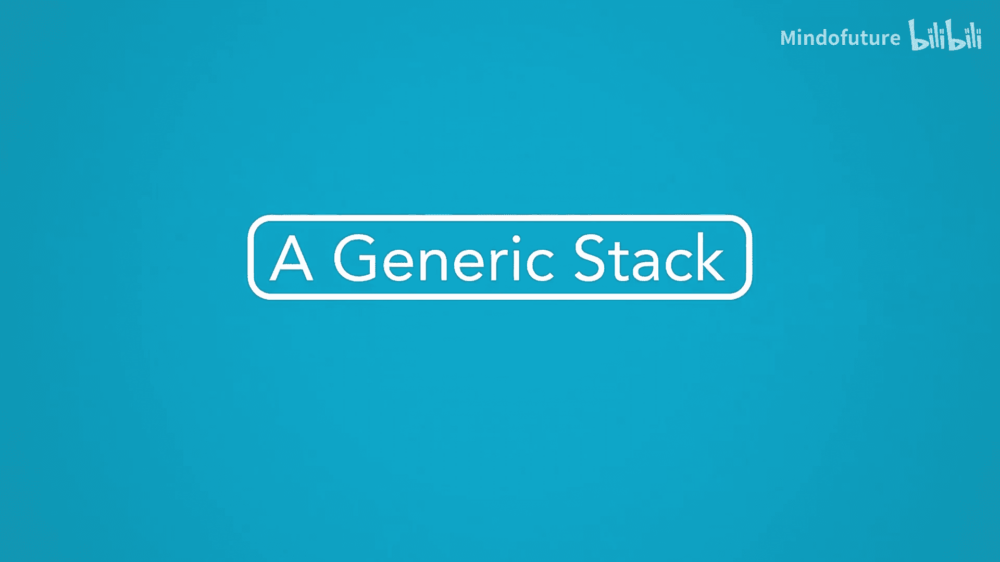
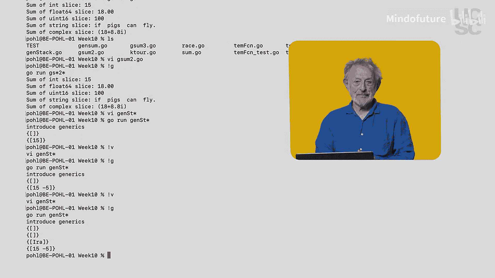

# 027：生成栈




在本节课中，我们将要学习如何编写适用于容器类型的泛型代码。我们将以栈（Stack）这种数据结构为例，展示如何使用Go的泛型和`any`类型来创建一个可以存储任意数据类型的通用容器。

## 容器类型与泛型

上一节我们介绍了泛型函数的基本概念。本节中我们来看看泛型在容器类型中的应用。

容器类型指的是用于存储一系列值的结构，例如切片（slice）。但除了切片，我们还可以创建链表、栈、队列等多种容器。为什么需要这么多类型？因为每种容器在存取数据时遵循不同的规则，并且各有优缺点。切片或数组可能是最方便、最常用的容器类，我们已经见过如何为切片编写泛型代码。

如果你学习过C++，就会知道标准库中包含大量容器，它们都是通过泛型实例化的，因此可以用于任何类型。

在这段代码中，我们还将使用一种通用类型。在之前的泛型代码中，我们为数字类型指定了一组具体的约束类型，但这排除了结构体或指针等其他类型。当我们只需要考虑存入和取出值，而不关心具体操作时，可以使用Go语言中名为`any`的通用类型。

## 栈数据结构简介

以下是栈的基本概念和操作。

栈是一种后进先出（LIFO）的数据结构，就像食堂里叠放的盘子。你只能从顶部拿走盘子（弹出），也只能将新盘子放到顶部（压入）。栈通常有以下几种基本操作：
*   **压入（Push）**：将一个新元素添加到栈顶。
*   **弹出（Pop）**：移除并返回栈顶的元素。
*   **查看栈顶（Peek/Top）**：返回栈顶元素但不移除它。
*   **判断是否为空（IsEmpty）**：检查栈中是否没有元素。

我们希望栈能存储任意类型的值，因此将使用`any`类型。本质上，栈是对切片的一种封装（或称为外观模式），因为我们想限制对数据的操作，只允许上述几种栈操作，而不允许像切片那样随机访问任意位置的元素。

## 实现泛型栈

现在，我们来看看如何用Go语言实现一个泛型栈。我们将定义一个结构体，并实现其`Push`方法。

```go
// 定义一个泛型栈结构体
type Stack[T any] struct {
    values []T // 底层使用切片存储值
}

// Push方法：将值压入栈顶
func (s *Stack[T]) Push(value T) {
    s.values = append(s.values, value)
}
```
我们定义了一个泛型结构体`Stack[T any]`，它内部使用一个类型为`T`的切片来存储数据。`Push`方法接收一个类型为`T`的参数`value`，并使用`append`函数将其添加到切片末尾（即栈顶）。

其他操作如`Pop`、`Peek`和`IsEmpty`将作为练习留给读者完成。接下来，让我们看看如何使用这个栈。

## 使用泛型栈

以下是使用我们定义的泛型栈的示例代码。

```go
func main() {
    // 创建一个整数栈
    intStack := Stack[int]{}
    fmt.Println("初始整数栈:", intStack)
    
    // 向整数栈压入值
    intStack.Push(15)
    fmt.Println("压入15后:", intStack)
    
    intStack.Push(-5)
    fmt.Println("压入-5后:", intStack)
    
    // 创建一个字符串栈
    stringStack := Stack[string]{}
    fmt.Println("初始字符串栈:", stringStack)
    
    // 向字符串栈压入值
    stringStack.Push("Ira")
    fmt.Println("压入‘Ira’后:", stringStack)
}
```
我们首先创建了一个`Stack[int]`类型的整数栈并打印其初始状态。然后，我们依次压入整数`15`和`-5`，并每次打印栈的状态以观察变化。接着，我们创建了一个`Stack[string]`类型的字符串栈，并压入字符串`"Ira"`。

运行这段代码，输出结果如下：
```
初始整数栈: {[]}
压入15后: {[15]}
压入-5后: {[15 -5]}
初始字符串栈: {[]}
压入‘Ira’后: {[Ira]}
```
输出显示，整数栈和字符串栈初始时都为空。压入操作后，相应的值被成功添加到各自的栈中。这证明了我们的泛型栈可以用于`int`、`string`乃至任何其他类型，包括自定义结构体或指针类型。

## 总结

本节课中我们一起学习了如何创建和使用泛型容器。我们以栈为例，定义了泛型结构体`Stack[T any]`，并实现了`Push`方法。通过实例化`Stack[int]`和`Stack[string]`，我们演示了泛型代码如何作用于不同的具体类型，使得容器既通用又类型安全。你可以基于这个框架，继续实现`Pop`、`Peek`等操作来完成一个功能完整的栈。



