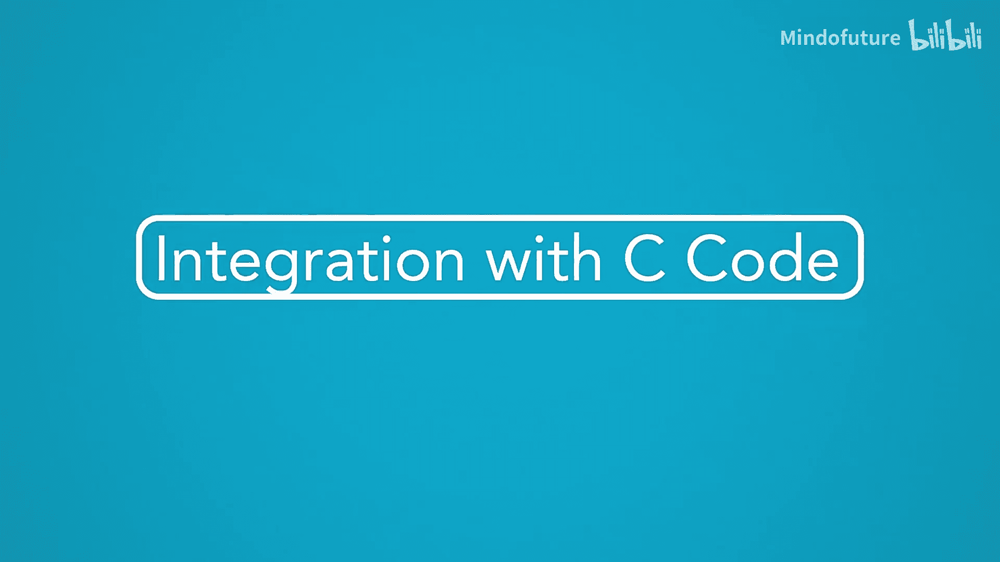
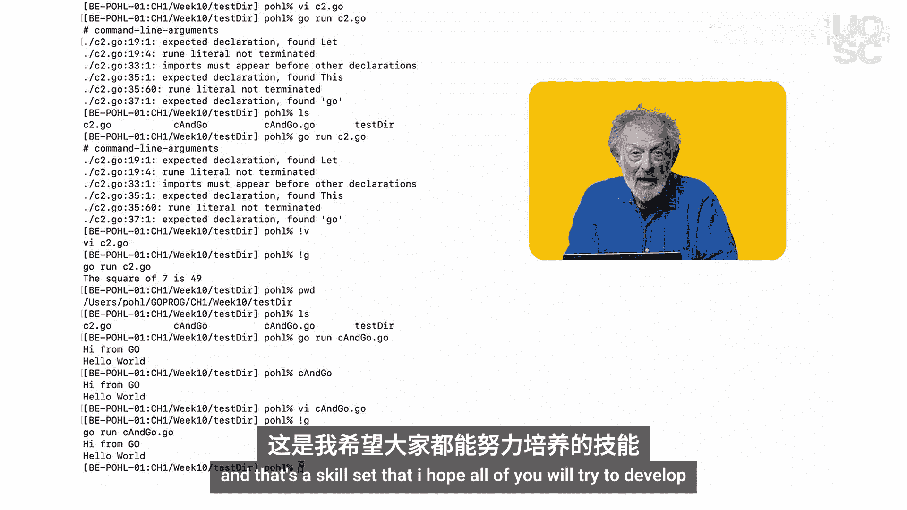

# 028：与C代码集成



## 概述
在本节课中，我们将学习如何在Go语言项目中集成C语言代码。Go语言虽然现代且强大，但在某些特定场景（如实时系统）下，C语言因其高效性和无垃圾回收的特性而更具优势。通过使用名为Cgo的工具，我们可以将两种语言的代码编译在一起，从而利用C语言庞大的现有代码库和操作系统级接口。

## Go与C集成的必要性
Go语言是一门相对现代的语言，其设计在某种程度上基于C语言，可被视为C语言家族的最新改进。然而，C语言在许多情况下比Go更高效。例如，Go的一个优点是垃圾回收机制，这意味着开发者无需过多操心内存分配，也避免了各种内存错误。但在某些计算领域，如实时应用，垃圾回收机制是不被允许的。因此，当你需要时，有一种简单的方案可以让你集成C代码。

C语言至今仍被广泛使用，它拥有丰富的库，并且是许多操作系统（包括最初为Unix发明的系统）的通用语言。这使得C语言因其广泛的应用而极具价值，尽管以现代标准来看，它可能显得有些古老。

## 使用Cgo进行集成
要将两种语言一起使用并编译，你需要一个名为Cgo的工具。在接下来的代码中，你会看到我们导入了名为“C”的包。然后，我们将要编写的C代码会放在Go语言的注释中。Cgo能够识别这些注释中的C代码，并将其与Go代码区分开来。之后，我们可以使用`go build`命令来构建一个同时使用C和Go代码的可执行文件。

## 代码示例解析
以下是集成C代码的Go程序示例。

```go
package main

import "fmt"

/*
#cgo LDFLAGS: -lm
#include <stdio.h>

void hello() {
    printf("Hello world\n");
}
*/
import "C"

func printHiFromGo() {
    fmt.Println("Hi from Go")
}

func main() {
    printHiFromGo()
    C.hello()
}
```

就像普通的Go程序一样，我们有一个`package main`，然后导入了`fmt`包，因为我们将使用Go的I/O功能。接着，我们进行了一些特殊的操作。

多行注释`/* ... */`包裹着C代码。这里展示了一个非常简单的C程序。如果你已经了解C语言，这可能是你最早编写的那种程序——经典的“Hello World”程序。在C语言中，`#include`类似于Go的`import`。`#include <stdio.h>`引入了标准I/O头文件，这相当于Go的I/O包。然后，这个函数所做的就是调用`printf`打印一行“Hello world”消息。

如果你没有学过C语言，这里可以看到它与Go函数的一些细微差别。在C语言中，你不使用特殊的关键字`func`，而是使用一个类型来声明函数。在这个例子中，由于函数不返回值，其类型是`void`。此外，与Go风格不同，C语言倾向于在每行末尾加上分号，这就是为什么你会看到`printf("Hello world\n");`以分号结尾。

然后我们看到`import "C"`，接着是我们正常的Go代码。在这段Go代码中，请注意最后一行`C.hello()`。这告诉编译器，这是与编译的C语言部分相关的代码。实际上，通过使用`C.hello()`，我们调用了C语言部分的`void hello()`函数。

你必须确保将`import "C"`紧接在包含C代码的注释块之后。我自己在学习时曾在此处留有空行，导致编译出错。所以，不要在这两者之间留任何空行。然后，使用`go build`来获取可执行文件并运行代码。当然，你也可以在不构建可执行文件的情况下以正常方式运行代码。

## 编译与运行
让我们继续并确保这一切正常工作。在终端中，我们拥有幻灯片中展示的代码。这是普通的Go代码：`package main`和`import "fmt"`。但接下来是新颖的部分。

我们在`/*`之后开始，可以包含一些传递给C编译器的指令，因为C编译器将与Go编译器一起被调用。这里我调用了`#cgo LDFLAGS: -lm`，对于这个特定程序来说并非必需，但`-lm`会加载数学库。在某些情况下，我试验过需要数学库的C代码。这里你包含了`stdio.h`。同样，这对许多有C语言背景的人来说可能很熟悉。

C语言的语法与Go的`func`语法略有不同。这里我们总是先声明返回类型。在这个例子中，它是`void`，意味着没有返回值。它仅仅是打印“Hello world”。然后我们立即执行`import "C"`。

这里是混合了C调用的Go代码。在这段代码中，我们定义了函数`printHiFromGo`，然后我们将调用`C.hello()`，这将调用程序的C语言部分，执行打印“Hello world”的操作。当然，这只是一个示例。在实际代码中，我们不会真正使用这样的例子，因为它对我们的代码类型没有实际价值。但如前所述，C世界拥有庞大的现有代码库，包括在Go中可能不安全的代码。如果你的应用程序需要那种超高效的代码，你可能还需要使用`unsafe`包。

现在，让我们继续并确保这一切正常工作。退出编辑器后，我将直接运行它。果然，它完全按预期输出了“Hi from Go”和“Hello world”。这里还有很多其他细节，但这确实非常基础，它展示了将C与Go结合是多么容易。这是一项我希望你们所有人都尝试去掌握的技能。




## 总结
本节课中，我们一起学习了如何在Go代码中集成C语言代码。我们了解了在某些场景下使用C语言的优势，并通过Cgo工具实现了两种语言的混合编译。我们分析了一个简单的“Hello World”示例，演示了如何通过特殊的注释块嵌入C代码，并使用`import "C"`和`C.函数名()`的语法在Go中调用C函数。最后，我们成功编译并运行了混合代码。掌握这项技能，将能帮助你利用C语言庞大的现有生态，解决Go在特定领域（如高性能计算、系统编程）的局限性。