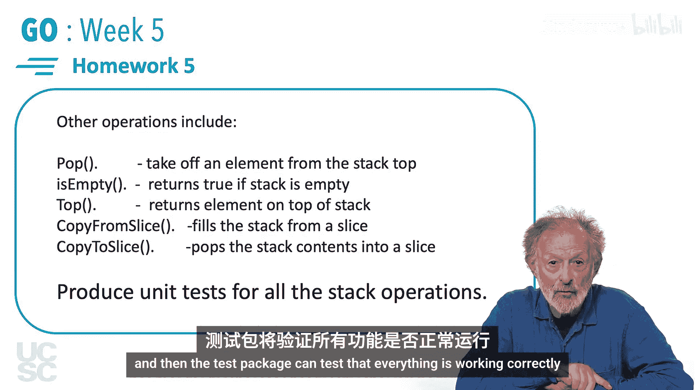

# 030：扩展泛型栈与单元测试 🧪


在本节课中，我们将学习如何扩展一个泛型栈数据结构，为其添加一系列标准操作，并利用Go语言的单元测试功能来验证每个操作的正确性。

## 栈数据结构回顾 📚

上一节我们介绍了栈的基本概念。栈是一种“后进先出”（LIFO）的数据结构，可以想象成一叠盘子，你只能从顶部放入或取出盘子。

在本节中，我们将基于一个泛型栈进行扩展。这个栈使用类型参数 `T`，其约束为 `any`，这意味着它可以存储任何类型的数据。我们之所以使用 `any` 而不是像 `number` 这样的特定约束，是因为栈的核心操作（如存储）不依赖于任何特定的运算（如加法），它只需要能存放数据即可。

栈的内部实现本质上是一个类型为 `T` 的切片（`slice`），而我们为其编写的方法则定义了栈的特定行为。

## 基础操作：入栈（Push） ➕

以下是栈的一个基础操作，我们之前已经见过：将值压入栈顶。

我们通过接收一个值，并将其追加（`append`）到内部切片来实现这个操作。Go语言的内存管理机制使得 `append` 操作可以高效地处理切片的扩容。

```go
func (s *Stack[T]) Push(value T) {
    *s = append(*s, value)
}
```

## 需要实现的操作列表 📋

现在，我们来看看需要为栈实现的其他标准操作，以使其成为一个功能完整的数据集合类型。

以下是需要编码实现的操作列表：

*   **Pop**：从栈顶移除一个元素并返回它。
*   **IsEmpty**：检查栈是否为空。在尝试弹出元素前进行此检查很重要，因为不能从空栈弹出元素。如果栈为空，则返回 `true`。
*   **Top**（有时也称为 **Peek**）：返回栈顶的元素，但**不**将其从栈中移除。它只是“查看”栈顶的值。
*   **CopyFromSlice**：将切片中的所有值复制到栈中。这允许我们使用切片来初始化或填充栈。
*   **CopyToSlice**：将栈中的所有内容弹出并复制到一个切片中。这便于我们在需要切片进行某些操作时，将栈的数据转移出来。

## 单元测试要求 ✅

对于上面列出的每一个操作，你都需要编写相应的单元测试（unit test）。Go语言内置了强大的测试框架，可以帮助你调试代码并确保其正确性。你将使用 `test` 包来创建测试，验证每个栈操作是否按预期工作。

## 总结 🎯



本节课中，我们一起学习了如何扩展一个泛型栈数据结构。我们回顾了栈的LIFO特性，明确了使用 `any` 类型参数的原因，并列出需要实现的核心操作：`Push`、`Pop`、`IsEmpty`、`Top`、`CopyFromSlice` 和 `CopyToSlice`。最后，我们强调了为每个操作编写单元测试的重要性，这是保证代码质量的关键步骤。