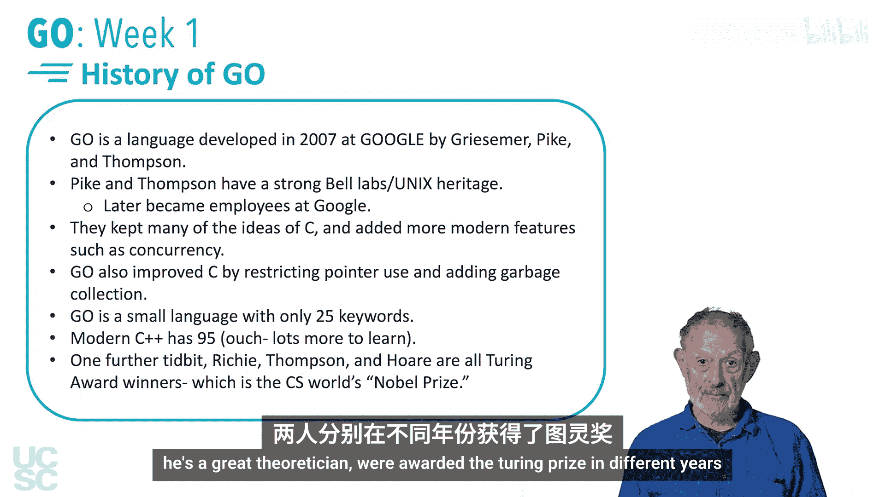

# 【加州大学】Go语言编程-｜-Go-Programming-Everyone-Part-1-p01-P01_Go语言介绍与历史_01_01_03--BV1h3e7zBE3U_p1-

Hi， I'm Professor I Raol of the University of California， Santa Cruz campus。Today。

 I'm talking to you about my new course， Go for see programmers and everyone。And this course。

 as its title says， is especially useful to see programmers who want to get a modernized C。

The world we live in coding now is a universally valuable skill。

 And whether you're a scientist or an artist or a humanist， algorithms are everywhere。

And we also have to know and understand how they work。

 And it's very valuable to be able to code them ourselves。

The gold language is particularly well suited as an introduction to coding。

 It's an elegant modern language that can be used as a successor to see。

 It's an advantage to know another programming language， especially C。

And if you've taken my other Coursera course on an introduction to C， that would be very helpful。

But this class can be studied on its own。 No prior knowledge of coding is needed for this course will start at the beginning。

The time requirements for you is a commitment of about。5 hours a week for five weeks。

If you're going to program and go， the first thing you need to do is get the go compiler for your computer。

Now I will be doing all my work and you'll see me at the Mac。Terminal window。

 which is really a Unix O S。 So one kind of system you might have is a Macintosh。

 Another kind of system you might have is a Microsoft PC。Using Windows。

 third kind of system might be a Linux system。Each system。

Has freely available downloads for the go compiler。

 And you can find them at go devev slash doc slash install。

Now you'll also need to be familiar with an editor to write the code。

 and I will be using the traditional UniX editor VI。But any editor can be made to work。

Programing requires practice and patience， but it can still be very rewarding。

 So go ahead and download， and we have additional instructions on the site。

If you can't figure out what's the go dev。And St sight tells you。Okay。

 some of the history of go is fascinating。Go is a modern language。

But it derives directly from C lineage。C itself was language invented by Dennis Ritchie at Bell Labs in 1972。

 So it's at this point，51 years old。And it was invented to be as systems， implementation language。

For writing eunuchs。And he did。This， in conjunction with Ken Thompson。

 a principal designer as well with Richie of the Unix operating system。

 So C was considered low level。 It was considered capable of efficiently running on any kind of hardware and easy to translate to machine language without a loss of efficiency。

 So it was near the hardware。Now， Ex became a big success starting in the late 70s because Bell Laps just gave Eunuchx away as an operating system。

 Many people in university， including here at University of California。

 Santa Cruz and at Berkeley really enjoyed using the Eix system。

 So they had adopted it and then started to teach it to their students。 but underlined。

 it was this obscure language C。😊，And later， when Uniuchx had become popular。诶。

In the late 70s and early 80s， especially after。Carnegan and Richie wrote the C programming language book。

It started to get used as a general purpose， programming language。But it had severe limitations。

 One of its problems was， it's what we call insecure。 There were security holes， especially because。

You could write。Almost you could access almost anything in the memory with the way original C uses pointers。

 And if you wrote stuff。In C。With these memory insecurities， it LED to many。

 many viruses and other kinds of malware happening。

 So it wasn't what was considered a very safe language。

 So other languages started to get introduced that superseded C， such language as C plus plus Java。

 Python and so on。But sea remains popular because of its sufficiency and because it's so embedded in many of the operating systems that already exist。

So it continues to have heavy use。 Now， go is a language developed at Google。

 That's quite appropriate。 go， Google。And was started in 2007 by a team of Grremer。

 Pike and Thompson。Now， recognized that Thompson， Ken Thompson was the designer of。

Eunix goes back to Bell Laps， and Pike was an associate of his at Bell Laps。

 So he was a heavy first userr and contributor to the Es operating system as well。

So they have a strong Bell Labss Uniix heritage。 And later they became employees at Google and teamed up with Grmer to develop this newer language。

 This what I consider a much better see。 But they kept a lot of the ideas from sea。

And then added more modern features。 One of the critical features will find out。

About in my courses will be concurrency and this concurrency。

Its history derives from a language of the 70s， as well， called。CSP。

Which was a language invented by Tony Hore in 1978 to display how you could run code in parallel。

So those are two of the major。Anticedents。2。The goal language。Now， go also improve C by again。

 restricting that point of use， making pointers far safer to be used and then adding garbage collection。

 which means that all sorts of。Memory errors and。Memory allocation and delocation work safely and automatically。

So these are some of the critical things that have improved go。Oversea。But it kept go simple。

 So unlike C plus plus or Java or Javascript go is a small language。

 One way you can measure that is it has only 25 keywords。

 That's actually a couple fewer than see did。 She had 27 keywords。Modern C+ plus。Has 95 keywords。

 and possibly growing。Lots and lots of concepts， basic concepts tied to that to learn。

 so it's a much more difficult language。Now， one further tidbit about this history。

 which I think is interesting is。Ricitchie and Thompson and Hore。All one nuturing award。

 nuturing award in the computer science world is。The equivalent of a Nobel Prize。

Ricitchie and Thompson for the Eunuchs work and who for work on things like CSP and other ideas。

 Yet added hes a great theoretician。We're awarded。The Turing prize in different years。

