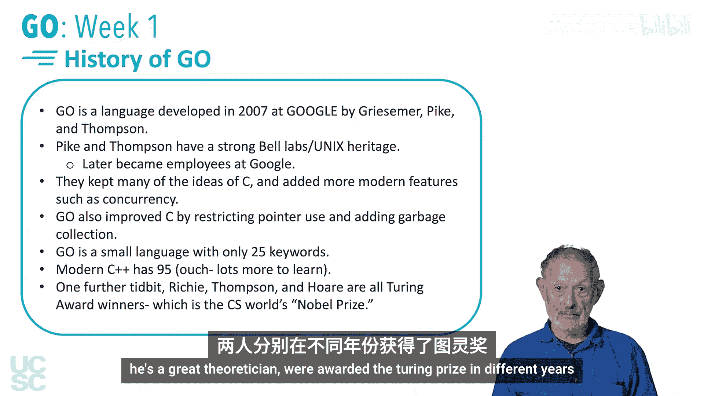

# Go语言编程：1：Go语言介绍与历史 🚀

在本节课中，我们将要学习Go语言的背景、历史及其设计理念。了解一门语言的起源有助于我们更好地理解它的特性和适用场景。

## 概述

Go语言是一门现代编程语言，它源自C语言的血统，旨在成为C语言的现代化继任者。它由Google的团队开发，融合了C语言的简洁高效与现代语言的先进特性，如安全性和并发支持。本课程适合所有人，尤其对C程序员非常有用，但无需任何编程基础即可开始学习。

## Go语言的起源与设计目标

上一节我们概述了Go语言，本节中我们来看看它的具体起源。Go语言由Google的Robert Griesemer、Rob Pike和Ken Thompson于2007年开始设计。Ken Thompson是Unix操作系统的共同设计者，而Rob Pike也是贝尔实验室Unix团队的重要成员，因此Go语言有着深厚的贝尔实验室和Unix系统传统。

Go语言的设计目标之一是改进C语言。C语言由Dennis Ritchie于1972年在贝尔实验室发明，用于编写Unix操作系统。它贴近硬件、运行高效，但存在安全性问题，例如指针的不当使用可能导致内存错误和安全漏洞。这些问题催生了C++、Java、Python等更安全的语言，但C语言因其高效和在现有系统中的深度嵌入，至今仍被广泛使用。

Go语言在保留C语言许多思想的同时，增加了现代特性。一个关键改进是**通过限制指针的使用使其更安全**，并引入了**垃圾回收机制**，从而自动、安全地处理内存分配与释放，避免了常见的内存错误。

## Go语言的特点

以下是Go语言的一些核心特点：

*   **简洁性**：Go是一门小型语言，只有25个关键字，比C语言的27个还少，远少于现代C++的95个。这使得它易于学习和掌握。
*   **并发支持**：Go内置了强大的并发编程支持，其思想源自1978年Tony Hoare提出的**通信顺序进程（CSP）** 理论。这使得编写并行运行的程序变得更加简单。
*   **现代化与实用性**：它被设计为一门优雅的现代语言，既适合作为C语言的继任者，也适合作为编程初学者的第一门语言。

## 学习准备与课程安排

要开始用Go语言编程，你需要先为你的计算机安装Go编译器。安装文件可以在官方网站 `golang.org/doc/install` 免费下载。无论你使用的是macOS、Windows还是Linux系统，都能找到对应的版本。

此外，你需要一个文本编辑器来编写代码。课程演示中将使用传统的Unix编辑器`vi`，但任何你熟悉的编辑器都可以。

本课程的时间要求约为每周5小时，持续五周。编程需要练习和耐心，但掌握后回报丰厚。如果你已经学习过C语言，那会很有帮助，但本课程从零开始，无需任何先验知识。

## 历史趣闻与总结

最后，分享一个有趣的历史关联。Go语言渊源中的几位关键人物——Dennis Ritchie、Ken Thompson和Tony Hoare——都因其在计算机科学领域的杰出贡献获得了图灵奖。图灵奖被认为是计算机界的诺贝尔奖。Ritchie和Thompson因Unix系统获奖，Hoare则因CSP等理论贡献获奖。这从侧面印证了Go语言所继承的思想具有深厚而卓越的学术与实践根基。

本节课中我们一起学习了Go语言的诞生背景、设计哲学、核心特性以及学习这门语言需要做的准备。Go语言作为一门融合了历史智慧与现代需求的简洁、高效、安全的语言，为系统编程和通用软件开发提供了优秀的选择。接下来，我们将开始动手搭建环境，编写第一个Go程序。