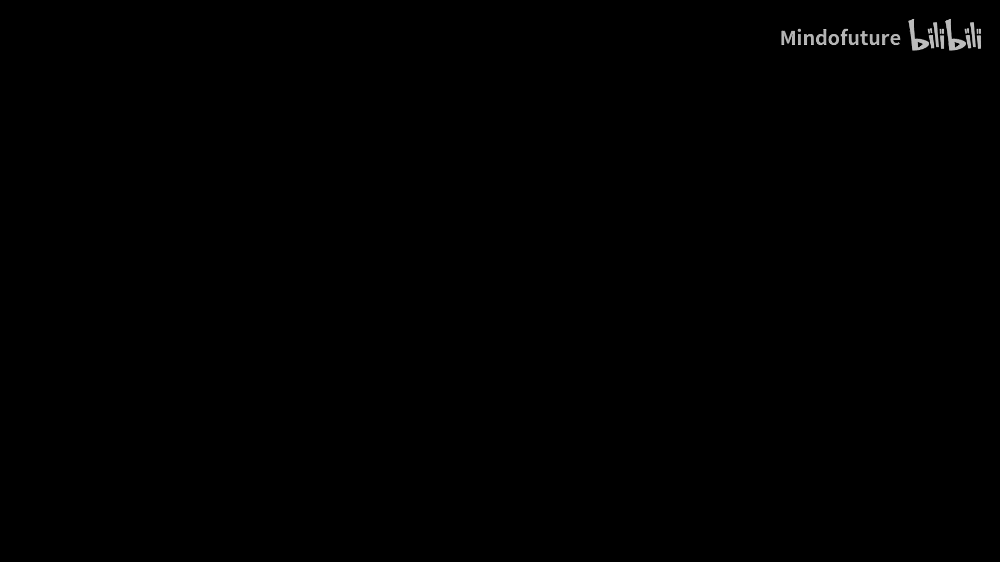
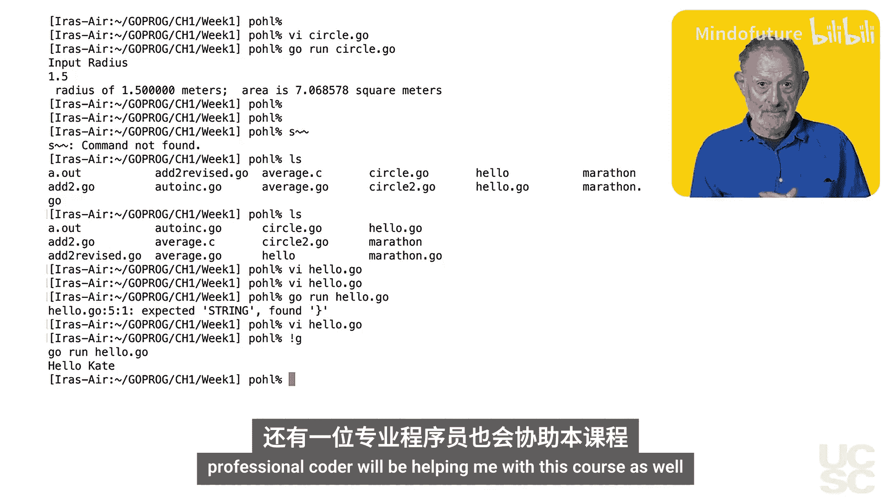
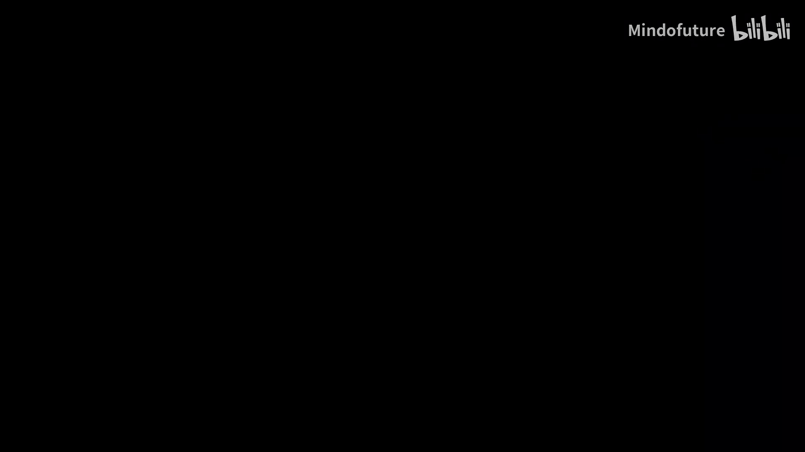

# 【加州大学】Go语言编程-｜-Go-Programming-Everyone-Part-1-p02-P02_你好_01_01_04--BV1h3e7zBE3U_p2-

Ever since Kernning and Richie's book。Wei。C programming language。Introduce C to the world。

The first program。Discusst in the book and the first program， everybody now writes。

Is some variation on hello world。Now。It's important to understand a simple program structure in any language。

 And in go， this is written in the file， Ho dot go。Now， of course。

 you'll have to use your own editor， as I told you earlier， I will be using VI。

And here's what that program looks like。There's a special keyword called package and it says package Ma。

And then there's an import statement， which is which quotes what's imported。 in this case， FMT。

 which stands for format。And then the function， which is the main program itself。

What gets executed is funk F U N C， That's， again， a keyword。 So package， import funk。

 They're all keywords to the language， main。Open paren， close paren。Then， curly brackets。

And then we have the executable format dot。Capital print line， Hello world。And then， closing。

We ending curly bracket。That's our whole program。Let's understand it a little better。

The go source is typically in a file where you name the program and you have the extension do go。

 That will let the compiler understand that it is source code。And it could be run with a go command。

 And we'll see that the go command。 And I'm going to try this out on my own Macintosh terminal window is go run Ho dot go。

 So go as the instruction to the go system。 run says。

 try and take this code and turn it into an executable and run it。If you have done everything right。

Then on your computer， wherever you're running this， you will see hollow world printed。

 and a new line will also be tacked on。And that's why that。Special function。

The output function is called print L， N。 L N stands for new line。

 We'll see other print functions that don't necessarily inject a new line。Now。

 one of the ways I like to discuss programs is what I call dissection。

I did this in some of my early books when I was discussing the C in the C plus plus language。

 So I have these books called C by dissection， C plus plus by dissection。

 And that's just a way of examining a program and explaining it in detail， typically line by line。

 And if we look at this code， which I say we have to understand， because this is sort of our main。

Treat it as an idiom。So once you understand it， you can write all sorts of other code。 So first off。

 we need this package main in package main indicates that this kind of file is a fully runnable program。

Because in the go community， there are other packages。

Which have code but are not meant to necessarily be run because Maine requires a main program where you start execution。

The next statement is import， FMT。Now， this is library code。 FMT means format。

 and it contains all the necessary functions for reading input and writing output。

If you were a C programmer。What you would see this equivalent or corresponding to is a sharp in statement。

 So in see， it would look like sharp in。Angle bracket， standard Io。h angle bracket。

But all of that is gone。 We no longer use in this community。 We no longer use these sharp。

Statements because they are involve a prepro， and preproors lead to。Err is so difficult to unravel。

So import is within the language and you can import any number of what you might consider libraries。

Then we have the actual main。So while main is not a key word。 It's an identifier。

 it's meant to be used to indicate that the program execution starts with this function， F U and C。

Abbreviation for function is， again， a key word。 And unlike C， it's required of all of its functions。

 C doesn't require this。 And said C starts with。A data type and then main。 So and see。

 you would see int main parent Par。 Finally， we have format print line hollowlow world。

 and print line is a very flexible program， and it can。😊，Output。Appropriately。

 any kind of contents in that。In that parenthesis。 So here's a single string。 But we can also。

 as you'll see later on。Print out variables， and the variables will be printed according to their implicit type。

So we don't have to have what's called a format string。 If we want a format string。

 we will see in some later code the use of a similar function called print F。

So print line is very simple， very straightforward， very easy to use。 And finally， as we see。

 every funk gets closed。 Also， the body of code in the funk。Has an open， curly bracket。

 and then a closing。Right curly back。Now， I should mention something。

That can easily lead to mistakes early on if you are， if you're coming from another。

Coing environment。The go community expects you to write one line of code per line and then go on to a new line。

And implicitly。Go the go compiler when it reads that end of line。Thinks of it as a semicolon。 It。

 it says， oh， there's really a semicolon there。This can lead to the following era， as we see here。

 If you set funk main， and then you put， as you can in other languages。

 the open curly brace underneath it， it would actually show up as funk main semicolon。

 which would lead to a syntax error。So be aware of that。 And the compiler will， of course。

Give you error messages if you do this wrong。 So you'll quickly be reminded of it。 In fact。

 you should even try it out just to get acquainted with how the compiler tries to inform you of any kind of syntax error。

Okay， now I'm going to turn to actually showing the code in use on my computer。So here I am。

On my terminal window， on my Mac and the operating system is Unix I'm in a。

Directory where I'm keeping my week one。呃。Programs。For this class。

And the first program we've just done is ao do go。 and I'm going to do a little variation on it。

And if I want to。Mes with the program。 either Al it。Or just see what I have already。

 I can use my editor。 So V I Ho dot go gets me inside the program。So here's that program。And。

You can see it's largely it's just these early lines I have at the top of the program。

I'm calling it program 1。2 called output， it's showing off output， I have slash slash slash slash。

As known to people in the C community， the C plus plus community is a way to introduce a one line comment。

 So that has nothing to do with the code。 It's just common。

 So it's easy for me to read or other people to read and understand。Again， we have package main。

 We've imported format。呃。Let me make one modification on this。So。

Sometimes I want more than one thing。More than one library。And there's a convenient way to do this。

I can。E in。A parent。And then。Put one or more。In this case， only one because。

An interesting feature of the language is， if you add in libraries that you're not going to use。

 it won't run your code。 It expects you to only use。Code that。Library。

That is actually useful in that particular program。 So can't have extraneous。

Libraries in there that's just not allowed。嗯。Again。That's just making the language。

Less prone to error than would be in the sea world where you can sharpen include as many。

Libraries as you want。And the program doesn't care if you're not using that library。So if I do it。

 if I do my import this way， whoops。Thiss going to be an error。 This is interesting。

 I use the wrong closing symbol。And then here， I'm instead of saying a low world， I set a low cage。

 So it's a little different。 So let's go ahead and try and run this。 So first。

 I have to exit the editor。Which I will do。And now， as I said earlier， we do this go run hello do go。

And let's see what happens。Recall， I have an error。Hello， go。

5 character 1 expected a string and found。A left a right， curly brace。So I have to fix that。

 So I'm going to go back into my editor。Now， I'm going to fix。That wrong symbol。Remember。

 in these programming languages， there are lots of things that have to match。So， whoop。喂。Excuse me。

Oh， that was not was fixing the wrong thing。😊，Again， you got to be very careful it was here。

 got line 5。Okay。Okay， I think I have fixed it now， hopefully。咩。The import， no。

 I didn't get that fixed， so。This is real time。Okay， and notice that when I fixed it。

I get some confirmation that I fixed it because it highlights the opening brace with the closing brace。

 So that's a good feature of。Most of your editors。So if you if you put your， let's say。

 on this character。It would highlight the other the opening。Curly， curly brace， All right。I see。

 I did that wrong there also， so I better go and correct that。 That has to be closing curly breaks。

 And now you see it highlighted properly。 So I think I'm okay now， hopefully。嗯。Okay。

 so I'm going to rerun go。Go run。 Ho， go。 and there it is， said Ho， Kate。

Not a very complicated program。And hopefully， you have some sense of how that all worked and that you should be doing that yourself。

 including trying to inject hers just see what would happen。嗯。Also。

 you can change what's being outputted just like I changed from hello world to Ho Kate。

 Kate is somebody who will be helping me。Professional coder will be helping me with this course as well。

Okay。

