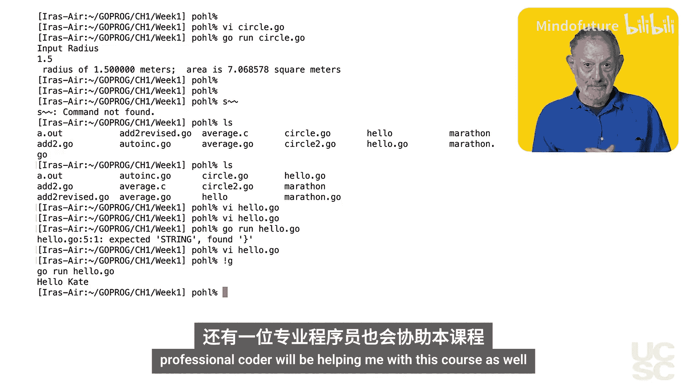

# Go语言编程：P02：你好世界


## 概述

在本节课中，我们将学习如何编写第一个Go程序——“Hello World”。我们将详细解析程序的结构，理解每个部分的作用，并学习如何运行和调试它。

## 程序结构解析

自从Kernighan和Ritchie的著作《C程序设计语言》将C语言介绍给世界以来，书中讨论的第一个程序，以及现在每个人编写的第一个程序，都是“Hello World”的某种变体。理解任何语言中的简单程序结构都很重要。

在Go语言中，这个程序写在名为 `hello.go` 的文件中。你需要使用自己的编辑器，我将使用VI。

以下是该程序的样子：

```go
package main

import "fmt"

func main() {
    fmt.Println("Hello World")
}
```

整个程序包含一个特殊的关键字 `package`，它声明为 `package main`。接着是一个 `import` 语句，它引用了 `"fmt"` 库，`fmt` 代表格式化。然后是函数，也就是主程序本身，执行的部分是 `func main()`。`package`、`import`、`func` 都是语言的关键字。`main` 后面跟着圆括号 `()` 和花括号 `{}`。在花括号内，我们有一行可执行代码 `fmt.Println("Hello World")`。最后是结束的花括号。这就是我们的整个程序。

## 深入理解

让我们更好地理解它。Go源代码通常保存在以 `.go` 为扩展名的文件中，这能让编译器识别它是源代码。它可以通过 `go` 命令运行。在我的Mac终端窗口中，我将尝试运行 `go run hello.go`。`go` 是指令，`run` 表示尝试将此代码转换为可执行文件并运行它。

如果你做的一切都正确，那么在你运行此程序的计算机上，你将看到打印出的“Hello World”，并且会自动添加一个新行。这就是为什么这个特殊的输出函数被称为 `Println`，`ln` 代表换行。我们还会看到其他不一定添加换行的打印函数。

## 逐行剖析

我喜欢通过“剖析”的方式来讨论程序，这在我早期讨论C和C++语言的书中被称为“C by dissection”和“C++ by dissection”。这是一种逐行检查并详细解释程序的方法。

我们需要理解这段代码，因为它是一种惯用模式。一旦你理解了它，你就可以编写各种其他代码。

首先，我们需要 `package main`。`package main` 表明这类文件是一个完全可运行的程序。因为在Go社区中，还有其他包含代码但不一定被运行的包，而 `main` 包需要一个作为执行起点的 `main` 函数。

下一个语句是 `import "fmt"`。这是库代码。`fmt` 代表格式化，它包含了所有用于读取输入和写入输出的必要函数。如果你是一名C程序员，你会看到这相当于 `#include <stdio.h>` 语句。但所有这些都消失了。我们不再使用这些 `#` 语句，因为它们涉及预处理器，而预处理器会导致难以解析的错误。`import` 是语言内置的，你可以导入任意数量的库。

然后我们有了实际的 `main` 函数。虽然 `main` 不是关键字，它是一个标识符，但它用于指示程序执行从此函数开始。`func` 是 `function` 的缩写，也是一个关键字。与C语言不同，Go的所有函数都需要这个关键字。C语言以数据类型开始，然后是 `main`。在C中，你会看到 `int main()`。最后，我们有 `fmt.Println("Hello World")`。`Println` 是一个非常灵活的函数，它可以适当地输出括号内的任何内容。这里是一个单独的字符串。但我们也可以，正如你稍后将看到的，打印变量，变量将根据其隐式类型被打印。所以我们不需要所谓的格式字符串。如果我们想要格式字符串，我们将在后面的一些代码中看到类似函数 `Printf` 的使用。

因此，`Println` 非常简单、直接、易于使用。最后，我们看到每个 `func` 都以右花括号结束。同时，函数体内的代码以一个左花括号开始，然后以一个右花括号结束。

## 注意事项

现在，我应该提到一些事情。如果你来自其他编程环境，这很容易在早期导致错误。Go社区期望你每行写一行代码，然后换到新的一行。隐式地，Go编译器在读取到行尾时，会认为那里有一个分号。这可能导致以下错误，正如我们在这里看到的：如果你写 `func main()`，然后像在其他语言中一样，把左花括号放在它下面，它实际上会显示为 `func main();`，这将导致语法错误。所以请注意这一点。当然，如果你做错了，编译器会给你错误信息。实际上，你应该尝试一下，以便熟悉编译器如何告知你任何类型的语法错误。

## 实际操作演示

现在，我将转向在我的计算机上实际展示代码的使用。我就在我的Mac终端窗口上，操作系统是Unix。我在一个保存本周课程的程序的目录中。我们刚刚完成的第一个程序是 `hello.go`，我将对它做一点小改动。

如果我想修改程序，或者只是想看看我已经有什么，我可以使用我的编辑器。所以 `vi hello.go` 让我进入程序。这就是那个程序。你可以看到，它基本上就是我放在程序顶部的这几行。我称它为程序1.2，名为输出，它展示了输出功能。我有 `////`，正如C社区和C++社区所知，这是一种引入单行注释的方式。所以这与代码无关。它只是注释，便于我或其他人阅读和理解。同样，我们有 `package main`，我们导入了 `fmt`。

让我对此做一个修改。有时我想要不止一个东西，不止一个库。有一个方便的方法可以做到这一点。我可以用括号，然后在里面放一个或多个库。在这个例子中，只有一个，因为语言的一个有趣特性是：如果你添加了不打算使用的库，它将不会运行你的代码。它期望你只使用在该特定程序中实际有用的库代码。所以不能有无关的库在里面，这是不允许的。这仅仅是使语言比C语言世界更不容易出错，在C中你可以 `#include` 任意多的库，即使你不使用那个库，程序也不在乎。

如果我这样做，如果我以这种方式导入，哎呀，这将是一个错误。这很有趣，我用了错误的闭合符号。然后在这里，我没有说“Hello World”，而是说“Hello Kate”。所以有点不同。让我们继续尝试运行这个。首先，我必须退出编辑器。现在，正如我之前所说，我们运行 `go run hello.go`。让我们看看会发生什么。回想一下，我有一个错误。`hello.go:5:1: expected string, found '}'`。所以我必须修复它。我要回到我的编辑器。现在，我要修复那个错误的符号。记住，在这些编程语言中，有很多东西必须匹配。哎呀，抱歉，我修复了错误的东西。你必须非常小心，是在第5行。好的，我想我现在已经修复了，希望如此。导入部分，不，我还没修复那个，所以。这是实时演示。好的，注意当我修复它时，我得到了一些确认，因为它高亮了左花括号和右花括号。所以这是大多数编辑器的一个好功能。所以如果你把光标放在这个字符上，它会高亮另一个左花括号。好的，我看到那里也错了，所以我最好去纠正它。那必须是右花括号，现在你看到它被正确高亮了。所以我想我现在没问题了，希望如此。好的，我要重新运行 `go run hello.go`。它输出了“Hello Kate”。

这不是一个非常复杂的程序。希望你对这一切是如何工作的有了一些感觉，并且你应该自己动手做，包括尝试注入错误，看看会发生什么。你也可以改变输出的内容，就像我把“Hello World”改成“Hello Kate”一样。Kate是一位将帮助我的专业程序员，她也将帮助我完成这门课程。



好的。


## 总结


本节课中，我们一起学习了Go语言中“Hello World”程序的基本结构。我们了解了 `package main`、`import` 语句和 `func main()` 函数的作用，并学习了如何运行和调试简单的Go程序。通过实际操作，我们还看到了如何修改代码和导入库。掌握这个基础程序是学习Go语言的重要第一步。