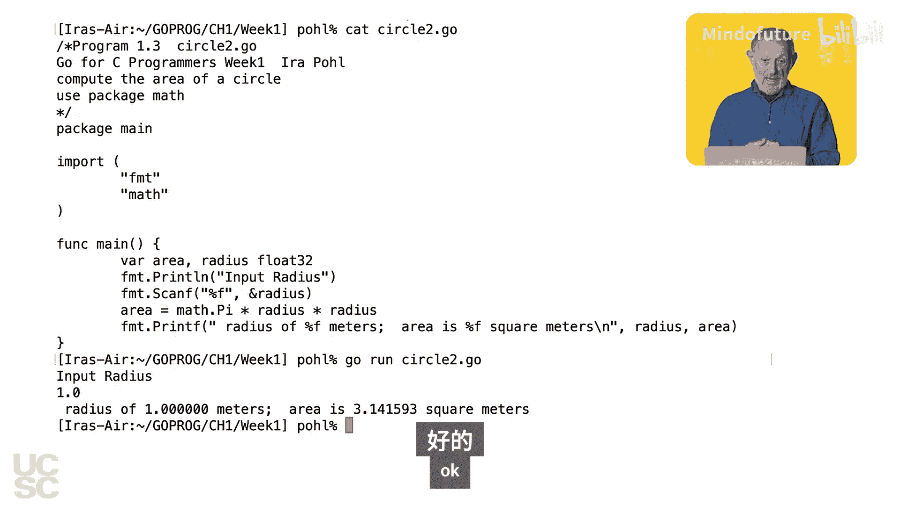

# 【加州大学】Go语言编程-｜-Go-Programming-Everyone-Part-1-p03-P03_圆形_01_02_01--BV1h3e7zBE3U_p3-

In this segment。We will write code to compute the area of a circle。What the radius is。

And then use that to compute the area。 So in this program， we will see how to enter information。

Capture it in the program and then use it to print out。 So we're going to see。And the next slide。

 how that code looks。And we'll calling thatcicle。go， remember our programs。

Are in files that end and dogo， which means they're compileilable go programs。So in this program。

 you will see。The critical variables。诶。For that start with Maine。 Remember any time we write。

Programmed that's to be executed。 we call it package main。

And then we have this function main where the code starts。And you'll recognize。

 just as you learned in high school mathematics， that we have two variables。

And V A R is what's called a key word。 So it's very special in the go。

And there will be area and radius， and they'll both be of the data type F 32。

 The 32 is how many Bs are used in representing that float number。It turns out in go。

 you can choose either F 32 or float 64 if you need a much bigger and more precise。

Floating point number， though， typically， that also means it will take longer for the computer to compute such a longer number。

Now， as you see in the code。We need pi and pi is a constant， so unlike the variables area and radius。

Pie stays the same， throughout。The code。And。When we assign 3。14159 to pi。The compiler。Interprets pi。

 which is what's called an identifier。As a floating point number。

And it's a floating point number that cannot be modified unlike the variables， area and radius。

And then we see that we're going to input。 We've used print line before。

 that will just give us a message on the screen that says input the radius in meters。

And then to do the input， we have this。Other function we grabbed from。

Format from the format package and that scanf capital scanf notice。That。

Anything we get from format like print or scan， we're always going to see as a capital。

 And that's later， we'll discuss this more， but that's a feature。Of。

Exporting things from packages that their names are capitalized。And there in Scf， we have a percentf。

 Percentf means it's a floating point format。 And then we have Ampersand radius。

 and Ampersand radius is just like it was in the sea world。

 And for those who didn't come from the sea world， it means。Stick this in。Where radius is located。

 Ampersands address of radius。 So this tells you to take whatever number you're inputting。

 typically from the keyboard and stick it into radius。

And then we have our computation area is pi times radius times radius。So。

We compute that and then we finally print it out。Okay， so that's our program。

 Let's examine the program in the next slide in a little more detail。Again。

 it's critical to notice how the code is structured。 There's always a package main。

There's always this funk main， funk and package are key words。 Maine is an identifier。

 but is an identifier that has this very specific quality of always starting a program。Now。

 in that little piece of code， we see that we're using a multi lined comment。

 multi lined comments are started by backlash star， and then you can have as many lines as you want。

 and you can end them with backlashlash star。Package main， as before。And then we do this import。

 which is telling us where to find things like print line and Scf。Finally。

 we declare variables and notice that the variables we get to pick their name。Now。

 we could have made area。Have a different name。 We could have just said Q2。

 And anywhere you see area， you could have substituted Q2。 The computer wouldn't have cared。

 But when you go to read the program， a human wouldn't understand why did you choose Q2 instead of area。

 So very important for writing， readable code is to pick names， identifier names。

 You get to choose them。 That makes sense。So that the code is readable or， as Don Cannuth would say。

 the code is literate。And as we said before， in this variable declaration。

 we're choosing the type F 32。Then we finally imp。 We finally issue a message to tell。

If we didn't issue that message and we ran this code， all we'd see is the computer would stop。

 and we'd have to realize with the computer stopping。 We had to input it。

 So we put in a message saying input。And then we put in our number。And then the number shows up。

 We do the。Area calculation。And， as well see。呃。Times as an operator， will have。In the next week。

 a segment that talks in great detail about the different kinds of operators available。

 What we have to know about operators are。Their precede in theirsoocciivity。

 And we'll talk more about that next week。And then we just print out the answer。

 and it comes out as we say as we've assumed that we're doing everything in meters。

So that's what's critical to this program， again。Comments are disregarded by the compiler。

 commentsments are meant for the human reader。If you have to maintain your own code。

 you want to know what you did。 Some else has to maintain it or use it。

 They want to know what you did。 So comments are very important。

 but they don't affect what the computer executes and。Just as in C and C+ plus。In go。

 you can have either single line comments， which are slash， slash。

 And then whatever is on the rest of line is a comment。And those are very useful。

 especially if you want to end the line with a comment。And you don't want to have to do。

Open slash star。 Sometimes if you forget the closing star slash。

Then the program just doesn't compile。So the single line comment is convenient because it's less typing and doesn't lead to certain kinds of mistakes。

 a multi line comment is convenient because again for multi line。

You don't have to assert at the beginning of each line to slash s。

 but either one can be used in place of the other。Format is where the IO functions were found。

 and there are other more advanced IO functions that we'll talk about later in the class。

 or you can look for them yourself。And they replace， if you've come from a sea background。

 what gets done in sharpen clue standard。I O dot H， where you found your I O。

Functions now a sharp include in C was using what was called the preprocessor。And go。

For reasons of security gets rid of the use of preproces。 you won't find a preprocesor。

 You won't find things like sharpr gluten sharpr define。In go。 And that makes it much safer。Again。

 go unlike sea， has very specific。ADe selection of data types， so you can say float 32。

 you can also say N 32， you can say N64。Whereas in sea， you say， float and double。And go。

 you say float 32 or float 64。And this is because go directly implements the IE。

Standards for numerical programming。Directions such as the constant direction says whatever I is whatever identifier am I using should be treated as constant。

And it could infer in that statement that that constant pi was indeed afloat because it saw con p equals 3。

149。 It knows 3。149 is ill literal。 So it understands its type。

 and it didn't require that you say con pi。Flolow 32 equal 3。14。And。

That's just because it's a saving again and typing it。A choice， by the way。

 the language was designed to make certain things。啊。Easier for the programmer。

Notice there was no squaring operator， So we need to use multiply twice to get our result。

 If you wanted， you could write a function that would square a number， but we don't have that。Now。

We'll see a lot more about how to declare things in next week's segments。 But generally。

 the standard way to declare something is using the key word there， remember。Go has 25 keywords。

 These are very important。 conceptually。 You'll have to know how to use every one of them。

 You can look them up in a keyword table。 I will show you later in one of our segments。

 that key word table。And ver is critical， too。Having。Different variables。To use in your program。

It's a little different than C， if you recall， if you come from a sea background or from my earlier sea course。

Instead of saying ver。Radius。Float 32， you would have said， float。Who had said the data type name。

And then you would have said the ver radius。Semicola。And here you don't do that。 You say there。

 you give the different。Names， they can be a list， comma separated list。

 And then you indicate a type。 And then if you want， you can also do an initialization。 Otherwise。

 they're automatically initialized to 0。So， everything is fairly safe。There isn't anything undefined。

 If you declare something， it's going to be a 0。Print line and print F can be used interchangeably。

 Pri F requires。Some kind of。Foratting the first string being interpreted as how to format the fault the rest of the arguments print line decides on what types。

Are being given in the。In its argument list and then prints accordingly。

 So print line is a little lazier， but doesn't give you the exact control that。A print。

That Prince F gives。Now let us turn to my running the code on my terminal window。

So let's see the code actually work on my Mac。And we're in the terminal window。

 And we see on that window。The code， as we saw on the on the slide。

 So it's all variable air area of radius。 We have conspi， and then we have the。

Prompt to ask for input。 And then we do a scanf and bring the input into radius。

 Then we do the expression where we're computing the area。And finally。

 we do the print out so we can get it on the screen and see what the answer is。

 it's a very very common type of computation， so。It's almost idiomatic of doing something where a formula is involved。

 and it's a hassle for you to do the formula by hand， and so you make up a computation for it。

And then， as you remember。We're going to run that。 Make sure it works。 So we'll do go G O。

 which calls a compiler， run says。Take whatever my file is。 It has to be a file that。Is。

We name it circle。Dot go。 So the extension is。go， if you recall， in the sea world。

 an extension would have been dot C。So that's very common to use something connected to the language to indicate what the file name that the file name is storing source。

Now， when we do this， if there was an error in the code， a syntactic error， it would appear。

But I'm pretty sure this is going to work。So it's compiling it prints on my sing input radius in meters。

 Let me input one。And think a second。 what should the answer be， Well。

 everybody should know that High school math again。It's pi times 1 squared， so it's going to be pi。

 And indeed， radius of 1 m area is 3。14159 square meters。Now。

 let me run it one more time and just show you that。In debugging it。

But typically would run several cases just to make sure we understand what's going on。

Just because program runs doesn't mean it's correct。It just means it's been pared that it's legal go。

 but that doesn't mean it computes what we want。So I'm running it again。It says input the radius。

 Let's say I input one point。4，5。So that would require。Me to check on。 But let's see what it goes。

 So it goes as 6。605194。 That sounds about right。 You can check on that。So there we are。

 we've run it。 Now， I want to show you one more thing here。So I wrote a second program。

 and the second program is called。Circle 2。God go。And I made one significant change in that program。

In that change， I've imported two things， two packages， I've imported formats。

 and I've imported math。Now， in the go world， just like in the C world， the C plus plus world。

 the Java world， all these worlds。 There are things called libraries。

 There's a lot of code that's already been written that needs to be reused constantly。

 And the good programmer doesn't write their own versions of code that's already been tried out in the community and has become so valuable as put into different libraries。

 math library has lots in it and among the things left， the math library has。

Is the constant pie and it pie to。As many places as is needed to have the most precision for a floating point number run on a go program。

So if we're going to import， which we do frequently for more than one thing， then we have。

 we can use。Instead of multiple import statements， we can just do an open。Pen。

And then quote the different packages we're importing from， and then a close paren。And， finally。

We can use it。And just like with print F， we use format dot print F。When we use P Pi here。

 and you can see that in this statement for area， area equals mathth dot Pi。So the way you address。

A name， an identifier taking from one of these packages is its prefix。

 so it won't be confused with what might be some other package。Or the local package。

We'll see later that it would be a bad idea to be using names from different packages and different scopes continuously because it' would be confusing。

 So， again， try and stay literate and literate means make sure your identifier your names。Are clear。

 and just like here with math dot P I。嗯。It's。Clear that it's coming in as a constant from the math package。

 And the reason pi is。Capitalized is， again， because we're exporting it from the math package。

 just like we exported scan F。 And that means it will be capitalized。

 Its first letter will be capitalized。 And now， if we run this。呃。So it was circle2。go。

And let me do 1。5 again， or let me just do 1。0。Let's see what the answer is。

And notice we get a little more than just 3。145， we get 3。14593。

 which is more exact than when I did pie as a local constant in the previous program。Okay。

