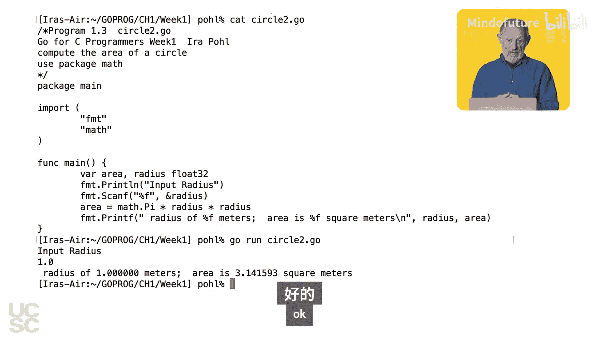

# Go语言编程：P03：计算圆的面积


## 概述
在本节课中，我们将学习如何编写一个Go语言程序来计算圆的面积。我们将看到如何从用户那里获取输入（圆的半径），在程序中使用它进行计算，并最终输出结果。这个程序将涵盖变量声明、常量定义、基本输入输出以及使用数学公式进行计算。

---

## 代码结构解析

上一节我们概述了程序的目标，本节中我们来看看实现这个目标的代码结构。

任何可执行的Go程序都必须以 `package main` 开头，并且包含一个 `main` 函数作为程序的入口点。

以下是程序的核心结构：
```go
package main

import "fmt"

func main() {
    // 程序代码将写在这里
}
```
*   `package main` 声明这是一个可执行程序包。
*   `import "fmt"` 引入了格式化输入输出包，我们将使用其中的函数来打印信息和读取输入。
*   `func main()` 是程序开始执行的地方。

---

## 变量与常量声明

理解了程序的基本框架后，我们需要存储数据。本节我们将学习如何声明变量和常量。

在Go语言中，我们使用 `var` 关键字来声明变量。对于计算圆的面积，我们需要两个变量：半径和面积。我们选择使用 `float32` 数据类型，它表示32位精度的浮点数。如果需要更高精度或更大范围，可以使用 `float64`。

常量使用 `const` 关键字声明。圆周率 π 是一个不会改变的值，因此我们将其声明为常量。

以下是声明部分的代码：
```go
var area, radius float32
const pi = 3.14159
```
*   `var area, radius float32` 声明了两个 `float32` 类型的变量。
*   `const pi = 3.14159` 声明了一个常量 `pi` 并赋予其值。编译器会根据赋值 `3.14159` 自动推断 `pi` 为浮点类型。

---

## 获取用户输入

声明了存储数据的变量后，我们需要从用户那里获取半径的值。本节我们学习如何进行输入操作。

首先，我们需要提示用户输入。我们使用 `fmt.Println` 函数在屏幕上显示一条消息。然后，使用 `fmt.Scanf` 函数来读取用户从键盘输入的数字。`&radius` 表示将输入的值存储到变量 `radius` 的内存地址中。

以下是实现输入功能的代码：
```go
fmt.Println("Input the radius in meters:")
fmt.Scanf("%f", &radius)
```
*   `fmt.Println` 用于输出提示信息。
*   `fmt.Scanf("%f", &radius)` 中的 `%f` 指定了输入格式为浮点数，`&radius` 将输入值存入 `radius` 变量。

---

## 进行计算与输出结果

获取到半径后，我们就可以进行计算并显示结果了。本节我们完成最后的计算和输出步骤。

计算圆的面积使用公式：**面积 = π * 半径 * 半径**。在Go语言中，乘法运算符是 `*`。计算完成后，我们使用 `fmt.Printf` 函数将结果格式化输出到屏幕。

以下是计算和输出的代码：
```go
area = pi * radius * radius
fmt.Printf("Radius of %f meters, area is %f square meters\n", radius, area)
```
*   `area = pi * radius * radius` 执行面积计算。
*   `fmt.Printf` 允许我们控制输出格式，`%f` 会被后面提供的变量值（`radius` 和 `area`）替换。

---

## 完整程序与运行示例

现在，让我们把所有的代码片段组合起来，看看完整的程序是什么样子，并观察它的运行。

以下是完整的 `circle.go` 程序代码：
```go
package main

import "fmt"

func main() {
    var area, radius float32
    const pi = 3.14159

    fmt.Println("Input the radius in meters:")
    fmt.Scanf("%f", &radius)

    area = pi * radius * radius
    fmt.Printf("Radius of %f meters, area is %f square meters\n", radius, area)
}
```
运行这个程序时，终端会等待你输入一个数字作为半径。例如，输入 `1`，程序会计算并输出面积约为 `3.14159`。

---

## 使用数学库改进程序

我们之前的程序自己定义了π的值。实际上，Go语言的标准库提供了更精确的常数。本节我们学习如何利用现有的数学库来改进程序。

我们可以导入 `math` 包，它包含一个预定义的、高精度的 `Pi` 常量。注意，从包中导出的标识符（如 `Pi`、`Scanf`）首字母都是大写的。

以下是改进后的 `circle2.go` 程序：
```go
package main

import (
    "fmt"
    "math"
)

func main() {
    var area, radius float32

    fmt.Println("Input the radius in meters:")
    fmt.Scanf("%f", &radius)

    area = math.Pi * radius * radius
    fmt.Printf("Radius of %f meters, area is %f square meters\n", radius, area)
}
```
*   使用 `import (...)` 语法可以导入多个包。
*   `math.Pi` 使用了 `math` 包中提供的π值，其精度高于我们之前定义的 `3.14159`。

运行这个程序，输入相同的半径，你会得到一个更精确的结果（例如 `3.141592653589793`）。

---

## 关键概念回顾

本节课中我们一起学习了如何构建一个完整的Go语言程序。以下是核心要点的总结：

1.  **程序结构**：可执行Go程序必须包含 `package main` 和 `func main()`。
2.  **变量声明**：使用 `var` 关键字，语法为 `var 变量名 数据类型`。多个变量可以一起声明。
3.  **常量声明**：使用 `const` 关键字，编译器通常可以自动推断类型。
4.  **输入输出**：
    *   使用 `fmt` 包中的函数。
    *   `fmt.Println` 用于输出一行信息。
    *   `fmt.Scanf(“%f”, &变量名)` 用于读取浮点数输入。
    *   `fmt.Printf` 用于格式化输出。
5.  **计算**：使用算术运算符（如 `*` 表示乘法）进行计算。
6.  **使用标准库**：通过 `import` 导入标准库（如 `math`），并使用 `包名.标识符`（如 `math.Pi`）的格式来使用库中的功能。
7.  **代码可读性**：为变量选择有意义的名称，并适当添加注释，这对于编写易于理解和维护的代码至关重要。



通过这个计算圆面积的例子，你已经掌握了Go语言程序的基本组成要素：包导入、主函数、变量常量、基本IO和算术运算。这些是构建更复杂程序的基石。