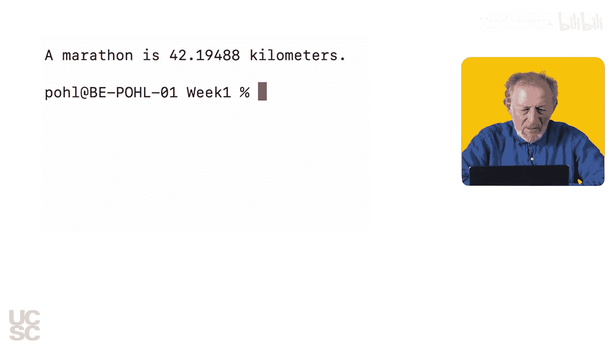

# 【加州大学】Go语言编程-｜-Go-Programming-Everyone-Part-1-p04-P04_马拉松_01_02_02--BV1h3e7zBE3U_p4-

In this segment， we're going to write a program。That converts。From miles and yards to kilometers。

And we're going to choose a distance a marathon race is。Sorry。

 everybody knows a marathon race is 26 miles， I think， and something like 300 yards。

But most of us don't know what the kilometers are。And this will give us further practice in basic simple programs。

Itll also give us some practice with。Print out。And with some formatting。 And finally。

 it'll also give us。The notion of how you have to convert between types in ways that you don't necessarily need to do in the C language。

 for example， if if you've come with a C background。

 or even some other languages where some of the conversions get done automatically。

 which they don't in go， Oh， that's a very important characteristic of go。

 which makes it a safer language。So here's our program。诶。Go for C programmers。

 compute the distance of marathon in kilometers。And。Notice in our function。

 we start with miles and yards being integers， the integers of type。In 32。

 we don't need a much wider type。And we're going to get the result in a floating point number。

 namely a F 32。So we're going to have to do what I call a conversion。 That's， as I say。

 if you're used to the sea language， a lot of this is done。Without seeing the conversion。

 the compiler decides on what to convert and how。But Go adopted a much more stringent attitude that said all of these types are separate。

 And if you want a conversion， you have to。Explicitly show it。 So look at the conversion statement。

 which is kilometers。 the the calculation， kilometers equals 1。60934。 That's a floating point。

 constant。Times， and now we have a parentheized expression where。Float 32 forces a conversion。

 so we convert the expression found after F 32， which is miles， which would be the 26 miles。

 And you can imagine that now it's converted to 26。0。

And then we have to also convert the yards over 1760， which is。How many yards are in a mile？

 So if we have this 300， I think，65 yards， that's going to end up being a fractional number。

 And if that had been done and strictly in an integer domain， we would have。

Seeing that that got to be zero。Because the integer divide of a small of a number smaller than the divisor ends up being a 0。

 So in order to get an exact result， we have to force these conversions。

 And then just as we discussed previously in formats， we're going to use printf， we're going to say。

 start on a new line， a marathon is。Force the argument that's following to be in a percentche and kilometers and then advance the curor two new lines。

And give the answer kilometers。Okay， that's the whole program。And just as a reminder。

 I have comment after the code， which says there are critical differences。Percent G， by the way。

 is a good choice。By the way， again， if you have used printf in the sea world。

There were also formats。But not everything is the same。

 So you've got to look explicitly at the format lists and how they work in the go community， though。

Intuitively， you're doing something very similar to what goes on with a printf in the sea community。

 If you come from the sea community。All right， finally。

 let's look at some of the critical parts of that program。Here's our declaration。

 where we're in the integer type。So we have， excuse me， it was 385 yards。

All of this is a 32 B integer， which capable of explicitly representing plus or -2 billion。

 We could have chosen to do everything in N 64， and that would be give us much larger ranges。

 but there's no need for it。 Then also， it's perfectly reasonable to use a smaller floating point type。

This allows us to get a more exact conversion。 And here， as I said before。

 we're forcing the two sub arguments in the expression miles plus yards over 1760 to be in the floating point domain。

So we see how to declare variables with initial values in this code。Otherwise。

 these variables could have gotten zero as an initial value。And the biggest distinction from C。

 if you've written this in the sea in the sea world。

 is that expressions with mixed arithmetic types do not get implicit conversions。

While it's very convenient in the sea world， it's also unsafe。

 It may may do something you didn't want here。 You're required to tell you what you want。

So go is much safer。Now let's go and see how this code runs on my terminal。Okay。

 so here we have the marathon program。As described in our little lecture。And notice。Again。

Some of the critical parts， this is the expression。Where you get this conversion。

And we have to force a conversion on miles and yards。 By the way。

 we could have started with everything being in float。

And if we had forced miles and yards to be floating point numbers like 26。

0 and declared them as float， then we wouldn't have needed a conversion。 So that would have bitten。

A much simpler way to go， but it wouldn't have enforced。

The idea that frequently we have mixed types and we have to do conversions if we're going to。

Compute with mixed types。So we're going to get a result。And here we're using Preci。

 so we'll print it。In whatever。Is convenient。As decided by percentci。

 because that could be either a percent E or a percent F。And as I said before。

 you have to be conscious。Of the differences from C， though， there's a lot of similarity as well。

 if you're coming from the sea world。 So let's try this out。

I've told marathoners and asked them at least American marathoners， well。

 what are you running in kilometers， and they haven't a clue。

So you can impress people with knowing what that answer is。 And there we are。

 It's basically 42 km with a 。19488。Not quite 0。2 kilometers。

So it's roughly 42。2。

