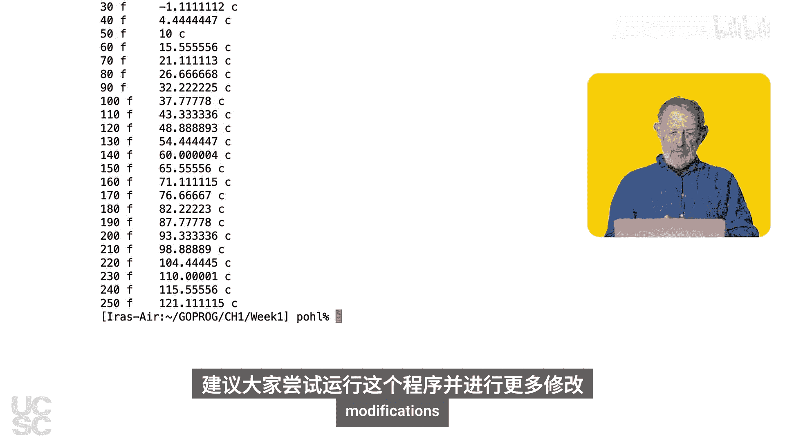

# 【加州大学】Go语言编程-｜-Go-Programming-Everyone-Part-1-p05-P05_温度_01_02_03--BV1h3e7zBE3U_p5-

Okay， so now we're going to do。In some sense， a very famous program。 how to convert。

Between centiegrate and Fahrenheit。And I'd say it's famous because。

In the original Carnegan and Richitchie book。In 1978， that taught everybody see。Page 8。

They gave a program that was the form of what I am showing you， so。

If you have come from the sea community or my own sea course， you'll have seen code like this in C。

 And we will mention what some of the differences are from the sea community， or otherwise。

 you can just understand it。As a beginner， without that background。But again， because。Carnegan。

Chhowose this as a nice， early， very early example in understanding how of code。诶。呃。

I'd pay my respects for him。And Richie， the inventor of the C language。Okay。

 so what we're going to see that's different in this program that you should pay particular attention to。

Is。That。We're going to use what is called a for loop or a loop。So until now。

 we've had a very simple linear structure to our program。It's like a recipe where in a recipe。

 you say。Take some salt。Put your salt into the soup。Heat your soup to。180 degrees。

Keep it on the stove for 30 minutes and now prepare to serve it。So that's like a linear recipe。

But what if in the soup， you say。Stir from time to time， taste。If there's enough salt。

 don't add any salt and go on to the next step。 But if it's still not salty enough。

Put in a little bit。 a teaspoon of salt。Continue to stir。Taste again。

 So that tasting thing is what we might call in the recipe， a loop。

 and loops are super critical in programming。It's easy enough to do a computation that's a simple computation like we did for area。

I mean， you can do that with paper and pencil， or you could do that on your smartphone using the smartphone calculator package and it wouldn't be a problem。

But。To do。1000 of those or a million of those。That wouldn't be possible in a reasonable amount of time for a person。

Computer can do a million things in。Almost instantaneously。

So anything that requires repeated computation。Over a data set。Is。Ideally suited。To a computer。

And we need to have a flow of control。 That is a loop。 So rather than have a linear flow of control。

 We go in and keep doing the thing until we're finished。 That's a loop。And the way we do looping。

In this language is to use the key word for。So we'll see that here。And again。

 this is a critical idiom to understand how to do lots and lots of program later on， we will。

Show you。In the middle， towards the end of the class。How to do arrays or what are called in C and go。

 not in C and go slices。In which you package a lot of homogeneous data。

 and then you do some processing over all that data sitting in those slices。

So that'll be very important later on and'll show you the power of looping。

 then we'll see looping here。So what this program is supposed to do is it's supposed to print out a table。

 and we're going to go from 0 to 250 and do a comparison between the Fahrenheits。And。

The centtgraderates of those temperatures。And we've chosen。

A from a two and a by in our first declaration， are vera。And those are from 02，2。

50 by a step or increment of 10。And then we have our two chosen。Variables Fahrenheit in centtegrate。

 and they both start at 0。And Fahrenheit starts from the from value。 So we're going to start from 0。

 Fahrenheit。 Compute what the centigrade value is。And then we're going to go on by steps of 10。

 So the next value would be Fahrenheit 10。 And then Fahrenheit 20 and Fahrenheit 30。

 And then we're going to continue until we get to the2 value， which is 2，50。

So there are going to be 25 values on the screen when we get done。

 So it's going to be a table of 25 values。 Fahrenheit 0 to2 50。

 And we'll see the corresponding centigrade temperature。

So notice in line3 of the main function that we have to do one of these conversions again。

You just conversions are safe。 And so you have to take Fahrenheit， which is a float variable。

And convert。呃。The front variable， which was an integer variable。

So we're saying Fahrenheit starts from 0。 And then we say4。The integer variable。

 the integer interpretation of Fahrenheit。As long as it's less than the two value。

 Remember the two value that's 2，50。So0 is less than or equal to 2，50。

So that is that less than or equal is a comparison operator。And at first，0 is less than 2，50 is true。

And then as long as it's true。We will continue to do what's sitting inside that loop。

 And notice the loop will start with this curly brace。

 Curly brace is always needed in any kind of what are called flow of control statements in the go language。

 not completely true of the sea language。 and what we're producing here。

 If you've taken the sea course or come from that community is what's called a while loop。

So while doesn't exist explicitly， while is a key word in C and is a key word in a lot of languages。

But。It's。Not。Needed。Because you can use the foresstate as while， and。

The designers of the Go language decided to leave while out as a consequence。So。

We have this one condition， which is tested to see its true。 As long as it remains true， the loop。

 all the statements that come after the。Curly brace。Until the matching curly brace。

 they're all executed in turns。 So we see centigrade is equal to 5。0 times 9。

0 times the floating point representation of Fahrenheit-32。And that's。

The conversion operator for centiegrate。From a Fahrenheit temperature。And then we print it out。

 again， we printed out using the percentche， as we've used before， because that's convenient。

 And that's a very compact floating point representation。

 And we print out Fahrenheit and the corresponding centigrade value。

So we're going to see on the screen 0， and then its cent value 10。

 and then its integrate value and so on。 And then notice in the final statement inside the loop。

 we have Fahrenheit plus equals。 So that's plus assignment， which means add to Fahrenheit。

The by value。 What was the by value was by 10。If we wanted a much bigger table。

 we could do it by one， then we would go 0，1，2，3 all the way to 250。

 and we'd have 250 values up on the screen。So all of these things could be modified。And I actually。

Wouldd like you to。呃。Play with the program and try and modify some of these values and see how the program still behaves。

So。What ends up being really different from sea is。We don't use while。

 We don't use the key word while。 instead use the for version of a while。And。

If a while was operating on a simple statement， it wouldn't need to be necessarily。

Backackaged in an open。A curly brace。 But it's always packaged in an open curly brace in the go language。

 Even for a single statement， even if for we were executing a single statement。

 you would still need that open brace。 And you'll see that again in other forms of flow of control。

When we'll go to explain things like the if and the F L's construct， the same thing will occur。

 We'll always need these curly braces。 And why it's clearer。 Curly braces stand out。

 and we then have an ination value。 We put the things being executed。 notice。

Their tab indented on my code。And we'll see that later when I run the program。

So that we understand visually again， it's literate。 compiler doesn't need that， but we as。

Programmers want to be able to read our code， and that makes it very clear。What is being looped over。

Okay。The general syntax for the for statement is。Similar to what would be in C。

 It would be the key word for。But notice。If you came from the sea language。

 you would expect a parentheses right after the fort。In。Go。

 you don't use parentheses for your controlling elements。So it's4。

 and then it's the first expression， which。Is generally the initializer expression。

 the second expression， which is the test expression， which needs to be true for the loop to go on。

 And the third expression is typically an increment expression。

So that's the general form of the four syntax。 And then you start the loop with your open。

Curly bracket， until。The next curly bracket。Now， when E1 and E 3 are omitted。

 we get to the wild statement and。Notice there was no need for semicoants。

 So the wild version of the four just has E 2 and just looks at E 2 as long as。呃。Now。

I poses a question because I'd like you to play with the program。

Can you modify the program to input values from to and step。That would make the program。

More sophisticated and more useful， because you might want a different range of values for centtegrate and。

Sent agrade in Fahrenheit。So a question for you is。

 can you modify this program to input values for the variables from to and step？

And that will make the program even more useful。And now let's go and see the code on my terminal。

So here we are on my terminal and I have the code for temperature。go。And。呃。

You can see at the top that that I say the conversion that we're using as centigrade as 59s times Fahrenheit -32。

 And， of course， when we turn that into。A。Go statement。 We have to also make sure that we have。

Things in the proper domain， namely that everything is being computed。In floating point。呃。If。

We use this without floating point conversion。 The integer value 5 over 9 would be 0。5 divided by 9。

呃。It's not going to be what you expect because。5 and 9 are integer。

 And when you do an integer divide on that。You actually get zero。So that's something to keep in mind。

Now， if instead， as you see in the program， we use 5。0 divide by 9。0 there。

 The operator is known to be floating point divide。And again， we see。

All these ideas we already talked about。 and the critical difference from C is in C。

 we would have used a while loop， and we would have used the key word while。

 which doesn't exist in four。 because it's unnecessary。 So the four people just said。

 let's omit it and let's just use 4。 And the four statement， as we'll see。

 when we use it later on with slices， also has a way of。Looping over what are called ranges。

 So that'll be very important as well。 if you want to try and jump ahead and do some looping。

 depending on your own experience。Okay。Let me run the program so that we can see what。What happens？

 So we'll do go。Ren。And there it is。 It fills my screen。

 You can see that 0 degrees Frenit F for Fahrenheit is -17。77779 centigrade。And then。

What's the boiling point of water， Well， in cent it be 100。In Fahrenheit， it it's roughly。

What about 212， I'm remembering right。And you can see that， while I didn't。Have that value here。

You could try it if you， if you redesign the program so that you increment by ones。

And you'll find where。呃。Centigrade 100， centigradeta。 Remember， the centigrade scale。

Which considered a metric scale， was chosen where 0 is where ice freezes， where water freezes。

 and 100 is where water boils。But in Fahrenheit。You get。Water freezing at roughly 32 degrees。

 And you get water boiling at roughly 212 degrees。 So that's。Why， in some ways。

 centiegrate is a more logical and consistent table than a sort of offbeat Fahrenheit。Okay。

 so I say try and play with the program and try and come up with even more。

Even more modifications that make the program more useful。

