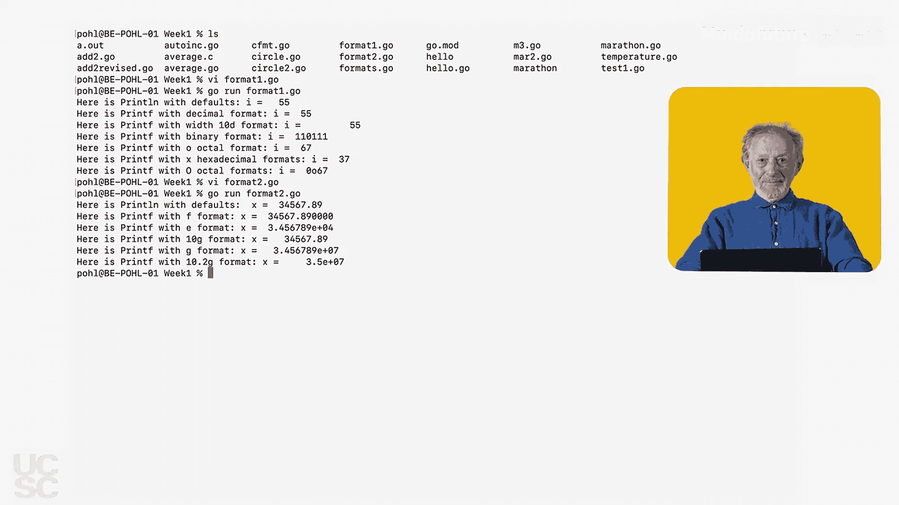

# 【加州大学】Go语言编程-｜-Go-Programming-Everyone-Part-1-p06-P06_格式_01_02_04--BV1h3e7zBE3U_p6-

So in this segment， we're going to talk about formatting。

And we use formatting in relation to input output。And principally， at first。

 we will largely concentrate on printing and the two。

Print functions that we will make use of our print L N and print F。

And they're both extremely convenient for printing to your screen。

And the easier one to use is print L N。 So if we see format dot print L N， and then we have a quote。

 X value is。with some space in it， X。Exia variable of type nt， let's say。

 was we restoring the value 55。 Then the screen will show。We。Character X value is 55。

 and the cursor will go to a new line。And that's why it's called print L end。

 The last part is to indicate that it'll always give you a new line。

 You don't have to insert it specifically。So print LN does its own formatting by knowing the types of the values its's printing。

If if we think about what we just printed， it has to know that X was an integer。

 and it has a standard format itll use to print that integer。

 and it knows the original x value is as a string， and the string is going to just be printed as is to the screen。

Print F。Meaning print where the format string is more complex because it it requires you now to provide the formatting for how the values。

And a list are to be。Printed。And the equivalent to what we just did using print F。

 because print F can always be used to give out the same thing that print Lend does would be format do print F。

 and then the format control string is X value is。 And here's where we get it interesting。

 we put in percent。 and after the percent comes the formatting instruction。 and percent D says。

Use decimal integer representation for the value that it sees in the following list。And backslash N。

Means move to a new line。So that gives us the feature of print LN where we wouldn't be left at the end of that line。

 but instead the cursor would move to a new line。So X。Has to be an integer。

 and presentee will interpret it and print it properly to the screen。Now， in order to properly use。

Formats。We're going to list。 and this is not comprehensive。 So if you want to see even more。

 you can go to the standard。Site for the go standard。

 and it will discuss every last format available to you。

 But these are the formats that will be most useful to us initially。 So here we see percent D。

 and that shows base 10， and it shows that 55 would be presented。But we also can。

 because it's very convenient for programme use to be able to print an ocal。

 An ocal is an integer with base 8， and 55 would show up on the screen at 67。

We can also print as hexidadecimal or base 16， and 55 would show up as 43 in hexadeademal。

 And then for for the really old school people who want everything in binary， we can print in binary。

 which is percent B， and that would lead 1，1，0，1，1，1。So those are。The integer formats。

 the most useful ones。 And then there are floating point formats。 and the floating point formats。

 we have formats like percent F， where we get sort of a standard notation like 12。345。

 And then we have a。Floating point format that can be used to give us an exponent。

And if we show up with an exponent that 12。345 would be written as 1。2345， E。

 meaning the power of 10 raised to one power。 So that would， in effect。

 mean you'd have to multiply that value by 10。Now， not in this list and you'll see it in some code。

 I will。I'll also use percent E， and percent E gives you strictly。What we。

 what we might call the exponent notation percent tree is fit when you use G。

 it's a little trickier G。Decides for you whether to use ordinary。

Floating point as in percent F or to use percent E。

 And its decision is based on what it thinks is more convenient and more legible。Okay， finally。

 we have percent C for character， so we could print out a， capital A as a character。

And then present S Letes print out a string， and the string can include things like blanks or special characters like back slash N。

So now let us turn to my terminal， I'm going to use these and show you and demonstrate explicitly how these things can be used。

So we're going to use the terminal on my Mac。And we're going to。Exhibit。Programs using formats。

And I encourage you to write your own such programs so you can experiment with it。

So the first program is going to be just called format1 go。Let's look at it。

And we see it's got a package main。And then。Oh， I。Have a whole bunch of the formats that could be used in the header。

呃。But this particular program is going to be formatting integer and showing how the integer formats can work。

So we're going to start by。Declaring a variable I with a value 55。 And remember。

 one of the ways of declaring a new variable。Inside a function is to use the colon equals and then the I。

Gets to be integer， because。The compiler can identify the 55 as an integer value。

So you don't need to say ver and I。Normal equals 55。 This is a shorter hand version of doing that。

 So we have I， and we're just going to print I in all sorts of different ways。

 And I'm going to print I with the default print line。 So print line is the easy。

 convenient way to do things， but we're going to have to accept。

What print line wants for its formats for the different types。

And then we're going to print with percent D， which is a standard way of printing。The integer。

 and then we're going to go to。Something that allows us to specify a width in which the integer is going to be printed。

 and by saying1 D。And we see in that format statement that， we have I equals percent10 D。

And then a backslash end。 so we're going to always get a new line and then we look at I and a10 is a width。

So along with formats， you can have widths that say print within these many spaces。And typically。

 it's a。Pushed to the right。 So it's。Right， justified。

And then we're going to use these various other bases， binary ocyl， exodadecimal。

 and octyl can have two types， a small O and a large O。

And we'll see that the large O is maybe more satisfactory， because when you print with large Oocyl。

Ol shows up as。呃。A 0， an indicator that the number isn't just some random number， but is indeed an。

Base ocal， otherwise， as will see it。 You can't just determine what。

The base was because it's just going to print out things like 55 or 57。

 And that could be an ocal because those are ocal digits。 So you have to know what the base is。

And of course， since you're the programmer， you would know from your program。

 but you might also want to make it literate。 So it's clear in the output that you're using something。

 and that would require some extra。Printing。Okay， so we have this now we're going to run it。有。Run。

Format。1 that go。And。We see the default for。Print line 55。 Then we see the percent D。

And it just also shows 55。And then we show it with width and notice with the width。

 after the eye equals， we get that。呃。Right justified 55， which takes up two of the 10 spaces。呃。

So you can imagine if you want your spacing in some tabular form。

 you might want to include a very specific lens。 So you know in what column things are being printed。

Then we do a binary。 and you see I equals。 But that again， as I said before。

 except for the fact I already indicated I'm printing out as binary。

 You wouldn't necessarily know that that wasn't the decimal number 110111。 Instead， in base 2。

 and everybody should learn how to calculate in base 2。 That's 55。

 say I'll leave that as an exercise to you to be assured that that's the right value。

 And then we see ocal。 and ocyl isn't quite 55 at 67 because base 8 is smaller than the base 10。

But then when we go to hexodademal， which is。Baase 16， now we look at 37。

 and that looks like a smaller number than 55。 So， again， only by knowing the base， do we。

 do we realize that all of these are representations of 55。In different bases。 Finally。

 as I pointed out earlier， if you use the capital O format， then Ol gets printed as。Zero。Small O。

 and then the ocal number。 So that you'll immediately recognize as ocal。Okay。

 now I want to do the same thing， but I want to do it for floating point numbers。

And I wrote a program。怎怎。Show various parts of formatting。

That can be used for floating point numbers。So here again is formatting floating point。 and now。

We'll start with an x equals 3456。67。89。And。Again， now exle get interpreted as a float。And。

We will see what the default format is。And then for print line。

 and then we're going to use percent F， which is the common format for a floating point。

And then we'll use percent E， which is the format when we want the exponent。Form。And finally。

 we're going to use a version with a width。 We're going to use percent10 G， which says again。

 have 10 characters of width， but use G。 and we'll see that G means。😊，Either use。F or E。

 And there is。Internal go rules for deciding whether which would be the more legible printout。

 So it gets to decide whether it's going to use exponent notation or non exponent notation。

And typically， if the number is large enough， it choose to use exponent notation。

 so I'm going to multiply x by 1000 and I'll get a much larger number。

So now there'll be a much larger power of 10。And then。I will again try Pre g， just to show you。

What happens？And then I'm going to do something interesting as well。

 Typically with floating point numbers， when you've done scientific calculation， some numbers。

 some parts of the number are significant。 There are significant digits。

 and then there sort of noise。So typically， a statistician might say， oh。

 this is only correct to the first three places。So there's a way to print out a floating point number where you decide how many significant digits there might be and that in this case。

 it's the point。 So this is saying 10 width。So stick it in10 character width。Then。

Print two significant digits。And use your format G， okay， now let's run this。And here， we see。

How things will work。The ordinary。Print LN chooses to use 34567。89。If we use。Preercent F。

 it wants to have。Essentially， more significant figures。 So the significant figures。

Are just zeroes in this case， So there are these trailing zeroes。When we print with。

The normal E format， and now we get scientific notation， we get 3。456789 raiseds。

 10 rays to the fourth power。On the other hand， when we use。10 G， we now get a width of 10。

 And you see that there are 8 characters。If you include the point as a character， which it is。

 you get 3，4567。89。 So G， in that case， chose the F format and notice that G also didn't bother with the trailing zeroes。

 So it knows that the trailing zeroes are irrelevant， just like print Ellen knew。Finally。

 after multiplying by1 thousand。We use the standard G format and now you see that she has chosen to use exponent。

So there at 3。456789 times 10 to the 7。 That means times 10 million。And。Finally， we show。

What it means to choose significant figures。 Remember， point2 says。

That's how many significant figures to print。 And 10 is a width。

 So you see the blank spaces because is' a width。 Then you see 1，2，3，4，5，6，7 characters。No。呃。Yes。

7 characters， point and plus and E are characters。 And you see that you only have two significant figures。

 namely 3。5。 So it understands to round up。Okay， so that's all I'm going to do with this。

 as I say there's much more in formatting， but intellectually。

🎼You just need to have tables around because it's going to be hard to remember all the formats and what their uses are。

 And we'll see some other formatting when we get into more complicated types later in this course。

Al right。

