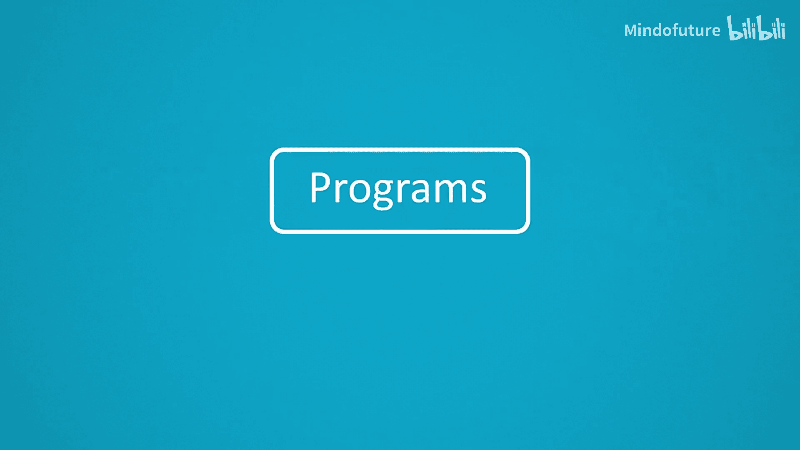
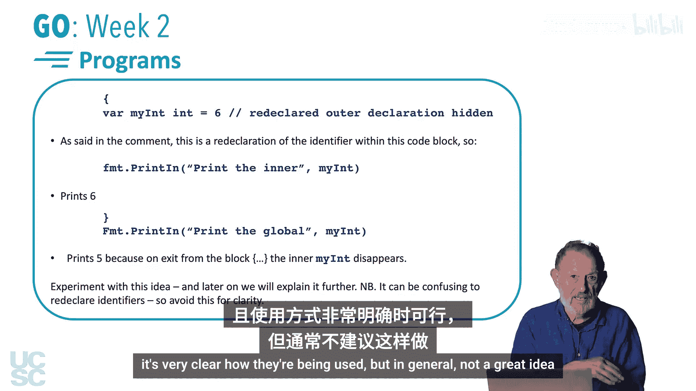

# 【加州大学】Go语言编程-｜-Go-Programming-Everyone-Part-1-p07-P07_语法标记_02_01_01--BV1h3e7zBE3U_p7-

Well， this week we will discuss some of the basics of go programming。Such as how to pick identifiers。

And how the language is parsed， what it means to have legal go code as per its syntax rules。

We're going to start with a simple go program that illustrates。

What constitutes syntactically legal go？This week we'll cover what are called lexical elements of the language。

 These are things like identifiers， keywords， expressions and literals。We will also discuss。

The declaration statement。That's how we。Otain variables for our program。

Then we're going to use in the second part of the week。

 a series of examples that show how to do at first。

 a very simple program that simulates rolling one fair dice。The programs。

There will be four of them will have increasing ability。

 and the final program will let you compute the Os。In the game of craps。

 we used two dice to find out what the probability of rolling a number like a seven is or a number like a。

Box cars， which is called 12 is。So you know how better to play craps。Okay。

 go like your natural language have syntax rules。 These rules tell you how to form the words from。

Your basic symbols like your letters。And then let you form for the words into sentences。

 So that gets you what we call syntactically legal go。

And that's the first thing the compiler tries to do。

Pase the symbols that you've typed in into the lexical elements of the language。

Which would form these things called keywords or identifiers or expressions。

And then it parses them to see that you've assembled them in correct syntax。

Getting the compiler to say your program is syntactically correct doesn't mean it runs correctly。

 but at least it will go past。The compiler and run。

We'll later talk a lot about how to make sure your program runs correctly。Okay。

 when you go to choose an identifier。The key thing is to make it literate。

 make it understandable to how a human reads。 It contributes as much to programme readability as comments do。

And also potential proper spacing and indentation。So there's a whole go style to how you lay out a program。

 there's even a specialized program called go format。

We'll throw through it for you if you're a little lazy about doing it yourself。

 but we hope you'll type in the program using these。

Key style ideas because they'll make the program more readable and making the program readable means you'll be able to modify it later。

 understand what you wrote or other people who have to use it or collaborate with you need to understand it。

 even though the compiler itself doesn't care whether an identifier is meaningful or not。Now。

 identifiers， besides being literate， can be keywords， and you'll see a table。Of go keywords。

 there are 25 of them， and you cannot use them for identifiers。

 even though technically they conform to the syntax of identifiers。

 they're basically just a string of letters like the word4。

The other thing that we'll talk about are things called predefined identifiers。They， you can use。

To redeccl and give no meanings， but you should avoid it。 That's a very bad idea， but we'll show it。

I'll give you an example of where we do it。And explain again why it's a really bad idea。

Now we'll have a following simple program and we'll see identifierss keywords。Punction symbols。哦。

Are our tokens， so let's look at our simple program As usual， it starts with the keyword。

 So this is one of the 25 keywords it's called package。

 you give package the name main main is indeed an identifier。

 but it's a special kind of identifier because it alerts。

The go compiler to the fact that this is a piece of code that you want to execute。

So you can have other packages with names like format。

But they won't directly be where you start running the program。

 mainine is where you start running the program。Then we have the keyword import。

 Now you see quoted the identifier format FMMT。 And that turns out to be a package of code that lets you do input and output。

 And we've seen that already in some earlier programs where we've used things like print line and scanf。

Now in the next line， we have a declaration。And this declaration is。There。

 my end with the I capitalized。Int， which is a pre declaredlar identifier， there is a key word。

 So ver is one of the keywords。My auntt is an identifier I chose。

And int is the predclared identifier meaning we're using this as an integer type。

And then we have the punctuation， again， another token。With an expression 5， in this case， aiteral。

And that's what is initially assigned to my int。Now。You can see in the。That the。Token for a comment。

That this is called the identifier name My int is called Caml Casa。Camel case。Is it？A style。

It's not enforced， but it's a style rule that the。Go community likes to use when it chooses multi word identifiers。

 So think of my inth and the capitalization， the internal capitalization as a way to separate out the words。

The other thing about where we are in the program with that declaration is。It's。

An external to the program funk declaration， so it's what we call a global。Now， in func Maine。

 we're going to use it， and we're going to try some simple ideas。 And so we print the global my int。

 and that would show up as 5。 That's what it was initialized to。But then notice。I've done。An open。

 curly bracket。And an open curly bracket means start。What's called a block。

 which is sort of a new area where I can declare variables。 And inside that block。

 I've reused the name I int。Now sometimes that's okay。

 sometimes that's a bad idea because of the confusion。But here。

 this is now called the inner declaration of my int。 And that means that it's separate。

 It's not the same as the global declaration。 And because it's the inner one， it hides the outer one。

 And here in this there again， there is a keyword。 One of the 25 keywords。

 Int is not int is predeclared。So you should avoid it。

And then we've done the assignment of 6 or the initialization to 6。 And now， if we do a print line。

 a print of the inner variable， my int， we get 6。 And then if we return the curly brace means we've exited that block。

And then we do again， a print。 Now we print the global， and that would be 5 again。 Okay。

 so what do we find in this， We find。That we have variables and we use identifiers for variables。

And the identifiers。呃。Can。They follow。The following simple syntax。

And that syntax is the first letter of an identifier must be an ordinary alphabetic character or the special alphabetic character underbar。

So you're going to get used to underbar on your keyboard。 It's， it tends to be at the。

Upper right of your keyboard and underbar can be used as a letter。In an identifier。

And we'll also see that the single underbar。As an identifier has special uses。

 so we'll discuss that later。Now。After you have。A letter， you can have either a letter or a digit。

 and you can have as many as you want。 so you can write very long identifiers。

 So it's very easy to make them。呃。Litererate， meaningful as part of your documentation in some sense。

 and again， if you want to use identify that multi word。Choose。Camel case， in other words。

 the internal。Start of a word should be capitalized。

And for those of you who have done C programming or some other programming， there's a correspondings。

Style called S snake case。 And in snake case。Words are separated by the underbar character。

 So some of you may be familiar with snake case from the from the sea world。And camel， by the way。

 what what does a camel have， What is it noted for， It's noted for a hump。

 So that's why you have capitalized letters in the middle of these identifiers。

 That's why they call it camel， rather than snake。 Snake is an animal on the ground。

 much like an under bar。Okay， so that lets us choose。To create identifiers。As we have already said。

 you can choose for the first character an alphabetic character or underbar。And then after that。

 you can choose digits。Now， there are other keyboard symbols， and they also produce tokens。

They're typically used for some kinds of punctuation， like semicolon。

 which is very important in this language， because it can separate out statements or it can separate internal parts of a for statement。

We'll see that we'll use commas because they can separate arguments to a function， they can separate。

 they can make up lists such as lists of initializer values。

 we have other symbols that can be used like plus and minus and star for arithmetic operations。

 we have symbols like the use of。Exlamation point。Which can be used for certain logical operations like not。

 And all of these things will produce tokens。 And if all those things get assembled and is syntactically legal。

 then the compiler will say， oh， okay， we can now run the program。An identifier such as Maine。呃。

Has a special use。So you tend not to use it for other purposes。

 And then keywords such as package can't be be be redefined at all。 So they must be used。

 and they're critical to the central concepts of the language。

 And as we go through the language in more and more detail。We will end up using all the keywords。

 including the more sophisticated keywords like Defer。Which we'll see later on。

But early on in a language we're using ver funk， we're going to be using four for the looping statements。

 so each of the keywords has a purpose which you're going to get familiar with， very familiar with。

Okay， so elite character can include the underbar， but generally speaking， it should be avoided。

Because A， they tend to have special purposes， the single underbar character does。

And doesn't need to typically be declared and sometimes when you use an underbar。

Let's say to declare a function。It's a style that says， oh。

 this is some kind of internal function within something like a systems package of code。

So generally speaking， we are going to expect ordinary identifiers to start with some lower case letter that would be stylistic Now notice。

That something like Q8 QQ9 is legal that conforms to the syntax， it's a Q。

 which is a lowercase letter，8， which is a digit。Q Q， again， letters and 9， a digit。

 So that's all legal， but it provides no meaning to a human reader， human coder。 so it's illiterate。

Should be avoided unless for some reason， you're writing code that you don't want anybody to understand。

 I guess that's possible。 You don't want people to steal your code。 So maybe you want。

To do something like that for some specialized reason， but that would be highly unusual。

And then we've chosen to use Caml case in the identifier my int where we capitalize I。

 and Caml case gets used when we intend the identifier to be read as a multi word identifier。

So we're going to show all 25 of the keywords， they have special uses。嗯。And then。诶。

In case you want to understand the language at more detail， I'm giving you the URL for。

The actual document that specifies the goal language in detail。

 and I'm giving you the specific place where the reference。Goes to show you how the identifiers。

Are created。 It's very worthwhile to get used to that go language specification。

 I can't cover everything in this class， So that's a very useful resource to go to。

 And it's sort of the official place where you find how the language is defined and the meaning of everything。

Now identifiers get used all over the place， they can name variables， they can name packages。

 they can name types。And here's how the syntax gets described more formally。

An identifier is created by first always having a letter， that's why it's not in the curly braces。

 and then when you see the curly braces， it means， repeat as often as you want。

And then you can choose a letter and then that upper bar is an ore sign。

 so you can choose a letter or a Unicode digit， UniIcode digit just think zero to nine。And。

So any internal thing can be either a digit or letter and you can have as many as you want。

 and that's the formal syntax。 And if you're trying to be a computer science student。

 it is worthwhile to I won't be doing a lot with formal syntax here。

 but the old days it was called back it now form， and it's important in understanding the。Legal。

Specificationations of the syntax of a language。 General speaking。

 every language has such a document and will show you how to， how to conform to。

Creating legal structures in that language。Baaks now our forum acknowledges two of the most famous early computer scientist Bas Anauer。

 who created this style of giving us syntax rules。So as I say。

 if you're hoping to go on in computer science。You know， go and read a Wikipedia or somewhere。

How Baccus now form gets used。So we've seen how to create identifier notice there's nothing mentioned about camel case。

 so Caml case is merely a style rule and it could be violated。

 there's nothing to say you have to use it。It's just that it's expected when you're writing literate。

Go code， it's expected by the community。All right， now let's turn to the keyword table。

And in the keyword table， there are 25 of them。And we're going to see that they refer to different things。

Many of them refer to。Things like declaring things like variables or functions。

 So ver and funk are important others。Involve flow of control。 So there's a go to， which lets you。

Jump to a different place in the program。There is an if and else which lets you do what are call conditional statements。

 There's a four， which lets you。Do looping， then there's things like continue which let you。

Change flow of control inside a loop。There's return which lets you come back from something like a funk。

Now， those are flow of control。There are specialized things like import and package， which。

Let you create。呃。And import。呃。Functions such as， such as。Print F。

Which you find in the when you import format。So all of these things have critical uses in the language。

And you'll get to learn them as we get more and more sophisticated in this class。

So far we've seen Fk， which starts a function declaration， we've seen ver。

 which starts the creation of a variable， we seen import。

 which gets code from a name package such as format。And we'll also see how to use four。

In the examples we're giving this week to do some simple flow of control and looping constructs。Oh。

 and we have used cons。And constant indicates that a variable cannot not have its value changed inside the code。

So all of these things have critical ideas。Go having 25 of them is typically a lot simpler than a language like C++。

 which at this stage。And some of the most recent C++。Compilrs is up to 95。

 so that's close to four times the number of concepts that are critical to a language like C++ and also makes it。

A lot more difficult to use and learn。Okay。So let's look at some other ideas from our first program。

Again， this initial global declaration was declared outside of Maine。 That means if we had a multi。

Function program。Let's say Maine was calling other functions。

All of those functions could have access to that global。

 So it's a way for functions to communicate with each other。Without having to。

Pass things in or out because they can all modify this global variable and make use of it if they want。

Again， that's not。An idea we want to rely on is's a very special use and should be used carefully。嗯。

Print line comes in the package format， that's what the dot notation means。And then。

 print line conforms to。Another special idea in the go language， in the go language。

 if you capitalize。An identifier inside a package。 That means that that can be used elsewhere if it's imported。

 if the package it's in is imported。However， if you were choosing to use lowercase。

For some function or some variable。Then that means that that variable is private to the package and it's not exportable。

 so you're going to see a lot of package name dot capitalized identifiers。

And are capitalized because they conform to that special need in the way。The go language。

Differententiates between a public and a private identifier。So that's an important concept。

We can red dec clear names again。That shouldn't be a first choice because it can lead to confusion。

 the same name means different things there's really two entities called my inth。

 there's the one created inside what's called the inner block and there the one that exists in the global environment。

And。We'll see more of this when we start doing more complex programs。

 which have many levels of curly brace because curly brace。Is what introduces a。呃。A new level。

 a possible new level of nomenclature or what's called a block。All right。 The final curly bla。

Exitts a block。 Or if it's the final one of a program， it matches the initial curly brace。

And exits the program。And when you exit the inner curly brace。The my int。

That was declared and it disappears。You can experiment with this idea will later have a bigger explanation again。

N B as stands for Notta Benny just。Beware， it's Latin for beware， and it says。

Don't get yourself confused by redeeclaring identifiers。

There are some places where that's an idiom when you're using some very simple things and it's very clear how they're being used。

 but in general， not a great idea。

