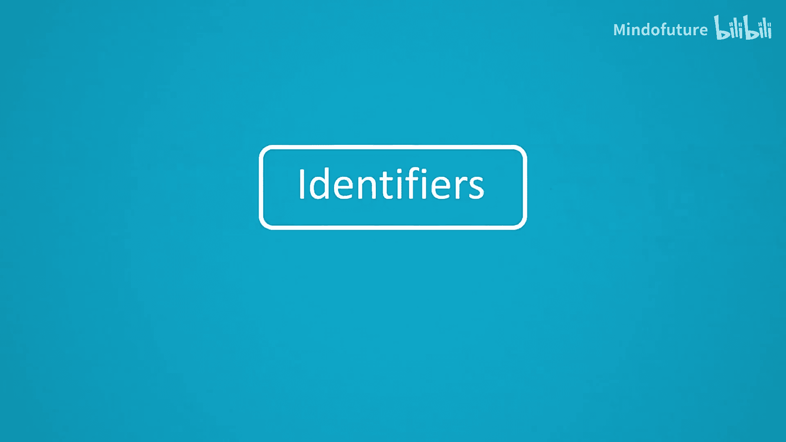
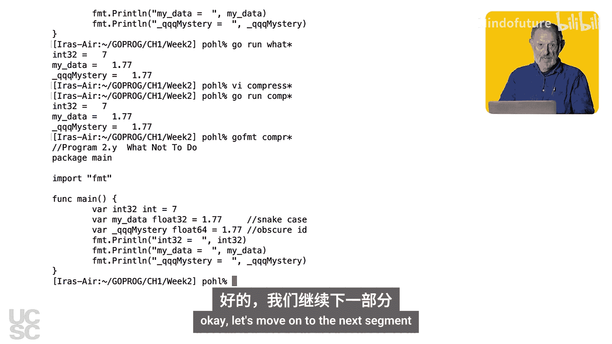

# 【加州大学】Go语言编程-｜-Go-Programming-Everyone-Part-1-p08-P08_标识符_02_01_02--BV1h3e7zBE3U_p8-

So we're making a big deal about identifiers， they're really important in writing literate code。呃。

Very famous book by Don Cannuth on writing literate code。

 case some of you want to do something more advanced， well worth looking into。

They contribute as much to program readability as proper commenting， don't forget。

 we have two types of comments， the wretle line comment。With the double。anglegle。

Sign and the angle sign star， which introduces a multiline comment， so they should be used as well。

And again， go。Onceants to have proper spacing， that's again just the community standard to make the program readable for humans。

 just think of it as an essay， piece of code is just like an essay。呃。

And identifiers again have that special syntax， but they cannot be keywords and。Things like N32。

 which are predefined identifiers。Should be avoided。

So now we're going to show you code that specifically。Does bad things。So we know what to avoid。

 so you'll keep in your heads， stay away from this。So let's look at the next package main。

It's a short program。It doesn't do very much。 It just declares some variables and prints them out。

 but we're going to see some very bad things。 and the worst thing we're going to see is right off the bat。

The variable in 32 in 32 conforms to the syntax of an identifier。 its lower case， lower case。

 lower case。Digit， digit。 And it's declared as the type in。Equals 7。So that's。

An identifier for an individual variable in this funk。

And then the next thing is variable my underbar data， again。

 it conforms perfectly well to the syntax an idifier。

But why shouldn't it be used because the community has said we want to use camel case？

What should have been used instead was my capital D。ATA。So this doesn't violate a rule。

 it says legal code this code will run。But it violates a norm in the community。

And that is almost as important。And there， a next identifier is also something to avoid。 It says Q。

 Q， Q underbar， Q， Q， Q underbar can be a first character。 But remember what I said。

Underbar generally introduces very specialized。Identifiers and here we're just choosing something which I call QQQ mystery because we don't know what its intention was in the code。

And remember， when we did the computation for area of a circle in week1。We had variables named area。

 and we had variables named Radius。 And reading that。

 it was very clear of what the program was doing。 Q， Q Q mystery doesn't tell us anything。

 Just obscure。Maybe the CIA would like to use it， but we're not going to use it。

And then these programs print out the information。So indeed， the program， as we'll see in a second。

Will run。 It will it will。Compile because the tokens are perfectly legal， the program executes。

It does what we wanted it to do， even though it's nonsense。As we explain again in this dissection。

This is really what not to do。So don't redefine one of the predefined。

Identifiers and the predefined identifiers is a large number of them。 many of them are types。

 so we will see that you can have a type in 32， which means that's 32 B integer。

 just like you can have a type int 64， which is a 64 bit integer。

 just like you can have a type U int， which is an。An integer which is always positive。So。

 and you can have float 32 or float 64， those are types again， and they're predefined。

So don't mess with the predefined identifiers even though they're not keywords。

Now here's our use of snake case that just violates a style。

 and that's easy to do because you may have come from the sea community， as many of you did。

 who took my original sea course。And so this differentiates。

 this is a different style and this community expects not snake case， this is snake case。

 expects camel case。And finally。The QQQ mystery is just very obscure， a poor choice。

And so we would never also do something like that， never a good idea。Okay， so all this will work。

 And now we're going to turn to actually running the code on my。Terminal。So， let's see。

What that code looks like on the terminal。Okay， so here we see on my terminal。

 the program we just talked about， and I'm going to go and compile it， so I'm going to say go。

Rud what not to do。And I just want to confirm。诶。So having terrible identifiers。

Did did not affect a compiler， right， the compiler isn't human。

 it just scares that the syntax was conformed to， which it was。

And so even though we did this terrible thing， like redefine an effect in 32。

It's still saying in 32 equals 7， which is what we initialize it to。In my data。

 which is snake case is 1。77。 and so is the mystery identifier。 Okay， so not a problem。

 Now I want to show you one more thing which will be useful to ho since I'm on the terminal。

I have the same program， but it's a program in which I was very lazy。 And so I decided to。Type it。

Without conforming， to。The standards inside go， so let's look at that。

This is also the what Not to do program， but look what I did。I have funked mane。

 and instead of just an open curly brace， I have a couple of the decors and I haven't separated out with the semicolon。

If you recall。Anytime you have an end of line in your ordinary go program。

It's as if you inserted a semicolon there， if needed。So it's a way that go gets around the rule that。

 for example， is in a lot of the other programming languages you were using like C。

 where semicolon ends things like declarations and statements here that's automatically done in effect at the end of a line。

And that's just。Not readable。 Again。 Look at this code。 I've condensed it there's no indentations。

 It's very unreadable。But let me exit。Wei。And I'm going to run it just to show you it's going to run just like the other program。

 so it has no effect the compiler completely understands it in the same way。

Absolutely the same result。 So from the compiler's perspective。

 it doesn't care that you're violating all this nice readability standards。

But very important to the community， very important for maintaining code。

 understanding your own code。There's a tool， it's called Go。FMT。And you can give it。This program。

And it will turn it into properly。Magically， into。Properly indented in spaced go code。

 so you can see after package main， it puts in a new line， after format it puts in a new line。

It puts in tab characters inside a ver。 It keeps everything one statement to align。

 And this is a much more， hopefully， you agree， readable。Version of the program。Okay。

 let's move on to the next segment。

