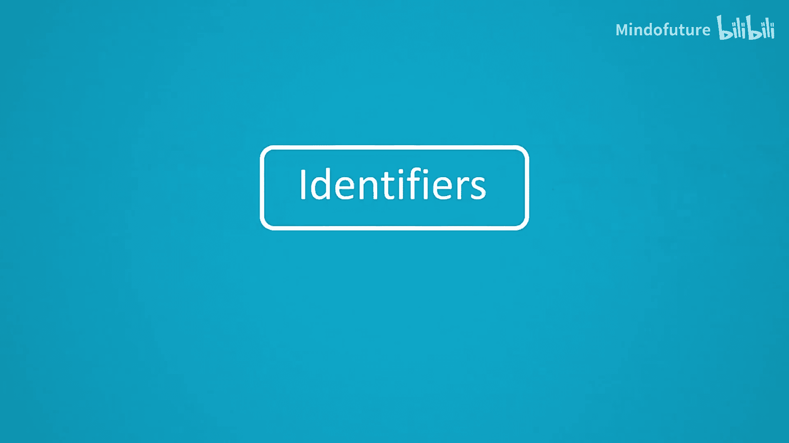
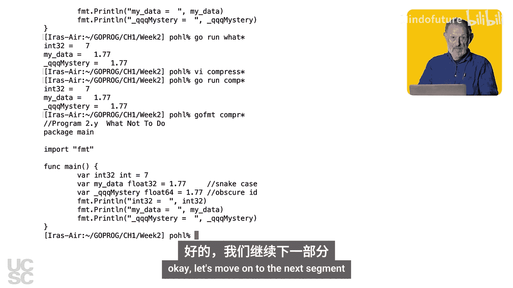

# Go语言编程：P08：标识符：命名规范与代码风格 🚫




在本节课中，我们将要学习Go语言中标识符的命名规范与代码风格。我们将探讨什么是好的标识符，以及哪些是应该避免的“坏”实践。理解这些规范对于编写清晰、可维护且符合社区标准的代码至关重要。

上一节我们介绍了标识符的基本语法和重要性，本节中我们来看看一些具体的反面案例，以明确应该避免的命名方式。

## 反面案例解析

以下是一个短程序，它声明了一些变量并打印出来。我们将通过这个程序展示几种不良的命名实践。

```go
package main

import "fmt"

func main() {
    var int32 int = 7
    var my_underbar_data float64 = 1.77
    var QQQ_mystery float64 = 3.14

    fmt.Println(int32)
    fmt.Println(my_underbar_data)
    fmt.Println(QQQ_mystery)
}
```

尽管这段代码在语法上是合法的，并且能够编译运行，但它违反了Go语言的命名规范和社区风格约定。

以下是这段代码中存在的三个主要问题：

1.  **重定义预定义标识符**：变量名 `int32` 是一个预定义的类型标识符（表示32位整数）。虽然Go允许这样做，但这会掩盖原有的类型含义，造成混淆，是应该避免的。
2.  **使用蛇形命名法**：变量名 `my_underbar_data` 使用了蛇形命名法（snake_case）。Go社区的标准是使用驼峰命名法（camelCase），因此更合适的命名应该是 `myUnderbarData` 或 `myData`。
3.  **使用含义模糊的标识符**：变量名 `QQQ_mystery` 完全无法表达其用途，使得代码难以理解。好的标识符应该像 `area` 或 `radius` 一样，能够清晰地表明其代表的含义。

## 代码风格与格式化工具

编译器只关心语法是否正确，并不关心代码风格是否优雅。因此，即使写成下面这样混乱的格式，程序依然可以运行：

```go
package main
import "fmt"
func main(){
var int32 int=7
var my_underbar_data float64=1.77
var QQQ_mystery float64=3.14
fmt.Println(int32)
fmt.Println(my_underbar_data)
fmt.Println(QQQ_mystery)}
```

然而，这种代码对人类读者极不友好。为了保持代码风格的一致性，Go语言提供了一个强大的工具：`go fmt`。

运行 `go fmt` 命令可以自动将杂乱的代码格式化为符合社区标准的样式：

*   在包声明和导入语句后添加空行。
*   在函数声明后添加空行。
*   使用制表符进行规范的缩进。
*   确保操作符周围有适当的空格。
*   将语句整理到单独的行上。

使用 `go fmt` 格式化后的代码不仅更美观，也极大地提升了可读性和可维护性。




本节课中我们一起学习了Go语言标识符的命名禁忌与代码风格的重要性。我们了解到，除了语法正确外，避免重定义预定义标识符、遵循驼峰命名法、使用有意义的名称以及利用 `go fmt` 工具保持代码整洁，都是编写高质量Go代码的关键。记住，代码不仅是给机器执行的，更是给人阅读和理解的。