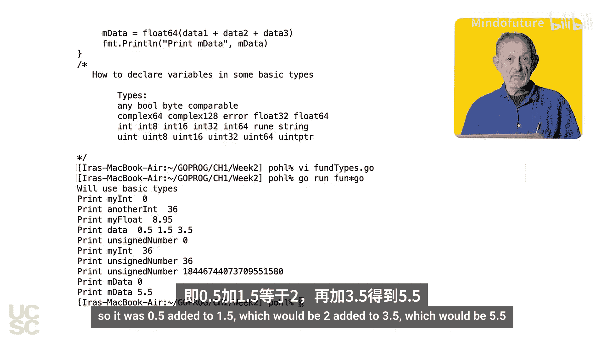

# 【加州大学】Go语言编程-｜-Go-Programming-Everyone-Part-1-p09-P09_声明_02_01_03--BV1h3e7zBE3U_p9-

In this segment we're going to talk about declarations now we've already used declarations。

 we've used the keyword var to declare variables。And each variable is declared， and given a type。Now。

 types come from a predclared set。Of identifiers， recall。That these are not technically keywords。

 but。You should stay away from trying to redeare them because that would be terribly confusing。Now。

 among。List of variables are things like int。But there are also more precise things like in 32 and 64。

 int 8， Fat 32， Fat 64， and many others。 Another one will see later on is called Roon， R U and E。

So all of those get to tell you how the variable is going to be used。Now。

I'm going to show you a program。That makes use of。呃。Declaring types。

 it's a program that's not very useful in the sense of we don't really have a。

Purpose in writing this code， except to learn more about types。 So I do encourage you to write code。

Where you're testing things out， even though the code doesn't do something like compute。

 centiegrate from Fahrenheit or compute the distance of a marathon。

It lets you check your understanding。So here's a function main。

 and we're going to stick different types。But I'm calling basic types。Into this program。

So a standard kind of declaration is ver My end notice that we're using。Camel case。

 so the eye is capitalized。So that's for multi word identifiers， and then we have int。Now。

 Int is a very interesting declaration， it's different than N32 or N64 in N32 or N64。

 you're specifying。The number of bits。That has to be used inside your computer。However。

 int tells the compiler， use whatever size is convenient to this particular machine。 Don't forget。

 there are supercomputers and there are very small computers。

 and they can have different what are called word sizes。 and some of them。

 the standard word size might be 32 Bs。 and others， like a very big supercomputer， it might be 64 Bs。

 The compiler， when you say int gets to decide。However， N32 or N64 gives you definitive control。

 so it's very useful to have both ideas。Okay， now look at the next declaration。

 the next declaration is another int。Colon equal36。Now， colon equal says。

 take the expression value in this case， the literal 36。Figure out。It's type。In this case。

 it's figured out to be an int。And assign that type。To another into the variable name。So there。

 we didn't have to use Ver。We didn't have to use。An explicit type in the declaration。

 we get it all out of。Inference， compiler inference， sometimes called duct typing。Now。

 we see the same thing in the next identifier。 My float again， camel case， again， colon equal 8。95。

 We understand that that is a floating point expression or a floating point， literal to be exact。

 And according to the。Language specification， when it sees a number like that in this context。

It chooses float 64， that's just。By the language rules。

 so my float is going to end up being a float 64 type。In the next declaration。

 we explicitly have the old style there。 we have a list。So the other thing we can do。

Is not half to say there data 1 is afloat。We can say ver data 1， comma data 2， comma data 3。

 and then say what type it is。 in this case， low 32。 And then a similarly， we can have。

An initialization to a a list of appropriate。Float 32 values。 So here， data 1 is initialized to 0。5。

 Data 2 is initialized to 1。5。 Data 3 is initialized to 3。5。In the next case。

 we have a VA M data float 64 and when we don't have an initializer。

 the rule and go is it's automatically initialized to a zero。So go does not allow for uninitialized。

Varis in the old days in the bad old days， the original days of C。

 the compiler didn't bother to do an initialization。

 Only if you explicitly gave it an initialization。 And as a consequence。😔，呃。A variable。

Could have whatever garbage was left in the computer from whatever program was run before your program got run。

 And occasionally， that could lead to a mysterious mistake。So here， again。

 because of safety in the language， anything that is not explicitly initialized will be initialized to a 0。

 In the next case， we have a ver unsigned number。 you went。

So you went analogous to end is an unsigned number， which means that。Again。

 whatever the natural unit， the natural word size for your machine is that the compiler wants will be targeted。

And。Instead of something which can be plus or minus， a U win can only be positive。

So since you're using all the bits。For the number， for the magnitude of the number， UNs are larger。

In absolute value， than int。And now。Our program prints these out so you can see that everything got done right and then getting down further。

We're using these things in expressions。So we have May aunt。Equal my int plus another in。

 That's perfectly O。That's not a problem， but then look at unsigned number equal U and myat。Go again。

Because it's safer than older languages like C。Insists on explicit conversion。

Sometimes called casting and sea。So you went。That。Name for the data type。Youent tells the compiler。

 look at my int， but don't treat it as an int。 Con to a representation for an unsigned number。

And if you didn't do that， you would have gotten a syntax sir。 if you had had omitted the cast。

 it would have told you， oh， this can't work。 We can't combine。

 You can't even combine a float 32 with a float 64。 You have to always be casting。Explicitly。Now。

 look at what I'm saying here。 Unsigned number equals you went。And were saying， a negative miant。

And my ink was initialized to something small。 and now。And we'll see it when I run the code。

We get a very large number， and that's。Like a small homework assignment。

 you have to go and look and see why that should be。And here， I'll print it out。 And then finally。

My data， again， needs to use a。Conversion into float because data 1， data 2 and data 3。

 if you recall， were float 32。So we want to convert to flow 64 because that's the data type of might of M data。

And then we can print out So again， this is not a useful program。

It doesn't compute things like temperature scales， but it's pedagogical。

 It teaches you stuff and it' something to play with。As you'll see。

 a term of art is called duck typing。 I don't know if you recall。 if it quacks like a duck。

 If it swims like a duck， you can take it to be a duck。So that's why the term duck typing came in。

 And you could say an expression 8。95 looks like a floatat。 So we're going to say it's a floatat。

64 literal。 because that's what it looks like。That special initialized operator， colon equal。Now。

 recall， when I print out my int， my int will print out to zero。

 and that's because anything that's not explicitly initialized is automatically initialized to zero。

And throughout the code， you saw that in some cases， we needed a conversion operation。

 So that's unlike C， for those of you who come from the sea community。

 where many conversions are implicit。 These conversions need to be explicit。And as I say here。

Some of the reason that the Uent becomes a very large number is where。In two complement binary。

 you would find a negative。 So if you have a negative。Number， negative integer。

The two's complement shows the highest order bit。As being a one， this is again。

Not so important for you to understand if you're just trying to learn how to be you know。

 programmer and go， but if you're studying this to be a computer science major。

 you should make sure that you read up on tos complement representation for integers know what that looks like because it can be very important later on。

All right， so let's turn to。Running the code and seeing how everything acts。

 seeing that it'll work as advertised。 Okay， so here we are in my terminal window on my Mac。

 We have that fundamental types and declarations program。 You can see it's what we just discussed。So。

We have all these initializations。 We have ver my endt not being initialized。

 but we're going to find out it is， of course， initialized to 0 Ver on sign number youent。

 That would also be initialized to 0 ver M data float 64 initialized to floating 。0。

Then we do our various operations。And we print out stuff。So again， as I was telling you。

You should play with something like this。 Just make sure you understand it。And。There's a whole bunch。

Of types that can be used in these declarations， and we've only seen some of them。

Can't go into all of it right away， but we will use lots of this later on。 For example。

 we will use bull。 Shortly， bull is a bullan。AType a Boolean type as only true or false as its literal values。

So that's a very simple type。 Then we have actually a complex number type。

 So for those of you who did some more advanced mathematics， you can actually have a complex number。

And 64 bits in a complex number in 128， why are complex numbers so wide because complex numbers are really a pair of two floating point numbers？

So we need either 2，32 B floating point numbers to represent them or 2，64 B。

Number floating point numbers to represent them because there's an imaginary part， a complex number。

 But again， we're not going to be that mathematical in this class。

 So we're probably not going to be using that in our own examples。

 but you can play with it if it's of interest。Then we have all those int types。 We have an int 8。

8 is a bitete length piece of code， right， A bite in a machine is 8 bits。 Sometimes you want。

A very dense packing where you don't need very large integers。 So that's a useful thing。

 Then there's also rune。 and runon is。A synonym for N 32。 But ruin， if you're using it。

Means to the human reader。 Well， we're really using this for purposes of storing characters like capital A。

 We can also store， actually the Hebrew alphabet， the Chinese alphabet， the Arabic alphabet。

 because 32 B allows us。To do what's a uncode encoding of alphabets。

 and essentially let's get to almost any alphabet that's in use by humans for their languages。

So if you want， you can find out how to print Chinese characters on your screen by looking up their Uniicode values and then using rune and then using。

 for example， in a print F。The format presents C。that will print as a character now。

 And then here are all the different length。呃。Unsigned integers again。And finally。

 there is a Uent pointer， which is an unsigned。Address of a pointer。 A pointer is a machine address。

 It's never negative。 It can be quite large because machines have lots of memory。

And if you want to be able to store a machine address。

Which will be part of our more advanced material later on in the class。

 you might need unsigned into your pointer。So let's run this。Get out of my editor。And I go。And run。

And here all。Of our outputs again， notice the first output my aunt it was 0， as expected。

Print un signed number again， it was 0 because that's automatically an initialization。

 If initialization is left out。And we can see that my float got initialized 8。95。

 All of that stuff worked。 And here's the thing I want you to。

Understand better and part of that sort of homework。

The initial ons signigned number was 36 because it was a conversion。 If you recall。

 for my int and my int became 36， because it was my int added into the0。 Another int。

 So my int became 36。Then the unsigned number became 36。

But when I negated it to be -36 and cast that， I got this horrendously large number。

So figure out what's going on there。 And then finally， if you look， M data was initialized to 0。

 but then M data ends up 5。5。 Why， Because I believe it was 0。

 It was a combination of the initializations of print data here。 So it was 05 added to 1。5。

 which would be 2 headed to 3。5。Which would be 5。5。

Okay， done。

