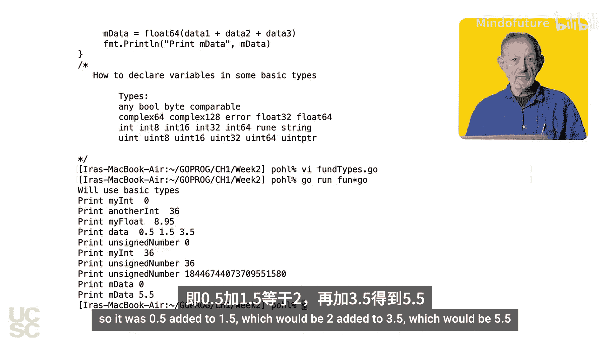

# Go语言编程：P09：声明与基础类型


在本节课中，我们将学习Go语言中的变量声明和基础数据类型。我们将了解如何使用`var`关键字声明变量，以及Go语言如何通过类型推断简化声明过程。同时，我们也会探讨不同类型之间的转换规则。

## 声明与类型

上一节我们介绍了程序的基本结构，本节中我们来看看如何声明变量并为其指定类型。

在Go语言中，我们使用`var`关键字来声明变量，每个变量都会被赋予一个类型。这些类型来自于一组预定义的标识符。虽然它们不是严格意义上的关键字，但应避免重新声明它们，以免造成混淆。

以下是部分基础类型：
*   `int`
*   `int32`, `int64`, `int8`
*   `float32`, `float64`
*   `rune`

这些类型决定了变量将如何被使用。

## 基础类型声明示例

为了加深理解，我们将分析一个教学程序。这个程序本身没有实际用途，目的是帮助我们学习类型声明。

以下是一个`main`函数，其中声明了多种基础类型：

```go
func main() {
    var MyInt int
    anotherInt := 36
    MyFloat := 8.95
    var data1, data2, data3 float32 = 0.5, 1.5, 3.5
    var MData float64
    var unsignedNumber uint
}
```

*   `var MyInt int`：这是一个标准声明，使用`int`类型。`int`类型很有趣，它让编译器根据当前机器的便利性决定使用32位还是64位。而`int32`或`int64`则明确指定了位数，两者各有用途。
*   `anotherInt := 36`：这里使用了`:=`运算符。它会让编译器推断表达式（此处是字面量`36`）的类型（推断为`int`），并将该类型赋予变量`anotherInt`。这种方式无需使用`var`关键字或显式指定类型，依赖于编译器的类型推断，有时也被称为“鸭子类型”。
*   `MyFloat := 8.95`：同理，编译器根据语言规范，会将这样的数字字面量推断为`float64`类型。
*   `var data1, data2, data3 float32 = 0.5, 1.5, 3.5`：这条语句演示了如何一次性声明多个同类型变量并分别初始化。
*   `var MData float64`：当声明变量但没有提供初始化值时，Go语言会将其自动初始化为该类型的零值（例如，数值类型为`0`）。这避免了像早期C语言那样变量可能包含随机“垃圾值”的问题，提高了语言的安全性。
*   `var unsignedNumber uint`：`uint`是无符号整数类型，只能表示正数。因为它使用所有位来表示数值大小，所以在相同位数下，`uint`能表示的最大绝对值比`int`大。

## 类型转换与运算

在程序中，我们还会使用这些变量进行表达式运算和类型转换。

```go
    MyInt = MyInt + anotherInt // 正确，同类型相加
    unsignedNumber = uint(MyInt) // 需要显式转换
    unsignedNumber = uint(-MyInt) // 将负数转换为无符号整数
    MData = float64(data1) + float64(data2) + float64(data3) // float32 需转换为 float64
```

*   `MyInt = MyInt + anotherInt`：同类型`int`相加，没有问题。
*   `unsignedNumber = uint(MyInt)`：Go语言为了安全，要求在不同类型间进行运算或赋值时必须进行**显式转换**（在C语言中常称为“强制类型转换”）。如果不进行转换`uint(MyInt)`，会导致语法错误。
*   `unsignedNumber = uint(-MyInt)`：将一个负数转换为无符号整数，会得到一个非常大的正数。理解其原因需要了解二进制补码表示法。
*   `MData = float64(data1) + ...`：`float32`类型在与`float64`类型的`MData`运算前，也必须显式转换为`float64`。

## 更多基础类型

我们目前只接触了部分基础类型。Go语言还提供了其他类型，以下是简要介绍：

*   **`bool`**：布尔类型，只有`true`和`false`两个值。
*   **`complex64`, `complex128`**：复数类型，分别由两个`float32`或两个`float64`构成，表示实部和虚部。
*   **`int8`, `int16`, `int32`, `int64`**：指定长度的有符号整数类型。
*   **`rune`**：`int32`的同义词，通常用于表示Unicode码点，可以处理包括中文、阿拉伯文等在内的多种字符。
*   **`uint8` (即`byte`), `uint16`, `uint32`, `uint64`**：指定长度的无符号整数类型。
*   **`uintptr`**：一种无符号整数，用于存储指针（即内存地址）。指针从不为负，且可能很大。

## 程序运行与输出

运行示例程序，观察输出以验证我们的理解：

```
MyInt: 0
unsignedNumber: 0
MyFloat: 8.95
data1, data2, data3: 0.5, 1.5, 3.5
MyInt after addition: 36
unsignedNumber after conversion: 36
unsignedNumber after converting negative: 4294967260
MData after conversion and addition: 5.5
```

输出结果符合预期：
1.  未显式初始化的`MyInt`和`unsignedNumber`被自动初始化为`0`。
2.  类型推断和初始化正常工作。
3.  将负数`-36`转换为无符号整数`uint`后，得到了一个很大的数（`4294967260`），这正是补码表示的结果。
4.  经过转换和相加，`MData`的值变为`5.5`。

## 总结




本节课中我们一起学习了Go语言的变量声明和基础类型。
*   我们掌握了使用`var`关键字进行声明，以及使用`:=`进行简短声明并利用类型推断。
*   我们了解到Go语言会为未初始化的变量提供零值，确保了安全性。
*   我们认识到Go语言要求在不同类型间进行操作时必须进行显式类型转换，这与C语言不同。
*   我们还浏览了Go语言提供的丰富基础类型，包括整数、浮点数、布尔值、复数和用于字符的`rune`类型。
*   最后，通过分析示例程序的运行结果，我们巩固了对这些概念的理解。建议初学者多编写类似的测试程序来验证和探索。