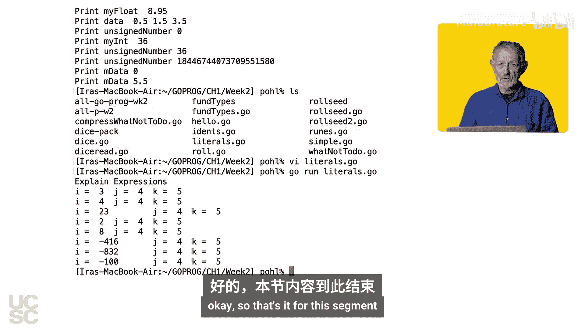

# 【加州大学】Go语言编程-｜-Go-Programming-Everyone-Part-1-p10-P10_字面量_02_01_04--BV1h3e7zBE3U_p10-

So in this segment， we're going to talk about literals and we're also going to start talking about how they get used in expressions。

And some of what you have to understand about。Getting expression values， correct。So a literal。

 like the integer value 4 is a fixed value， and it has an associated type。Its type can be int。

 Its type could also have been an int 32。Which depends on how it's declared。

 If it's just being used in terms of what we were callingduct typing 4 would be of type int。 However。

 the value 4。0。 if we saw a 4。0 typed。And we initialized that a variable with that special initializer colon equal。

That would be a type float 64， so the compiler recognizes。

What we call these tokens when it assembles this token。Within the program， it says， odd。

 that's its type。Now， again， if it sees something like true， then its type is bo。So。

 there are literals for。Any type。And those literals may in declarations be used。

In duct typing declarations to extract the type or in expressions。To create。

A new value within that type， like adding two integers will give us yet another integer。

So for example， we've already seen in one of our beginning programs how to compute the area。

Of a circle。 And that was 3。14159， which is a floating point literal float 64 times a radius。

 times a radius。And radius。Would undoubtedly have been also declared to bef float。

And then that becomes an expression。Now， in order to understand what that expression would give rise to。

 we have to know what the star operate late， the star operator that it's a multiply and that。

We're going to also explain what's called operator precedence。

So we need to know how to write literals for each type。

And then we need to know how to interpret expressions， because， again。

 we can use expressions to initialize variables as well。

We're going to start with the domain of integers， because integers are something all of us understand。

 It's one of the earliest things we learn。 We learn how to count。Maybe when we're two or three。And。诶。

And。While it depends on the machine you're on the compiler you're using。

 whether it'll be typically 32 or 64 bits， it's the usual type we'll do when we have a calculation that requires an in。

Now， there are all these other lengths。Types in int。But you could call them more specialized。

 and we're not going to go and be using them unless there's a very particular reason to use an in。

 A typical reason for in is we need to compact our data。Or N 64。

 because we're outside the range N 32 lets us be， which is plus or minus。2 billion。

So then we use the longer type。And there are similar distinct types for the Uent。

 the unsigned integer type as well。Now let's see how we use this in a program。

 we'll see it in the next slides。And we'll show how to understand how operators work。

 we have to know their precede and sociivity。And the precedence in asciivity。A。

Things that you probably know about from your ordinary use of mathematics。But。

You have to formally know it or you can get wrong answers in programming languages。

A very simple precedence is。The operators plus and minus。

 the additive operators are lower in precedence than the multi multiply divide operators。So times。

Divide modo， which is the percent operator。 They all have higher precedence。 What does that mean。

 An expression where you're mixing these operators， It means that times will go before addition。Now。

 fortunately， in programming languages like go， if we don't want that precedence。Or that associivity。

 typically associivity is left to right。So we do the leftmost thing first。

Then we can override it with parentheization。That's very important。

 And parentheses might even add to clarity if we're， if we're going to do something very complicated。

 we might still rely on parentheses， even if we could do it with。

Understanding precedence and associivity， we could do it with。An unparsized expression。So。

 let's look at the code。As usual， we have a function main。And here， we have。

A set of integer variables。Remember， we can use Ver to declare a whole list。

And then we can initialize the whole list。If we didn't initialize them， they'd be zero。

And now we can print them out。And here's our first expression， I equals。C times K divide by 5。Now。

 if you recall， I said times and divide are the same precedes。However。

 we're going to do this with a left to right association。So we're going to multiply j times k。

And then we're going to divide it by 5。 And since all of that integers that all gets done in the integer domain。

Again， it's very important to understand when you divide two integers like3 divided by 5。

It's done as an entityger division。And we don't get。For 3 divided by 5， we don't get 06。

 because that would be a floating point number。 since it's less than one。

 we would actually end up with3 divide 5 being 0。Keep that in mind That frequently leads to mistakes。

Now in the next one， we have I equals J times k plus 99 modulo 6。Now。

 modo may be an operation you don't use in your everyday arithmetic。

 So you might have to understand it。 I'll explain it in a second。 But again。

 modo is an operation that takes precedence over addition。And times takes precedence over edition。

 So this would read as first multiply J by K。And then。

Do the mod operation of 6 and 99 and then combine a result with an addition。

 The addition is the lowest precedent soward go last。So let's see what six， what 99 modo6 is。

Md modulo means divide by that integer。And then take the remainder part。So  six into 99 goes。16。

6 times 16 is 96。And then。The remainder is going to be 3。 So 99 Moo 6 is 3。

 and we'll add that into our J plus K。 We should see that result when I run the code。

And we'll also notice that we might get a different result when we do I equals J times k plus 99。

 So here。We override the normal precedence Once we parentheize K plus 99 gets done first。And now。

 inside that parentheization， we're going to do the modlo operation。

 and then we'll do the multiplication。So different parentheizations give rise to possibly different evaluations because they override the normal precedence and associivity of the operations。

In those expressions。 So， again， be very careful about that， or you can make。

Serious arithmetic mistakes in your program。 and it will lead to。The program will run。

 but it'll give you。啊。Results that are in error。Okay。And then just like plus is a lower precede。

 So is minus。 So there we get J times minus K times 5。 We'll see its result later on。

 because we're going to print it out。That's the end of this example。 So make sure that。

If you've come from the sea world that。You understand precedence here。

 though largely the precedence of operators is somewhat the same as in the sea world。

But one place that you'll find at the sea world is different than this world。

Then go is using an expression where you have auto increment or autoderement。Remember。

 when you do something like I plus plus， if I was three after you do the plus plus I is now four。

However， in go， this is not an expression value。 It's called a statement。 So you can't mix in your。

 you can't say something like。K plus I plus plus， you can't mix that in because that's not allowed in。

The auto increment。Is part of a specialized statement， so that's very different than the sea world。

Okay， so let's again look at some of the ideas in this following dissection。3，4 and 5 are literals。

 Lierals are our simplest form of expression。 We could have also used more complicated things to do initialization。

And then I equals J times k divide by 5。Where we have。

Precentence of of times and divide at the same level， We will do that in a right to left。

So I is going to end up being equal to J， which is 4 times k， which is 5。

 So four times 5 is 20 divide back by 5 or get a whole number， which is 4， so I will become4。

And it turns out this is exactly equivalent。 if we fully parenthesize it。To be explicitly done。

 it would be J times K first。 That's why it was in the inner parentheses。 and therefore that。

Now here's our use of modulo。And there we， as I said earlier，99 modo 6 is 3。 And again。

 keep that in mind when you use modlo because we're going to be using modo in some of our following programs because we're going to need it。

In some cases， for it turns out suitable random number generation。

 which will come shortly in this class。And therefore， when we did that previous thing。

 I got assigned 23 here we have I equal J times k plus 99。Moullo 6。

That means the answer can't be larger than5 zero to5 is going to be the answer to that。

 that's why it ends up being two because when you take J and you multiply a by，K plus 99。

 you' end up with a big number， but then you must do the divide by 6 and find the remainder。

 in this case， that remainder will be2。Here's a different example。

 but here the Times gets done after the K plus 99。Gues。Moduleode with 6。

 so k plus 99 module O 6 would be equal to 2。But then it's multiplied by 4。

 And I guess assigned 8 order of。Using operators or overriding them with parentheses。

 very important to understanding that you're getting things correct。All right。

 let's quickly turn to my code， we'll run the code and hopefully we'll see that all of this works。

 and again I encourage you to write your own code and test out things to make sure you understand this。

So here。On my terminal is the code we just talked about。

And I really want you to pay attention to where we're using Molo。

 which is an operator that might not be as familiar to you。诶。啊。Something I didn't mention。

In the code before I take a quick look here。In this next to last expression， I have a plus equals。

So normally I have like I assign J times k divide 5， integer divide 5。But here。

Instead of an ordinary assignment， I have an additive assignment。 What does that mean。

It means that whatever the preexisting value of I is。Should be added to the expression。On。

The right hand side of that。Plus， equals。So it's a shorthand for saying I equals。

 and then it would be I minus that entire expression。

So that's a shorthand you don't really need to use those。

 but it's very common both in the C community and the go community。As a way of saving。

A little bit of typing。All right， so I'm going to jump out of my tech editor。

And that was the program literals， so I'm going to run it。And here you can see all those values。

Here's where。That too shows up。J in K stay 4 and 5。 But if you recall。

As we talked about that modlo operator where we were mod modulating that whole expression。

 it had to be between 0 and 5。 It turns out， if you do all the arithmetic it would be， too。

Here we did an expression in which I ended up as- 416。And then we did the minus assign the。Plus。

 a sine expression where we added the value of I to the expression value。 Well I was 416。

 we had the same expression on the other side。 So we end up with-8832， just double the 416。And then。

Again， you can check the arithmetic by rewriting the code and the last instance。So， we've kept。

J and K， the same throughout we never change them， but we show how I gets changed by all those expressions。

 And the takeaway is to understand。The precedence when things。Are evaluated in those expressions。

And its associivity。Okay， so that's it for this segment。

Yeah。