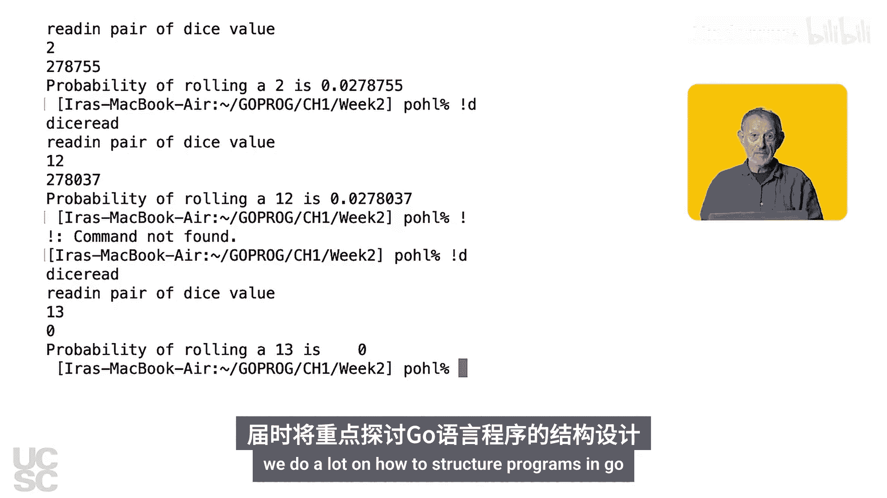

# 【加州大学】Go语言编程-｜-Go-Programming-Everyone-Part-1-p11-P11_骰子_02_01_05--BV1h3e7zBE3U_p11-

嗯。

Besides looking at the basic lexicon of the go language。

 we want exposure to useful small programs that have important ideas。For much the rest of my classes。

What we're going to introduce。And the next four programs is the use。

Of what is called a pseudo random number generator。

Will'll show how it can be used to compute probabilities。And the probabilities will be of computing。

2 dice as they're rolled。 Think about being at a casino and you're playing crs。

 And it's very useful for you to know， Well， what's the probability of rolling a 7。

 very important number in crs。Now， we're going to write this program incrementally。 And this， again。

 is a useful idea。 We're going to write a small program that incorporates。A fundamental idea。

And test it。 make sure it works。 And we understand that。 then we're going to expand the program。

 and our second program will get some more。Functionality。And similarly， the third program。

 and then we're going to go with what in this case will look like our final program to compute the probability of crops odds for arbitrary crafts values。

So that's our plan。Now。Our first piece of code is very simple。It just imports from a library。Called。

Math slash ran。The procedures we need， the functions we need to get a pseudo random number generator。

Now。We'll， of course， also need format。 So we're going to import， have an open par。

 and that'll lead us to getting both。Math ran and format in the same import。

So we don't have to use multiple import statements。

 And then the whole program in the funk main is just。Format that print line that ran that int。And。😊。

Argument6， add one。Now， what R int and does is it generates a pseudo random number generator。

And it generates the numbers between zero and five， so it can have zero， one， two， three， four， five。

But recall when you roll a dice。You get the numbers one to six。So that's why we added one。

So that specialized function。呃。And N。Ks an argument。

 like if we had put 1000 there would get the argument be would allow us to generate between 0 and 9。

9，9。 again， try this out for yourself。So if we look critically at this。

Math ran contains pseudoran number generator。 Remember， we've already used the library math。

We got the constant pie。So math is a very big library。

 and we want the sub library ran so that lets us just take in a portion of what we need。

And now we're going to go to my。呃。Mac terminal window will run the program and see what we get。Okay。

 so。Now。We've managed to understand how to get a true。

What appears to be random rolling of a single dice。 But recall what our ultimate aim is。

 is to get the values of probabilities。For rolling pairs of dice。 or again。

 we're going to increase the functionality of our program。

The third program will look at rolling two dice。And we're going to compete one we want to compute the probability。

Of rolling a seven， which is sort of the most important number in craps。So。

 I've already written that code。I made just double check。On my terminal。So here we see。

The code for checking。Let's look at it。 again。 we have our import where we're importing three different packages format mass random and time。

Now we're going to have a pair of dice， we're going to roll those dice， get a value for the roll。

Now recall， when we roll actual dice， each dye has a number one to six on it。

So what can be our results？Our results are between。2 and 12。Right， right， okay。

 but we're actually rolling two dice， each randomly produces one to six。

Very important to realize we can't just produce a random number between 2 and 12。

 If we got to produce two random numbers between one and 6 to properly simulate the rolling of a pair of dice。

Again， as before， in order to start and get different results。

 we're going to start with Rand C time Now， Uniix do nano。 That'll be our seed。

 And now we're going to use。A very big number of roles。 So we're going to use our force statement。

 Now we see the power of a computer。 We're going to say for I。Assign0。Now that's initialized。

 and that means that I there is a variable int。And that's local to that forstatement。

 So it disappears after the for statement。The test is an expression。 what's called a bo expression。

 I less than。And there， I think I'm using。10 million。 So I'm going to do 10 million rolls。

 That should be enough to find a probability。 If I use a small number of rolls。It's like。

 using an experiment。And only rolling the dice five times to see what the value of 7 shows up。

 It's not going to be accurate。 The more rolls， the more accurate what's called a Monte Carlo computation is。

 So you really need powerful computers to apply Monte Carlo techniques。

 because you want to do the thing over and over and over again。

And it's really no problem to run this 1010 million times would be a real problem to roll real dice 10 million times and figure out how often 7 comes up。

 You would get very tired before you finish that experiment。So this lets you do it。

 Then you have your auto increment statement， I plus plus， and now inside the loop。

You get the value for the pair of dice， notice。Rand in 6 plus ran in 6 plus 2。 not plus one。 Why。

 Because I need the one for each tie。 Otherwise， I'd get values between1 and 11。

 rather than 2 and 12。 So this will give me values between 2 and 12。And now， I test to see。

Did my pair of values equal 7。Again， pair equal equal is a bo expression。So equal。

 equal is the bull operator saying， are the two values the same？His pair equal to 7。

So we don't use a single equal， because that would be assignment， we use a double equal。

And then because it's an if statement， unlike C。We don't have it inside parentheses。 and instead。

 we always use open curly braces to incorporate what。We execute if it's true。

 and there we have a how many increment。So after them， the 10 million runs。

 how many is going to give us how many times we saw 7。I could print how many。

 and then I want to calculate the probability of how many。 And there。

 because how many was an integer， I want this computed as a floating point number。

 So I do how many over the 10 million。 and I should get an answer。Okay， so let's actually roll it。

So I'm going to go。Ren。Dice。Thought go。And even though I rolled it 10 million times。I got a 7。

1660139 types。The probability。Because we get that from that floating point expression。Was roughly 0。

1666139。If you recall， that's about one sixthth of the time。So rolling a 7 in crs。Shows up。

Roughly one out of six times。 if that's correct， If our simulation is correct。

 And if you could show this mathematically， you would find out that that's very close to correct。

 Why don't we do it again。We'll see what differs， because don't forget where O me。So I want to do go。

Run。Dice。Dot go。And the answer is slightly different。 This was 1668000。 Remember。

 the last time was 1666000， but still very close。 It's 0。1668， rather than 0。1666。

 So it's still very close。 and it gives us。Some degree of trust in the fact that。

I'll do it one more time this time I get1。6 I get 1。6666702。So that shows you。

 if I had a larger number， we would get what's called convergence on that。 And it's basically 0。1666。

 And so。Our suspicion is that it's probably technically。One sixth of the time。That you would get a 7。

Okay。Now， as you've seen， when we ran that。We kept getting the number 6。Well。

 that's not what we'd like out of something that we call random。We don't want to always see 6。

 That sounds very unrandom， Very unlikely， unless we had。

Loaded our dice to make sure that the number 6 landed each time It would be called an unfair dice。

 if the only thing it turned up was 6。Now why is that， well， we got this little funny contradiction。

A computer is deterministic， it always does the same thing。

So if we run the random number generator and start in the same place。

 we'll always get the same first number。That's not what we want。How can we avoid that？

There's a standard technique for avoiding that。 The standard technique is to start it with something from the real world that can be viewed as random。

In this case， we're going to start it with。What we think is the number of seconds since the ex operating system started operating in the real world。

 And fictionally， that's thought to be the first day of。January 1970。

 So we're a huge number of seconds later。 Any time we run this program。

 that number is going to change。 That means if we start our random number sequence。

 based on that position。 We'll get it potentially a different random number each time。

 So that's called seeding a random number generator again， an important technique。

 if you really want to understand more about this， there's a very detailed description， though。

 fairly mathematical of how to produce effective random number generation in canth the art of computing。

Now。In order to start with this special time， we need to also import a third package。 And this time。

 we're going to import the package time。 So now we're going to get format， mass， ran and time。

And time will let us use。This fancy thing called time dot now do Uniix nano Parparen。

And what that means is now is a method on Ex nano， which extracts out in seconds where we are。

In the age of the eunuch universe， and then we seed it by calling Rand do seed。

Remember all of these things。Are capitalized because they're exported from those packages and once we have the seed。

 we're going to run this 10 times。And that's what that fores statement is。

 running it 10 times and printing。What we think are the 10 random roles of the dye。As I said already。

Time thatt now that unix that now。Compuses the starting time from the start in seconds from Euchx E time。

 January 1，1970。 This becomes the argument to ran。 It's different every time you run your program。

 so you should get different results。One place to focus on that we haven't done much with yet is the slooping statement。

And look at the looping statement。 We'll see it later。Next week。

 we're going to talk a lot about looping， because we're going to talk about changing flow of control to make programs interesting。

 we can't just have simple， linear programs。Frequently。

 programs are very useful when we do things many， many times。And here。

 the for statement has an I colon equals 0。 Remember what colon equal does。

 It initializes a variable。 So this variable I is declared to be local to the loop。

Then the second part is at test。 I less than 10。That's a boolean expression。 Remember。

 Boole was one of the。Predeclared variables for a type。 It can either be true or false。It's false。

It's when it's false， the loop stops。 So as long as the test is true， we do the loop。

 And the last part of that。For statement had I plus plus。

 and I plus plus is an increment statement where I， the variable goes。Goes up。

 And if I was not incremented， the loop would have been infinite。Caerda stayed at 0。

 So that lets us get to 10，10 is where we would stop the loop。

 So that loop gets us to execute that little random function producing the value of rolling the die 10 different times。

The difference from C here。Again。If you want to compare it and you have a C background is how the forlo gets written。

 The forlo in C would be written where those three items were parenthesized here。

 they're written without parentheses， but we always start even a simples one statement loop with an open curly brace。

Curly braces are always used in go， and they aren't always used in C。

And now we'll stop run the code to see that we do indeed get different results each time。Now。

 let me do the final calculation in order to really know about。Crapps， I really have to know， oh。

 how often can I get box cars I don allow many of you are gamblers。 box cars represents 12，6 and 6。

Or what about snake eyes。Snake ices， too。 So gamblers have names for these various things because they play a lot of craps。

And they also， if they're very good at crs， know the probability for any kind of craps rule。Now。

In order to find this， what has to be changed in the code we just saw？Well。In that code。

How many was tested against。We incremented how many。Every time we saw a 7。So instead of a 7。

 I want something that I can input。 I want to be able to input 2，3，4，7，12。

 So in order to make this program more universal， more useful。😊，I have to be allowed。As a user。

To provide the program。With what value to check。 So that's the modification I'm going to make。

What's that going to require？ recall we've already done that occasionally。

 and that requires using a scanf。 So let's go and see what that would be。 And that's going to be。

My program， which I'm calling dice Reed VI。Dice reed。That go。So， everything looks the same。

Except here。I have something I call V pair。So V pair is going to be the value。

Which had been hard wirered before， to be 7。The pair is going to be the value of the pair that I want you to look for。

 the probability for。Here's where I get it。On this line， I have format at scan F。Present the。

 Why percent the， because that's the format for an integer。Ampersand。

 why the ampersand operator that's address of， that's how we read things into their variables。

 so it said， read it into the location of the variable V pair。And then。

My computation is exactly by before， except in the if statement， I say if pair equals equals v pair。

 not if pair equals equals 7。And I count how many。 and then I print out my answer。

So I've gotten to change my program to read in what value of pair I need and V pair。

 and then computers。Probability。So let's go and do this。嗯。I'm going to build this， rather than。

Just run it。So I can redo it as I go。 I'm going it's。Because I want to reuse it。

The program is diread。go。And now the executable is Dce Reed。And it says， read in pair of dice values。

 So let's read in 7， because we've already used 7。 Let's see what it does， if I say 7。啊。

Somewhat different number than before， but it's one。It's 0。1667。

 very close to all the other numbers we got before。Let me run this program again。Read a pair。

 Let's see。Let's see what the value might be for snake eyes。So snake ices value is two。

And look how much lower value it is 0。02。7，8，7，7。So that's much more unlikely than 7。

Not quite an order of magnitude。 Does that make sense， yes。For 7， you have many combinations。

 You have 6 and one。2 and 5，3 and 4。For two， you only have one combination， one and one。

 So youve got to get exactly that one combination， rather than all the combinations available for 7。

So that ties in with what we intuitively understand。And especially if you rolled crap st before。

 you would know for a fact that。Now， what's also interesting about dice or crs is。

6 and 6 is the other end of the spectrum， but it also should have a probability that's close to the probability of snake eyes。

 So let's try that。And now， the value for 6 and 6 is 12。Let's roll it。 Oh， very close。s0，2，7，8。

 And that's what we expect。 We'd expect it to show up in the same way。

 And look how valuable this Monte Carlo simulation is。 It's giving us。

Values for what otherwise would take。Some fancy college mathematics to do if we had to do it by hand。

And if we had to do it experimentally， it would exhaust us。

One last thing I'm going to try with this program is。

 what if I give it a dice roll that doesn't exist？So I told you before。What can't？

 I can't have a dice roll of 13， right。So if I asked it。

 what's the probability of getting a di shawl of 13？I got the answer， I expect，0。Okay。

 so we've tested it。 It looks good。 We took a small idea。

 We've learned how to do something with Monte Carlo and random numbers。

 and then we built it up in a way that lets us test and make sure we understand the concepts。

 And it was also critical to see how we use the for loop。😊，🎼Forlo is super powerful。

 It's one of the most important constructs and flow of control。

 So I say we'll go over that in detail next week， when we do a lot on。

How to structure programs and go。

